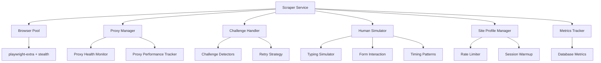
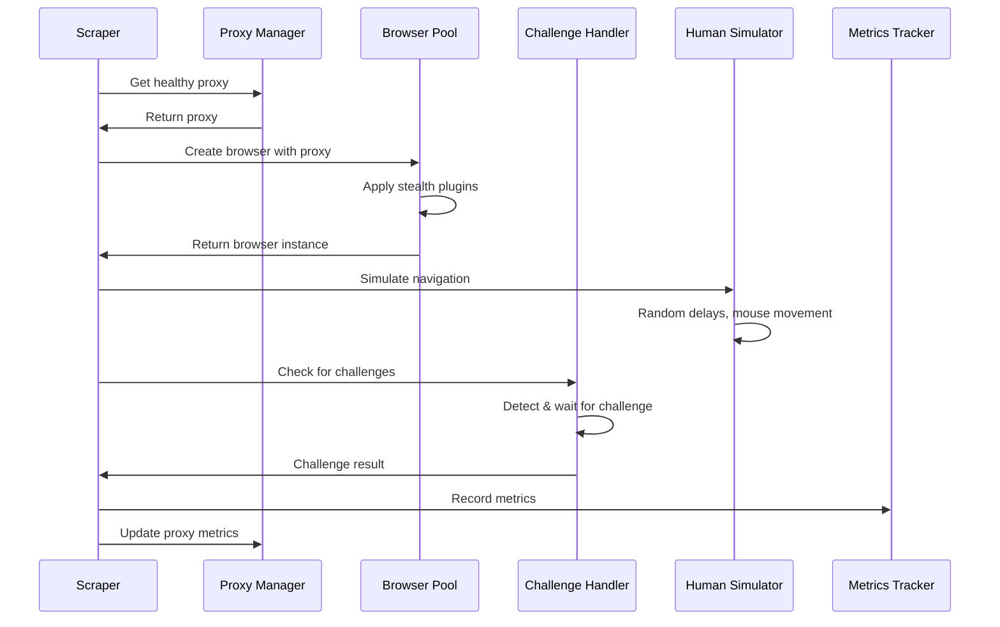

# Design Document: Advanced Stealth Scraping

## Overview

This design enhances the existing web scraping system with advanced stealth capabilities to reduce detection rates and improve success rates against modern anti-bot systems. The enhancement builds upon the existing Browser Pool, Scraper, and Human Simulation services by adding:

1. **Enhanced Fingerprinting Protection**: Integration of playwright-extra with comprehensive stealth plugins
2. **Intelligent Proxy Management**: Health monitoring, performance tracking, and automatic rotation
3. **Advanced Challenge Handling**: Detection and intelligent waiting for Cloudflare Turnstile, reCAPTCHA, and other challenges
4. **Enhanced Human Simulation**: Realistic typing, form interaction, and timing patterns
5. **Adaptive Bot-Evasion**: Per-domain rate limiting, session warmup, and adaptive delays
6. **Comprehensive Monitoring**: Metrics tracking for block rates, success rates, and proxy performance

The design maintains backward compatibility with existing scraping code while providing opt-in enhancements through configuration.

## Architecture

### High-Level Architecture



### Component Interaction Flow



## Components and Interfaces

### 1. Enhanced Browser Pool

**File**: `lib/services/browser-pool.ts`

**Enhancements**:
- Integration with `playwright-extra` and `puppeteer-extra-plugin-stealth`
- Additional fingerprinting protection layers

**Interface**:
```typescript
interface BrowserPoolConfig {
  maxBrowsers: number;
  stealthLevel: 'basic' | 'advanced' | 'maximum';
  fingerprintRandomization: boolean;
}

interface StealthOptions {
  canvas: boolean;
  webgl: boolean;
  audio: boolean;
  fonts: boolean;
  webrtc: boolean;
  timezone: boolean;
  locale: boolean;
  battery: boolean;
}

class BrowserPool {
  async createBrowser(proxy?: ProxyConfig, stealthOptions?: StealthOptions): Promise<Browser>
  async releaseBrowser(browser: Browser): Promise<void>
  getStats(): BrowserPoolStats
}
```

**Implementation Details**:
- Use `playwright-extra` wrapper instead of direct Playwright
- Apply stealth plugin with configurable options
- Randomize canvas fingerprint using noise injection
- Mask audio context with fake values
- Randomize font list and metrics
- Block WebRTC IP leak through navigator.mediaDevices override
- Randomize timezone from common timezones list
- Randomize locale from common locales
- Mask battery API to return fake charging status

### 2. Proxy Manager (New Component)

**File**: `lib/services/proxy-manager.ts`

**Purpose**: Manage proxy pool with health monitoring and performance tracking

**Interface**:
```typescript
interface ProxyConfig {
  url: string;
  type: 'residential' | 'datacenter' | 'unknown';
  username?: string;
  password?: string;
}

interface ProxyHealth {
  proxy: ProxyConfig;
  isHealthy: boolean;
  failureCount: number;
  successCount: number;
  avgResponseTime: number;
  lastChecked: Date;
  lastSuccess: Date;
}

interface ProxyStats {
  totalProxies: number;
  healthyProxies: number;
  avgResponseTime: number;
  successRate: number;
}

class ProxyManager {
  constructor(proxies: ProxyConfig[], options?: ProxyManagerOptions)
  
  async getHealthyProxy(): Promise<ProxyConfig | null>
  recordSuccess(proxy: ProxyConfig, responseTime: number): void
  recordFailure(proxy: ProxyConfig, error: Error): void
  async checkProxyHealth(proxy: ProxyConfig): Promise<boolean>
  getProxyStats(): ProxyStats
  getProxyHealth(proxy: ProxyConfig): ProxyHealth
}

interface ProxyManagerOptions {
  failureThreshold: number; // Default: 3
  healthCheckInterval: number; // Default: 300000 (5 min)
  recoveryCheckInterval: number; // Default: 600000 (10 min)
}
```

**Implementation Details**:
- Parse proxy URLs and classify type based on IP range or configuration
- Maintain in-memory health status for each proxy
- Use round-robin selection among healthy proxies
- Weight selection by success rate and response time
- Periodically check unhealthy proxies for recovery
- Store metrics in memory with optional persistence to database

### 3. Challenge Handler (New Component)

**File**: `lib/services/challenge-handler.ts`

**Purpose**: Detect and handle anti-bot challenges

**Interface**:
```typescript
interface ChallengeResult {
  detected: boolean;
  type: 'cloudflare' | 'turnstile' | 'recaptcha' | 'perimeter-x' | 'datadome' | 'unknown';
  solved: boolean;
  attempts: number;
  duration: number;
}

interface ChallengeStats {
  site: string;
  challengeType: string;
  totalAttempts: number;
  successfulSolves: number;
  solveRate: number;
  avgSolveTime: number;
}

class ChallengeHandler {
  async detectChallenge(page: Page): Promise<ChallengeResult>
  async waitForChallenge(page: Page, maxWaitTime: number): Promise<ChallengeResult>
  getChallengeStats(site: string): ChallengeStats[]
  recordChallengeAttempt(site: string, result: ChallengeResult): void
}
```

**Implementation Details**:
- Detect Cloudflare by checking for `cf-challenge` class or `cf-browser-verification` text
- Detect Turnstile by checking for `cf-turnstile` iframe
- Detect reCAPTCHA by checking for `g-recaptcha` or `recaptcha` iframe
- Detect PerimeterX by checking for `_px` cookies or `px-captcha` elements
- Detect DataDome by checking for `datadome` cookies or challenge pages
- Wait with exponential backoff: 2s, 4s, 8s, 16s, 30s (max)
- Check for challenge completion by monitoring DOM changes and navigation
- Track success/failure per site and challenge type

### 4. Enhanced Human Simulator

**File**: `lib/services/human-simulation.ts`

**Enhancements**: Add typing, form interaction, and enhanced timing patterns

**New Interface Methods**:
```typescript
class HumanSimulator {
  // Existing methods remain
  async moveMouseTo(page: Page, x: number, y: number): Promise<void>
  async scrollPage(page: Page, direction: 'up' | 'down', distance: number): Promise<void>
  async smartClick(page: Page, selector: string): Promise<void>
  
  // New methods
  async typeText(page: Page, selector: string, text: string): Promise<void>
  async fillForm(page: Page, formData: Record<string, string>): Promise<void>
  async simulateTabFocus(page: Page): Promise<void>
  async randomPause(min?: number, max?: number): Promise<void>
  async hoverElement(page: Page, selector: string): Promise<void>
}
```

**Implementation Details**:
- **Typing**: Type character by character with random delays (50-150ms)
- **Form Filling**: Focus field, pause, type, pause, move to next field
- **Tab Focus**: Simulate focus/blur events on window
- **Random Pause**: Use weighted random distribution favoring shorter pauses
- **Hover**: Move mouse to element with Bezier curve, pause briefly

### 5. Adaptive Site Profile Manager

**File**: `lib/config/site-profiles.ts`

**Enhancements**: Add rate limiting, concurrent limits, and adaptive delays

**Interface**:
```typescript
interface SiteProfile {
  domain: string;
  strategy: 'light-js' | 'full-js' | 'html-only';
  waitTime: number;
  cacheTime: number;
  retryCount: number;
  
  // New fields
  rateLimit?: {
    requestsPerMinute: number;
    concurrentRequests: number;
  };
  sessionWarmup?: {
    enabled: boolean;
    visitHomepage: boolean;
    visitPaths?: string[];
  };
  adaptiveDelay?: {
    enabled: boolean;
    baseDelay: number;
    multiplier: number;
    maxDelay: number;
  };
  referrerChain?: {
    enabled: boolean;
    startUrl?: string;
  };
}

class SiteProfileManager {
  getProfile(domain: string): SiteProfile
  updateProfile(domain: string, updates: Partial<SiteProfile>): void
  getAdaptiveDelay(domain: string): number
  increaseDelay(domain: string): void
  decreaseDelay(domain: string): void
}
```

**Implementation Details**:
- Maintain in-memory profile state with adaptive multipliers
- Increase multiplier by 1.5x on 429 or block detection
- Decrease multiplier by 0.9x after 10 consecutive successes
- Enforce rate limits using token bucket algorithm
- Track concurrent requests per domain using counter
- Session warmup visits homepage, waits, then navigates to target

### 6. Metrics Tracker (New Component)

**File**: `lib/services/metrics-tracker.ts`

**Purpose**: Track and persist scraping metrics

**Interface**:
```typescript
interface ScrapingMetrics {
  site: string;
  timestamp: Date;
  totalRequests: number;
  successfulRequests: number;
  blockedRequests: number;
  challengedRequests: number;
  successRate: number;
  blockRate: number;
  avgResponseTime: number;
}

interface ProxyMetrics {
  proxy: string;
  timestamp: Date;
  totalRequests: number;
  successfulRequests: number;
  failedRequests: number;
  avgResponseTime: number;
  successRate: number;
}

class MetricsTracker {
  recordRequest(site: string, proxy: string, result: RequestResult): void
  getSiteMetrics(site: string, timeRange: '24h' | '7d'): ScrapingMetrics
  getProxyMetrics(proxy: string, timeRange: '24h' | '7d'): ProxyMetrics
  async persistMetrics(): Promise<void>
  checkThresholds(): ThresholdAlert[]
}

interface RequestResult {
  success: boolean;
  blocked: boolean;
  challenged: boolean;
  responseTime: number;
  statusCode: number;
}
```

**Implementation Details**:
- Store metrics in memory with periodic flush to database
- Aggregate metrics by time windows (hourly, daily)
- Calculate rolling averages for rates
- Check thresholds and generate alerts when exceeded
- Persist to Prisma database using new ScrapingMetrics and ProxyMetrics models

## Data Models

### Database Schema Extensions

**New Prisma Models**:

```prisma
model ScrapingMetrics {
  id                  String   @id @default(cuid())
  site                String
  timestamp           DateTime @default(now())
  totalRequests       Int
  successfulRequests  Int
  blockedRequests     Int
  challengedRequests  Int
  successRate         Float
  blockRate           Float
  avgResponseTime     Float
  
  @@index([site, timestamp])
}

model ProxyMetrics {
  id                  String   @id @default(cuid())
  proxy               String
  timestamp           DateTime @default(now())
  totalRequests       Int
  successfulRequests  Int
  failedRequests      Int
  avgResponseTime     Float
  successRate         Float
  
  @@index([proxy, timestamp])
}

model ProxyHealth {
  id              String   @id @default(cuid())
  proxyUrl        String   @unique
  proxyType       String
  isHealthy       Boolean  @default(true)
  failureCount    Int      @default(0)
  successCount    Int      @default(0)
  avgResponseTime Float    @default(0)
  lastChecked     DateTime @default(now())
  lastSuccess     DateTime @default(now())
  
  @@index([isHealthy])
}
```

### In-Memory Data Structures

**Proxy Health Map**:
```typescript
Map<string, ProxyHealth> // Key: proxy URL
```

**Site Profile State**:
```typescript
Map<string, {
  profile: SiteProfile,
  currentMultiplier: number,
  consecutiveSuccesses: number,
  lastRequestTime: number,
  activeRequests: number
}> // Key: domain
```

**Metrics Buffers**:
```typescript
Map<string, ScrapingMetrics[]> // Key: site, Value: recent metrics
Map<string, ProxyMetrics[]> // Key: proxy, Value: recent metrics
```


## Correctness Properties

*A property is a characteristic or behavior that should hold true across all valid executions of a system—essentially, a formal statement about what the system should do. Properties serve as the bridge between human-readable specifications and machine-verifiable correctness guarantees.*

### Property 1: Browser Stealth Protection Application

*For any* browser instance created by the Browser_Pool, all configured stealth protections (canvas, audio, fonts, WebRTC, timezone, locale, battery) should be applied and verifiable through fingerprinting tests.

**Validates: Requirements 1.1, 1.2, 1.3, 1.4, 1.5, 1.6, 1.7**

### Property 2: Proxy Classification

*For any* proxy added to the Proxy_Manager, it should be classified as either residential, datacenter, or unknown type based on its URL or IP address.

**Validates: Requirements 2.1**

### Property 3: Proxy Health Tracking

*For any* proxy and any request outcome (success or failure), the Proxy_Manager should update the proxy's health metrics (failure count, success count, response time) accordingly.

**Validates: Requirements 2.2, 2.5, 6.3**

### Property 4: Unhealthy Proxy Exclusion

*For any* proxy that exceeds the failure threshold, the Proxy_Manager should mark it as unhealthy and exclude it from the rotation pool when selecting proxies.

**Validates: Requirements 2.3**

### Property 5: Healthy Proxy Prioritization

*For any* proxy selection request, the Proxy_Manager should return a healthy proxy (if available) and should prioritize proxies with better performance metrics over those with worse metrics.

**Validates: Requirements 2.4**

### Property 6: Proxy Statistics Accuracy

*For any* state of the proxy pool, the statistics (total proxies, healthy count, average response time, success rate) should accurately reflect the current health and performance data of all proxies.

**Validates: Requirements 2.7**

### Property 7: Challenge Detection

*For any* page containing challenge elements (Cloudflare, Turnstile, reCAPTCHA, PerimeterX, DataDome), the Challenge_Handler should correctly detect the challenge type.

**Validates: Requirements 3.1, 3.2**

### Property 8: Challenge Wait Exponential Backoff

*For any* detected challenge, the Challenge_Handler should wait with exponential backoff timing (2s, 4s, 8s, 16s, 30s) up to the maximum timeout.

**Validates: Requirements 3.3**

### Property 9: Challenge Result Recording

*For any* challenge attempt (successful or failed), the Challenge_Handler should record the result with site, challenge type, success status, and duration.

**Validates: Requirements 3.4, 3.5**

### Property 10: Challenge Solve Rate Calculation

*For any* set of challenge attempts for a site and challenge type, the solve rate should be correctly calculated as successful solves divided by total attempts.

**Validates: Requirements 3.6**

### Property 11: Challenge Fallback Triggering

*For any* site where the challenge solve rate drops below the configured threshold, the Challenge_Handler should trigger the fallback strategy.

**Validates: Requirements 3.7**

### Property 12: Typing Speed Variation

*For any* text input, the Human_Simulator should type each character with delays between 50-150ms, and the delays should vary (not be constant).

**Validates: Requirements 4.1, 4.6**

### Property 13: Form Interaction Realism

*For any* form filling operation, the Human_Simulator should include pauses between field interactions and the total time should be realistic (not instantaneous).

**Validates: Requirements 4.2**

### Property 14: Focus Simulation

*For any* navigation or page interaction, the Human_Simulator should trigger appropriate focus and blur events on the page and window.

**Validates: Requirements 4.3**

### Property 15: Action Pause Timing

*For any* sequence of actions, the Human_Simulator should insert pauses between actions ranging from 100ms to 2000ms.

**Validates: Requirements 4.4**

### Property 16: Natural Mouse Movement

*For any* hover or click action, the Human_Simulator should move the mouse along a curved path (not instant teleportation) to the target coordinates.

**Validates: Requirements 4.5**

### Property 17: Rate Limit Enforcement

*For any* domain with configured rate limits, the Scraper should enforce the requests-per-minute limit by delaying requests when the limit would be exceeded.

**Validates: Requirements 5.1**

### Property 18: Concurrent Request Limiting

*For any* domain with configured concurrent request limits, the Scraper should never have more than the specified number of simultaneous active requests to that domain.

**Validates: Requirements 5.2**

### Property 19: Adaptive Delay Increase

*For any* 429 status code or block detection for a domain, the Scraper should increase the delay multiplier for that domain.

**Validates: Requirements 5.3**

### Property 20: Adaptive Delay Decrease

*For any* sequence of consecutive successful responses for a domain, the Scraper should gradually decrease the delay multiplier (after sufficient successes).

**Validates: Requirements 5.4**

### Property 21: Session Warmup Navigation

*For any* domain with session warmup enabled, the Scraper should visit the homepage (or configured warmup paths) before navigating to the target scraping URL.

**Validates: Requirements 5.5**

### Property 22: Referrer Chain Accuracy

*For any* request made after navigation, the Scraper should set the referrer header to match the previous page URL in the navigation chain.

**Validates: Requirements 5.6**

### Property 23: Metrics Rate Calculation

*For any* set of recorded requests for a site, the block rate and success rate should be correctly calculated as (blocked/total) and (successful/total) respectively.

**Validates: Requirements 6.1, 6.2**

### Property 24: Metrics Time Range Filtering

*For any* metrics query with a time range (24h or 7d), only metrics within that time window should be included in the returned statistics.

**Validates: Requirements 6.5**

### Property 25: Metrics Persistence

*For any* metrics recorded in memory, they should be persisted to the database and retrievable through database queries.

**Validates: Requirements 6.6**

### Property 26: Block Rate Alert Logging

*For any* site where the block rate exceeds the configured threshold, the Scraper should log a warning message containing the site name and proxy information.

**Validates: Requirements 6.7**

### Property 27: Default Profile Application

*For any* domain without a specific site profile, the Scraper should apply default conservative settings for rate limits, delays, and retry behavior.

**Validates: Requirements 7.3**

### Property 28: Stealth Fallback

*For any* failure during stealth feature initialization, the Scraper should fall back to basic stealth configuration and log a warning without crashing.

**Validates: Requirements 7.5**

### Property 29: Site Profile Precedence

*For any* domain with both a site-specific profile and global defaults, the site-specific settings should be used instead of the global defaults.

**Validates: Requirements 8.3**

### Property 30: Runtime Configuration Updates

*For any* configuration change made at runtime, subsequent scraping operations should use the updated configuration without requiring a restart.

**Validates: Requirements 8.4**

### Property 31: Configuration Validation

*For any* invalid configuration provided at startup, the Scraper should log an error message describing the validation failure and either use defaults or fail gracefully.

**Validates: Requirements 8.5**

## Error Handling

### Error Categories

1. **Proxy Errors**
   - Connection timeout
   - Authentication failure
   - Proxy unavailable
   - All healthy proxies exhausted

2. **Challenge Errors**
   - Challenge timeout (max wait exceeded)
   - Unknown challenge type
   - Challenge solve failure

3. **Browser Errors**
   - Browser creation failure
   - Stealth plugin initialization failure
   - Page navigation timeout
   - Page crash

4. **Rate Limiting Errors**
   - Rate limit exceeded (429)
   - Too many concurrent requests
   - Domain temporarily blocked

5. **Configuration Errors**
   - Invalid proxy URL
   - Invalid site profile
   - Missing required configuration

### Error Handling Strategies

**Proxy Errors**:
- On connection timeout: Mark proxy as unhealthy, retry with different proxy
- On authentication failure: Mark proxy as permanently failed, remove from pool
- On all proxies exhausted: Return error to caller with retry-after suggestion

**Challenge Errors**:
- On timeout: Record failure, return error with challenge type information
- On unknown challenge: Log warning, attempt generic wait strategy
- On solve failure: Record failure, trigger fallback strategy if solve rate drops

**Browser Errors**:
- On creation failure: Retry up to 3 times with exponential backoff
- On stealth initialization failure: Fall back to basic stealth, log warning
- On page crash: Release browser, create new instance, retry request

**Rate Limiting Errors**:
- On 429: Increase delay multiplier, wait adaptive delay, retry
- On concurrent limit: Queue request, wait for slot, retry
- On domain block: Mark domain as temporarily blocked, return error

**Configuration Errors**:
- On invalid proxy: Log error, skip proxy, continue with others
- On invalid profile: Log error, use default profile
- On missing config: Use sensible defaults, log warning

### Error Recovery

**Retry Logic**:
- Maximum 3 retries per request
- Exponential backoff: 1s, 2s, 4s
- Different proxy on each retry
- Reset retry count on success

**Circuit Breaker**:
- Open circuit after 10 consecutive failures for a domain
- Half-open after 5 minutes
- Close circuit after 3 consecutive successes

**Graceful Degradation**:
- If advanced stealth fails, use basic stealth
- If proxy pool exhausted, attempt direct connection (if allowed)
- If challenge handler fails, proceed without challenge detection

## Testing Strategy

### Dual Testing Approach

This feature requires both unit tests and property-based tests for comprehensive coverage:

- **Unit tests**: Verify specific examples, edge cases, and error conditions
- **Property tests**: Verify universal properties across all inputs

Both testing approaches are complementary and necessary. Unit tests catch concrete bugs in specific scenarios, while property tests verify general correctness across a wide range of inputs.

### Property-Based Testing

**Library Selection**: Use `fast-check` for TypeScript/JavaScript property-based testing

**Configuration**:
- Minimum 100 iterations per property test (due to randomization)
- Each property test must reference its design document property
- Tag format: `// Feature: advanced-stealth-scraping, Property {number}: {property_text}`

**Property Test Examples**:

```typescript
// Feature: advanced-stealth-scraping, Property 3: Proxy Health Tracking
test('proxy health metrics update on request outcomes', async () => {
  await fc.assert(
    fc.asyncProperty(
      fc.record({
        proxy: fc.webUrl(),
        outcomes: fc.array(fc.record({
          success: fc.boolean(),
          responseTime: fc.integer({ min: 10, max: 5000 })
        }), { minLength: 1, maxLength: 20 })
      }),
      async ({ proxy, outcomes }) => {
        const manager = new ProxyManager([{ url: proxy, type: 'unknown' }]);
        
        for (const outcome of outcomes) {
          if (outcome.success) {
            manager.recordSuccess({ url: proxy, type: 'unknown' }, outcome.responseTime);
          } else {
            manager.recordFailure({ url: proxy, type: 'unknown' }, new Error('Test failure'));
          }
        }
        
        const health = manager.getProxyHealth({ url: proxy, type: 'unknown' });
        const expectedSuccesses = outcomes.filter(o => o.success).length;
        const expectedFailures = outcomes.filter(o => !o.success).length;
        
        expect(health.successCount).toBe(expectedSuccesses);
        expect(health.failureCount).toBe(expectedFailures);
      }
    ),
    { numRuns: 100 }
  );
});

// Feature: advanced-stealth-scraping, Property 23: Metrics Rate Calculation
test('block rate and success rate calculations are accurate', async () => {
  await fc.assert(
    fc.asyncProperty(
      fc.array(fc.record({
        success: fc.boolean(),
        blocked: fc.boolean()
      }), { minLength: 1, maxLength: 100 }),
      async (requests) => {
        const tracker = new MetricsTracker();
        
        for (const req of requests) {
          tracker.recordRequest('test-site.com', 'proxy1', {
            success: req.success,
            blocked: req.blocked,
            challenged: false,
            responseTime: 100,
            statusCode: req.success ? 200 : 403
          });
        }
        
        const metrics = tracker.getSiteMetrics('test-site.com', '24h');
        const expectedBlocked = requests.filter(r => r.blocked).length;
        const expectedSuccess = requests.filter(r => r.success).length;
        const total = requests.length;
        
        expect(metrics.blockRate).toBeCloseTo(expectedBlocked / total, 2);
        expect(metrics.successRate).toBeCloseTo(expectedSuccess / total, 2);
      }
    ),
    { numRuns: 100 }
  );
});
```

### Unit Testing

**Focus Areas**:
- Specific challenge detection patterns (Cloudflare, Turnstile, reCAPTCHA)
- Edge cases: empty proxy pool, all proxies unhealthy, zero requests
- Error conditions: invalid configuration, browser crash, network timeout
- Integration points: Browser Pool ↔ Proxy Manager, Scraper ↔ Challenge Handler
- Backward compatibility: existing API methods still work

**Unit Test Examples**:

```typescript
describe('ChallengeHandler', () => {
  test('detects Cloudflare Turnstile challenge', async () => {
    const page = await createMockPage('<div class="cf-turnstile"></div>');
    const handler = new ChallengeHandler();
    
    const result = await handler.detectChallenge(page);
    
    expect(result.detected).toBe(true);
    expect(result.type).toBe('turnstile');
  });
  
  test('handles empty proxy pool gracefully', async () => {
    const manager = new ProxyManager([]);
    
    const proxy = await manager.getHealthyProxy();
    
    expect(proxy).toBeNull();
  });
  
  test('falls back to basic stealth on plugin failure', async () => {
    const pool = new BrowserPool({ stealthLevel: 'maximum' });
    mockPlaywrightExtra.mockImplementation(() => {
      throw new Error('Plugin initialization failed');
    });
    
    const browser = await pool.createBrowser();
    
    expect(browser).toBeDefined();
    expect(mockLogger.warn).toHaveBeenCalledWith(
      expect.stringContaining('Falling back to basic stealth')
    );
  });
});
```

### Integration Testing

**Test Scenarios**:
1. End-to-end scraping with proxy rotation and challenge handling
2. Adaptive delay adjustment over multiple requests
3. Session warmup followed by target scraping
4. Metrics persistence and retrieval
5. Proxy health recovery after temporary failures

### Performance Testing

**Metrics to Track**:
- Browser creation time with stealth plugins
- Proxy selection latency
- Challenge detection time
- Memory usage with multiple browser instances
- Database write performance for metrics

**Targets**:
- Browser creation: < 2 seconds
- Proxy selection: < 10ms
- Challenge detection: < 100ms
- Support 10 concurrent browser instances
- Metrics flush: < 500ms

### Manual Testing

**Verification Steps**:
1. Test against real sites with Cloudflare protection
2. Verify fingerprinting protection using online fingerprint testers
3. Test proxy rotation with mix of healthy/unhealthy proxies
4. Verify adaptive delays respond to 429 errors
5. Check metrics dashboard shows accurate statistics

### Test Coverage Goals

- Line coverage: > 80%
- Branch coverage: > 75%
- Property test coverage: All 31 properties implemented
- Integration test coverage: All component interactions tested
