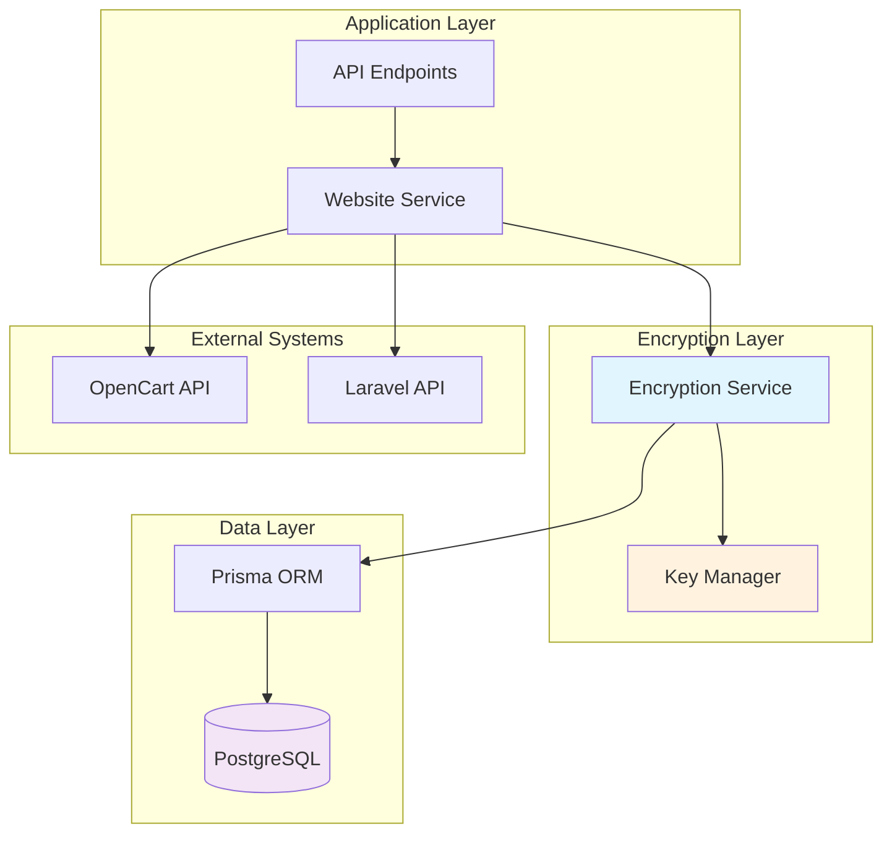
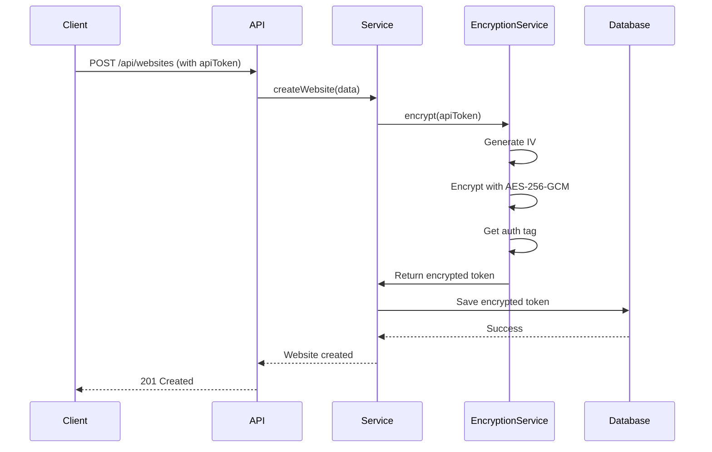
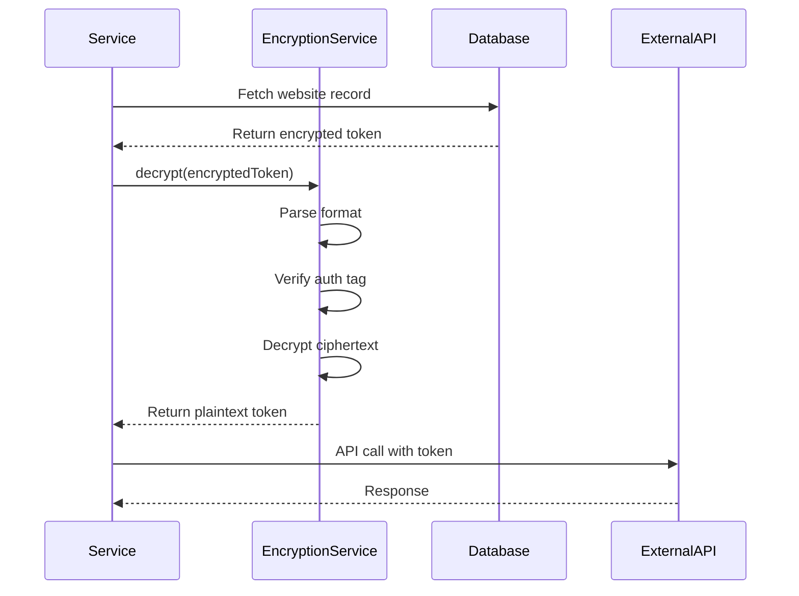

# Design Document: API Token Encryption

## Overview

This design implements secure encryption and decryption of API tokens stored in the PricePilot database. The solution uses AES-256-GCM (Galois/Counter Mode), an authenticated encryption algorithm that provides both confidentiality and integrity verification. The design ensures that sensitive integration credentials remain protected at rest while maintaining system performance and backward compatibility with existing integrations.

The implementation leverages Node.js's built-in `crypto` module, avoiding external dependencies for core cryptographic operations. The design supports transparent encryption/decryption, automatic migration of existing plaintext tokens, and future key rotation capabilities.

**Key Design Decisions:**
- **AES-256-GCM**: Chosen for authenticated encryption (prevents tampering) and industry-standard security
- **Environment-based key management**: Master key stored in environment variables for deployment flexibility
- **Transparent migration**: Automatic detection and encryption of plaintext tokens during retrieval
- **No persistent caching**: Decrypted tokens only exist in memory during request lifecycle
- **Structured storage format**: Self-describing encrypted data format for versioning and algorithm flexibility

## Architecture

### High-Level Architecture



### Encryption Flow



### Decryption Flow



## Components and Interfaces

### 1. Encryption Service

**Purpose:** Core cryptographic operations for encrypting and decrypting API tokens.

**Interface:**
```typescript
interface IEncryptionService {
  /**
   * Encrypts a plaintext string using AES-256-GCM
   * @param plaintext - The string to encrypt
   * @returns Encrypted string in format: aes-256-gcm:iv:authTag:ciphertext
   * @throws EncryptionError if encryption fails
   */
  encrypt(plaintext: string): string;

  /**
   * Decrypts an encrypted string
   * @param encrypted - The encrypted string
   * @returns Decrypted plaintext string
   * @throws DecryptionError if decryption fails or auth tag verification fails
   */
  decrypt(encrypted: string): string;

  /**
   * Checks if a string is in encrypted format
   * @param value - The string to check
   * @returns true if the string appears to be encrypted
   */
  isEncrypted(value: string): boolean;
}
```

**Implementation Details:**
- Uses Node.js `crypto.createCipheriv()` and `crypto.createDecipheriv()`
- Generates 12-byte random IV for each encryption operation using `crypto.randomBytes(12)`
- Stores encrypted data in format: `aes-256-gcm:{base64_iv}:{base64_authTag}:{base64_ciphertext}`
- Validates format before decryption attempts
- Throws specific error types for different failure modes

**Error Handling:**
- `EncryptionError`: Thrown when encryption operation fails
- `DecryptionError`: Thrown when decryption fails (wrong key, corrupted data)
- `InvalidFormatError`: Thrown when encrypted string format is invalid
- `AuthenticationError`: Thrown when auth tag verification fails (tampering detected)

### 2. Key Manager

**Purpose:** Manages encryption keys and provides secure key access.

**Interface:**
```typescript
interface IKeyManager {
  /**
   * Retrieves the master encryption key
   * @returns Buffer containing the 256-bit key
   * @throws KeyNotFoundError if key is not configured
   */
  getMasterKey(): Buffer;

  /**
   * Validates that the master key is properly configured
   * @throws KeyValidationError if key is invalid
   */
  validateKey(): void;

  /**
   * Supports key rotation by managing multiple keys
   * @param keyId - Identifier for the key version
   * @returns Buffer containing the specified key
   */
  getKey(keyId: string): Buffer;
}
```

**Implementation Details:**
- Reads `ENCRYPTION_MASTER_KEY` from environment variables
- Expects key as base64-encoded string (44 characters for 256 bits)
- Validates key length (must be exactly 32 bytes)
- Caches key in memory after first load
- Logs key access events for audit trail
- Supports future key rotation with versioned keys

**Key Format:**
- Environment variable: `ENCRYPTION_MASTER_KEY=base64_encoded_32_byte_key`
- Generation command: `node -e "console.log(require('crypto').randomBytes(32).toString('base64'))"`

### 3. Website Service (Modified)

**Purpose:** Handles user website CRUD operations with transparent encryption.

**Modified Methods:**
```typescript
interface IWebsiteService {
  /**
   * Creates a new user website with encrypted API token
   * @param data - Website data including plaintext apiToken
   * @returns Created website record with encrypted token
   */
  async createWebsite(data: CreateWebsiteInput): Promise<UserWebsite>;

  /**
   * Updates website data, re-encrypting token if changed
   * @param id - Website ID
   * @param data - Updated data
   * @returns Updated website record
   */
  async updateWebsite(id: string, data: UpdateWebsiteInput): Promise<UserWebsite>;

  /**
   * Retrieves website with decrypted token for API calls
   * @param id - Website ID
   * @returns Website with plaintext token
   */
  async getWebsiteWithToken(id: string): Promise<UserWebsiteWithToken>;

  /**
   * Syncs products from user's e-commerce platform
   * Uses decrypted token internally
   * @param websiteId - Website ID
   */
  async syncProducts(websiteId: string): Promise<SyncResult>;
}
```

**Integration Points:**
- Calls `encryptionService.encrypt()` before saving tokens to database
- Calls `encryptionService.decrypt()` when retrieving tokens for API calls
- Handles migration of plaintext tokens automatically
- Logs encryption/decryption events for audit

### 4. Migration Utility

**Purpose:** Batch migration of existing plaintext tokens to encrypted format.

**Interface:**
```typescript
interface IMigrationUtility {
  /**
   * Migrates all plaintext tokens to encrypted format
   * @param options - Migration options (dry run, batch size, etc.)
   * @returns Migration results with success/failure counts
   */
  async migrateAllTokens(options: MigrationOptions): Promise<MigrationResult>;

  /**
   * Migrates a single website's token
   * @param websiteId - Website ID
   * @returns Migration result
   */
  async migrateToken(websiteId: string): Promise<boolean>;
}

interface MigrationOptions {
  dryRun: boolean;        // Preview without making changes
  batchSize: number;      // Number of records to process at once
  continueOnError: boolean; // Continue if individual migrations fail
}

interface MigrationResult {
  total: number;
  migrated: number;
  failed: number;
  skipped: number;        // Already encrypted
  errors: MigrationError[];
}
```

**Implementation Details:**
- Queries all `user_websites` records
- Uses `isEncrypted()` to identify plaintext tokens
- Processes in batches to avoid memory issues
- Logs each migration event
- Supports dry-run mode for testing
- Provides detailed error reporting

## Data Models

### Database Schema Changes

**user_websites table** (existing, no schema changes required):
```sql
CREATE TABLE user_websites (
  id UUID PRIMARY KEY,
  tenant_id UUID NOT NULL REFERENCES tenants(id),
  platform VARCHAR(50) NOT NULL,
  base_url VARCHAR(255) NOT NULL,
  api_token TEXT NOT NULL,  -- Will store encrypted tokens
  status VARCHAR(50) NOT NULL,
  last_sync_at TIMESTAMP,
  created_at TIMESTAMP NOT NULL DEFAULT NOW(),
  updated_at TIMESTAMP NOT NULL DEFAULT NOW()
);
```

**Note:** No schema migration required. The `api_token` field already supports TEXT type, which accommodates encrypted strings (typically 150-200 characters for encrypted tokens).

### Encrypted Token Format

**Structure:**
```
{algorithm}:{iv}:{authTag}:{ciphertext}
```

**Example:**
```
aes-256-gcm:a3f2c1b4d5e6f7a8b9c0:1a2b3c4d5e6f7a8b9c0d1e2f3a4b5c6d:9f8e7d6c5b4a3f2e1d0c9b8a7f6e5d4c
```

**Components:**
- `algorithm`: Encryption algorithm identifier (supports future algorithm changes)
- `iv`: Base64-encoded initialization vector (12 bytes = 16 chars)
- `authTag`: Base64-encoded authentication tag (16 bytes = 24 chars)
- `ciphertext`: Base64-encoded encrypted data (variable length)

**Format Validation:**
```typescript
function validateEncryptedFormat(encrypted: string): boolean {
  const parts = encrypted.split(':');
  if (parts.length !== 4) return false;
  
  const [algorithm, iv, authTag, ciphertext] = parts;
  
  // Validate algorithm
  if (algorithm !== 'aes-256-gcm') return false;
  
  // Validate base64 encoding
  const base64Regex = /^[A-Za-z0-9+/]+=*$/;
  if (!base64Regex.test(iv) || !base64Regex.test(authTag) || !base64Regex.test(ciphertext)) {
    return false;
  }
  
  return true;
}
```

### TypeScript Types

```typescript
// Core types
type EncryptedString = string & { readonly __brand: 'encrypted' };
type PlaintextString = string;

// Service types
interface EncryptionResult {
  encrypted: EncryptedString;
  algorithm: string;
  iv: string;
  authTag: string;
}

interface DecryptionResult {
  plaintext: PlaintextString;
  algorithm: string;
}

// Error types
class EncryptionError extends Error {
  constructor(message: string, public cause?: Error) {
    super(message);
    this.name = 'EncryptionError';
  }
}

class DecryptionError extends Error {
  constructor(message: string, public cause?: Error) {
    super(message);
    this.name = 'DecryptionError';
  }
}

class AuthenticationError extends DecryptionError {
  constructor(message: string = 'Authentication tag verification failed') {
    super(message);
    this.name = 'AuthenticationError';
  }
}

class KeyNotFoundError extends Error {
  constructor(message: string = 'Encryption key not found in environment') {
    super(message);
    this.name = 'KeyNotFoundError';
  }
}

// Audit log types
interface EncryptionAuditLog {
  event: 'token_encrypted' | 'token_decrypted' | 'token_migrated' | 'decryption_failed';
  tenantId: string;
  userId?: string;
  websiteId: string;
  timestamp: Date;
  success: boolean;
  errorMessage?: string;
}
```

## Correctness Properties

*A property is a characteristic or behavior that should hold true across all valid executions of a system—essentially, a formal statement about what the system should do. Properties serve as the bridge between human-readable specifications and machine-verifiable correctness guarantees.*


### Property 1: Encryption Round-Trip Consistency
*For any* valid API token string, encrypting then decrypting should return the original plaintext value unchanged.

**Validates: Requirements 1.2, 3.2**

### Property 2: IV Uniqueness Ensures Different Ciphertext
*For any* plaintext token, encrypting it multiple times should produce different ciphertext values due to unique initialization vectors.

**Validates: Requirements 1.3**

### Property 3: Encrypted Format Structure
*For any* encrypted token, it should match the format `aes-256-gcm:{base64_iv}:{base64_authTag}:{base64_ciphertext}` where all components are valid base64-encoded strings.

**Validates: Requirements 1.4, 8.1, 8.2, 8.3**

### Property 4: Authentication Tag Verification
*For any* encrypted token, tampering with any component (IV, auth tag, or ciphertext) should cause decryption to fail with an authentication error.

**Validates: Requirements 1.5**

### Property 5: Key Length Validation
*For any* encryption key, keys shorter than 256 bits (32 bytes) should be rejected during initialization.

**Validates: Requirements 2.3**

### Property 6: Key Non-Exposure in Errors
*For any* error condition (encryption failure, decryption failure, missing key), error messages and logs should never contain the master encryption key.

**Validates: Requirements 2.4, 5.5**

### Property 7: Key Rotation Round-Trip
*For any* encrypted token and any two valid encryption keys (old and new), decrypting with the old key and re-encrypting with the new key should preserve the original plaintext value.

**Validates: Requirements 2.5, 9.1, 9.2**

### Property 8: Plaintext Token Migration
*For any* plaintext token detected during retrieval, the system should encrypt it, update the database, and subsequent retrievals should return the same plaintext value.

**Validates: Requirements 3.1, 3.2**

### Property 9: Transparent Encryption on Storage
*For any* user website creation or update with an API token, the token stored in the database should be in encrypted format, not plaintext.

**Validates: Requirements 4.2**

### Property 10: Token Non-Exposure in Errors
*For any* encryption or decryption error, error messages should never contain the plaintext API token.

**Validates: Requirements 4.4**

### Property 11: Encryption Performance
*For any* API token, encryption and decryption operations should complete in under 10 milliseconds.

**Validates: Requirements 4.5, 7.4**

### Property 12: Concurrent Operation Safety
*For any* set of concurrent encryption/decryption operations, all operations should complete successfully without race conditions or performance degradation.

**Validates: Requirements 7.5**

### Property 13: Comprehensive Audit Logging
*For any* encryption, decryption, migration, or key access operation, an audit log entry should be created with tenant ID, timestamp, and operation type, and should never contain plaintext tokens or keys.

**Validates: Requirements 5.1, 5.2, 5.3, 5.4, 5.5**

### Property 14: Format Validation Before Decryption
*For any* string passed to the decrypt function, invalid formats should be rejected before attempting decryption, and valid formats should proceed to decryption.

**Validates: Requirements 8.3, 8.4**

### Property 15: Token Length Constraints
*For any* plaintext token, the resulting encrypted token should not exceed 1024 characters in length.

**Validates: Requirements 8.5**

### Property 16: Helpful Error Messages
*For any* decryption failure, the error message should provide clear guidance to users about re-entering their API token without exposing sensitive data.

**Validates: Requirements 6.5**

## Error Handling

### Error Types and Handling Strategy

**EncryptionError:**
- **Cause:** Encryption operation fails (invalid input, crypto library error)
- **Handling:** Return 500 error, log with details, prevent database write
- **User Message:** "Failed to encrypt API token. Please try again."

**DecryptionError:**
- **Cause:** Decryption operation fails (wrong key, corrupted data)
- **Handling:** Return 500 error, log security event, prevent API calls
- **User Message:** "Failed to decrypt API token. Please re-enter your token in settings."

**AuthenticationError (extends DecryptionError):**
- **Cause:** Auth tag verification fails (data tampering detected)
- **Handling:** Return 500 error, log critical security event, mark website for re-authentication
- **User Message:** "API token integrity check failed. Please re-enter your token."

**InvalidFormatError:**
- **Cause:** Encrypted string doesn't match expected format
- **Handling:** Attempt migration as plaintext token, log migration event
- **User Message:** (Transparent to user - automatic migration)

**KeyNotFoundError:**
- **Cause:** Master key not found in environment variables
- **Handling:** Fail application startup, log critical error
- **User Message:** (Admin-facing) "ENCRYPTION_MASTER_KEY environment variable not configured"

**KeyValidationError:**
- **Cause:** Master key is invalid (wrong length, format)
- **Handling:** Fail application startup, log critical error
- **User Message:** (Admin-facing) "ENCRYPTION_MASTER_KEY must be 32 bytes (256 bits)"

### Error Recovery Strategies

**Corrupted Token Recovery:**
1. Detect decryption failure
2. Log security event with website ID and tenant ID
3. Mark user_website status as 'requires_reauth'
4. Send notification to user to re-enter token
5. Clear corrupted token from database

**Migration Failure Recovery:**
1. Log migration error with details
2. Continue operation with plaintext token (backward compatibility)
3. Retry migration on next access
4. Alert administrators if repeated failures

**Key Unavailability Recovery:**
1. Application fails to start (fail-fast principle)
2. Log critical error with troubleshooting steps
3. Prevent any encryption/decryption operations
4. Require administrator intervention

### Transaction Handling

**Token Storage Transaction:**
```typescript
async function createWebsite(data: CreateWebsiteInput): Promise<UserWebsite> {
  return await prisma.$transaction(async (tx) => {
    // Encrypt token first (fails fast if encryption fails)
    const encryptedToken = encryptionService.encrypt(data.apiToken);
    
    // Create website record with encrypted token
    const website = await tx.userWebsite.create({
      data: {
        ...data,
        apiToken: encryptedToken,
      },
    });
    
    // Log encryption event
    await tx.auditLog.create({
      data: {
        event: 'token_encrypted',
        tenantId: data.tenantId,
        websiteId: website.id,
        timestamp: new Date(),
      },
    });
    
    return website;
  });
}
```

**Token Migration Transaction:**
```typescript
async function migrateToken(websiteId: string): Promise<boolean> {
  return await prisma.$transaction(async (tx) => {
    // Fetch website
    const website = await tx.userWebsite.findUnique({
      where: { id: websiteId },
    });
    
    if (!website || encryptionService.isEncrypted(website.apiToken)) {
      return false; // Already encrypted or not found
    }
    
    // Encrypt plaintext token
    const encryptedToken = encryptionService.encrypt(website.apiToken);
    
    // Update with encrypted token
    await tx.userWebsite.update({
      where: { id: websiteId },
      data: { apiToken: encryptedToken },
    });
    
    // Log migration event
    await tx.auditLog.create({
      data: {
        event: 'token_migrated',
        tenantId: website.tenantId,
        websiteId: website.id,
        timestamp: new Date(),
      },
    });
    
    return true;
  });
}
```

## Testing Strategy

### Dual Testing Approach

This feature requires both **unit tests** and **property-based tests** for comprehensive coverage:

**Unit Tests** focus on:
- Specific error conditions (missing key, invalid format)
- Edge cases (empty strings, very long tokens)
- Integration points (database transactions, audit logging)
- Migration utility functionality
- Key manager initialization

**Property-Based Tests** focus on:
- Universal correctness properties across all inputs
- Round-trip consistency for random tokens
- Format validation for generated encrypted strings
- Concurrent operation safety
- Performance characteristics

### Property-Based Testing Configuration

**Library:** [fast-check](https://github.com/dubzzz/fast-check) for TypeScript/Node.js

**Configuration:**
- Minimum 100 iterations per property test
- Each test tagged with feature name and property number
- Tag format: `Feature: api-token-encryption, Property N: [property description]`

**Example Property Test:**
```typescript
import fc from 'fast-check';

describe('Feature: api-token-encryption, Property 1: Encryption Round-Trip Consistency', () => {
  it('should return original plaintext after encrypt then decrypt', () => {
    fc.assert(
      fc.property(
        fc.string({ minLength: 1, maxLength: 500 }), // Generate random tokens
        (plaintext) => {
          const encrypted = encryptionService.encrypt(plaintext);
          const decrypted = encryptionService.decrypt(encrypted);
          expect(decrypted).toBe(plaintext);
        }
      ),
      { numRuns: 100 } // Minimum 100 iterations
    );
  });
});
```

### Unit Test Coverage

**EncryptionService Tests:**
- ✓ Encrypts plaintext to different ciphertext each time
- ✓ Decrypts encrypted text back to original
- ✓ Throws error on invalid encrypted format
- ✓ Throws AuthenticationError on tampered data
- ✓ Correctly identifies encrypted vs plaintext strings
- ✓ Handles empty string encryption
- ✓ Handles very long token encryption (1000+ chars)

**KeyManager Tests:**
- ✓ Loads key from environment variable
- ✓ Throws KeyNotFoundError when key missing
- ✓ Throws KeyValidationError for invalid key length
- ✓ Caches key after first load
- ✓ Never logs key in error messages

**WebsiteService Integration Tests:**
- ✓ Creates website with encrypted token
- ✓ Updates website and re-encrypts token
- ✓ Retrieves website and decrypts token for API calls
- ✓ Automatically migrates plaintext tokens
- ✓ Rolls back transaction on encryption failure
- ✓ Creates audit logs for encryption operations

**Migration Utility Tests:**
- ✓ Migrates all plaintext tokens in batch
- ✓ Skips already encrypted tokens
- ✓ Continues on individual failures when configured
- ✓ Provides accurate migration statistics
- ✓ Supports dry-run mode

### Integration Test Scenarios

**End-to-End Token Lifecycle:**
1. User creates website with plaintext token via API
2. System encrypts token before database storage
3. System retrieves website for product sync
4. System decrypts token transparently
5. System makes API call to user's e-commerce platform
6. Verify audit logs created for each step

**Migration Scenario:**
1. Seed database with plaintext tokens
2. Run migration utility
3. Verify all tokens encrypted
4. Verify decryption returns original values
5. Verify audit logs created

**Key Rotation Scenario:**
1. Create websites with tokens encrypted using key A
2. Provide new key B
3. Run key rotation utility
4. Verify all tokens re-encrypted with key B
5. Verify decryption with key B returns original values
6. Verify old key A no longer works

### Performance Testing

**Benchmarks:**
- Single encryption operation: < 5ms
- Single decryption operation: < 5ms
- Batch migration of 1000 tokens: < 10 seconds
- Concurrent operations (100 parallel): No degradation

**Load Testing:**
- 1000 concurrent encryption operations
- 1000 concurrent decryption operations
- Monitor memory usage and CPU utilization
- Verify no memory leaks

### Security Testing

**Penetration Testing Scenarios:**
- ✓ Attempt to extract master key from error messages
- ✓ Attempt to tamper with encrypted tokens
- ✓ Attempt SQL injection through token fields
- ✓ Verify tokens not logged in plaintext
- ✓ Verify encrypted tokens can't be decrypted without key

**Compliance Verification:**
- ✓ Encryption algorithm meets industry standards (AES-256-GCM)
- ✓ Key management follows best practices
- ✓ Audit logging captures all required events
- ✓ Error messages don't leak sensitive data

## Implementation Notes

### Deployment Checklist

**Before Deployment:**
1. Generate master encryption key: `node -e "console.log(require('crypto').randomBytes(32).toString('base64'))"`
2. Set `ENCRYPTION_MASTER_KEY` environment variable in all environments
3. Test encryption/decryption in staging environment
4. Backup database before migration
5. Run migration utility in dry-run mode
6. Review migration statistics

**During Deployment:**
1. Deploy application code with encryption service
2. Verify application starts successfully (key validation)
3. Run migration utility to encrypt existing tokens
4. Monitor error logs for migration failures
5. Verify API integrations still work

**After Deployment:**
1. Verify all tokens encrypted in database
2. Test website creation/update flows
3. Test product sync operations
4. Review audit logs for encryption events
5. Monitor performance metrics

### Key Rotation Procedure

**Preparation:**
1. Generate new master key
2. Store new key securely (do not deploy yet)
3. Test key rotation utility in staging
4. Schedule maintenance window

**Execution:**
1. Set new key as `ENCRYPTION_MASTER_KEY_NEW` environment variable
2. Deploy key rotation utility
3. Run rotation: `npm run rotate-keys`
4. Verify all tokens re-encrypted
5. Update `ENCRYPTION_MASTER_KEY` to new key value
6. Remove `ENCRYPTION_MASTER_KEY_NEW`
7. Restart application

**Verification:**
1. Test decryption with new key
2. Verify old key no longer works
3. Test all integration flows
4. Review audit logs

### Monitoring and Alerts

**Metrics to Monitor:**
- Encryption operation count and latency
- Decryption operation count and latency
- Decryption failure rate
- Migration success/failure rate
- Key access frequency

**Alerts to Configure:**
- Critical: Decryption failure rate > 1%
- Critical: Master key not found on startup
- Warning: Encryption latency > 10ms
- Warning: Plaintext tokens detected (migration needed)
- Info: Key rotation completed

### Backward Compatibility

**Migration Strategy:**
- Automatic migration on first access (lazy migration)
- Batch migration utility for proactive migration
- Graceful handling of plaintext tokens during transition
- No API contract changes required
- No database schema changes required

**Rollback Plan:**
If encryption causes issues:
1. Deploy previous version without encryption
2. Plaintext tokens still work (backward compatible)
3. Encrypted tokens will fail (require re-entry)
4. Alternative: Implement decryption-only mode for emergency rollback

### Security Considerations

**Key Storage:**
- Never commit keys to version control
- Use environment variables or secret management service
- Rotate keys periodically (recommended: annually)
- Maintain key version history for rotation

**Access Control:**
- Limit access to environment variables
- Audit key access events
- Use separate keys per environment (dev, staging, prod)
- Implement key rotation without downtime

**Compliance:**
- AES-256-GCM meets FIPS 140-2 standards
- Authenticated encryption prevents tampering
- Audit logging supports compliance requirements
- Key management follows NIST guidelines

## References

**Encryption Standards:**
- [NIST SP 800-38D: GCM Mode](https://csrc.nist.gov/publications/detail/sp/800-38d/final) - Official GCM specification
- [Node.js Crypto Documentation](https://nodejs.org/api/crypto.html) - Node.js crypto module reference

**Implementation Examples:**
- [AES-256-GCM Example](https://gist.github.com/rjz/15baffeab434b8125ca4d783f4116d81) - Reference implementation (content rephrased for compliance with licensing restrictions)

**Best Practices:**
- Environment variable management for secrets
- Key rotation procedures
- Authenticated encryption benefits
- Multi-tenant data isolation
