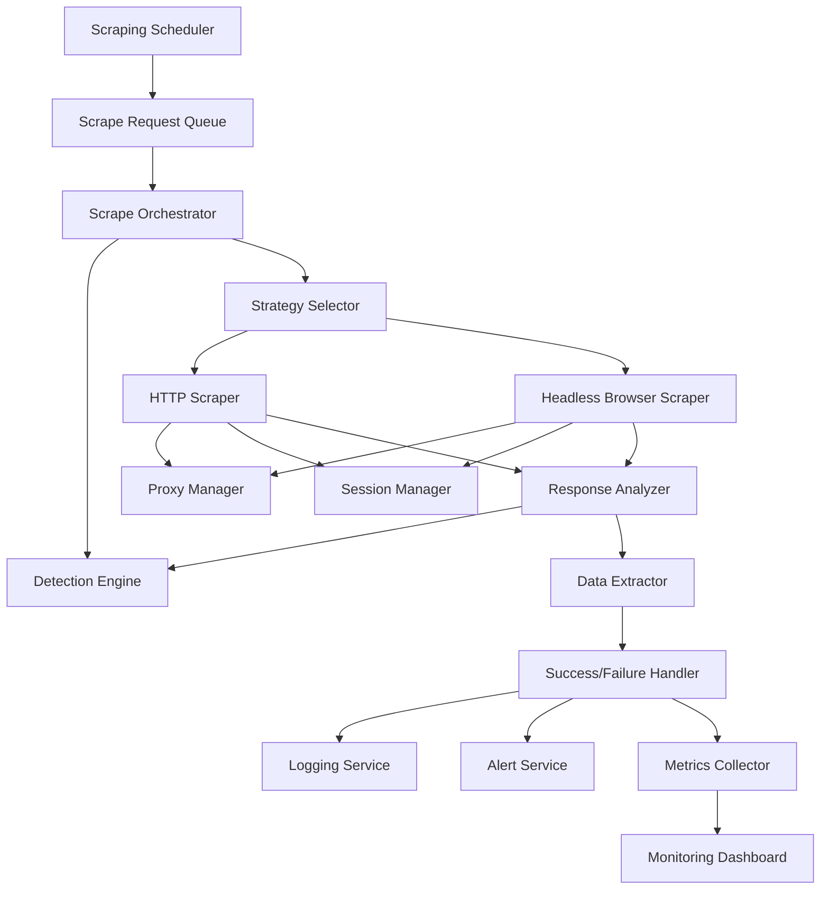

# Design Document: Bot Protection Handling

## Overview

The Bot Protection Handling system provides comprehensive capabilities for detecting, mitigating, and reporting on anti-scraping measures employed by competitor websites. This design implements a multi-layered approach combining detection algorithms, adaptive retry strategies, proxy rotation, browser fingerprinting, and fallback mechanisms to ensure reliable price data collection.

The system architecture follows a pipeline pattern where each scrape request flows through detection, mitigation, execution, and reporting stages. The design emphasizes observability, configurability, and graceful degradation to maintain service quality even when facing sophisticated bot protection.

### Key Design Goals

1. **Resilience**: Automatically adapt to various bot protection mechanisms
2. **Observability**: Comprehensive logging and monitoring of scraping health
3. **User Experience**: Clear communication about scraping status and issues
4. **Maintainability**: Modular design allowing easy addition of new strategies
5. **Performance**: Efficient resource usage while respecting rate limits

## Architecture

### High-Level Architecture



### Component Layers


**1. Request Layer**
- Scrape Orchestrator: Coordinates scraping workflow
- Strategy Selector: Chooses appropriate scraping method
- Retry Manager: Implements retry logic with backoff

**2. Execution Layer**
- HTTP Scraper: Lightweight HTTP client-based scraping
- Headless Browser Scraper: Puppeteer/Playwright-based scraping
- Proxy Manager: IP rotation and proxy health tracking
- Session Manager: Cookie and session state management

**3. Analysis Layer**
- Response Analyzer: Examines responses for bot protection indicators
- Detection Engine: Classifies protection types
- Data Extractor: Parses price data from responses

**4. Observability Layer**
- Logging Service: Structured logging with retention policies
- Metrics Collector: Success rates, latency, error counts
- Alert Service: Threshold-based notifications
- Monitoring Dashboard: Real-time visibility

### Data Flow

1. **Scrape Request Initiation**: Scheduler creates scrape jobs for competitor products
2. **Strategy Selection**: System selects scraping method based on site configuration and history
3. **Request Preparation**: Proxy, headers, and session state are configured
4. **Execution**: Request is sent via HTTP client or headless browser
5. **Response Analysis**: Response is analyzed for bot protection indicators
6. **Classification**: Protection type is identified if present
7. **Data Extraction**: Price data is extracted if response is valid
8. **Retry Decision**: System decides whether to retry with different strategy
9. **Result Storage**: Success or failure is logged with metrics
10. **User Notification**: Alerts are sent if thresholds are breached

## Components and Interfaces

### Scrape Orchestrator

**Responsibility**: Coordinates the entire scraping workflow from request to result storage.

**Interface**:
```typescript
interface ScrapeOrchestrator {
  executeScrape(request: ScrapeRequest): Promise<ScrapeResult>;
  retryFailedScrape(failedRequest: FailedScrapeRequest): Promise<ScrapeResult>;
}

interface ScrapeRequest {
  competitorProductId: string;
  competitorWebsiteId: string;
  url: string;
  tenantId: string;
  priority: 'high' | 'normal' | 'low';
}

interface ScrapeResult {
  success: boolean;
  price?: number;
  currency?: string;
  protectionDetected: boolean;
  protectionType?: ProtectionType;
  attempts: number;
  finalStrategy: ScrapingStrategy;
  responseTime: number;
  timestamp: Date;
}
```


### Detection Engine

**Responsibility**: Analyzes HTTP responses to detect and classify bot protection mechanisms.

**Interface**:
```typescript
interface DetectionEngine {
  analyzeResponse(response: HttpResponse): DetectionResult;
  classifyProtection(indicators: ProtectionIndicators): ProtectionType;
  calculateConfidence(indicators: ProtectionIndicators): number;
}

interface HttpResponse {
  statusCode: number;
  headers: Record<string, string>;
  body: string;
  redirectUrl?: string;
  responseTime: number;
}

interface DetectionResult {
  protectionDetected: boolean;
  protectionType?: ProtectionType;
  confidence: number;
  indicators: string[];
  reasoning: string;
}

enum ProtectionType {
  IP_BLOCK = 'ip_block',
  RATE_LIMIT = 'rate_limit',
  CAPTCHA = 'captcha',
  FAKE_DATA = 'fake_data',
  REDIRECT_BLOCK = 'redirect_block',
  DELAYED_RESPONSE = 'delayed_response',
  EMPTY_RESPONSE = 'empty_response',
  JAVASCRIPT_CHALLENGE = 'javascript_challenge',
  UNKNOWN = 'unknown'
}

interface ProtectionIndicators {
  statusCode: number;
  hasExpectedContent: boolean;
  hasCaptchaKeywords: boolean;
  isRedirected: boolean;
  responseTime: number;
  priceValue?: number;
  contentLength: number;
}
```

**Detection Logic**:
- **IP Block**: Status 403/429, or specific error messages
- **CAPTCHA**: Keywords like "captcha", "recaptcha", "hcaptcha" in HTML
- **Fake Data**: Price values like $0.00, $999999.99, or missing decimal places
- **Redirect Block**: 3xx status to different domain or error page
- **Delayed Response**: Response time > configured threshold (e.g., 30s)
- **Empty Response**: Content length < minimum threshold or missing expected selectors
- **JavaScript Challenge**: Specific patterns in HTML indicating JS validation


### Strategy Selector

**Responsibility**: Selects the appropriate scraping strategy based on site configuration, history, and previous failures.

**Interface**:
```typescript
interface StrategySelector {
  selectStrategy(context: StrategyContext): ScrapingStrategy;
  selectRetryStrategy(failureContext: FailureContext): ScrapingStrategy | null;
}

interface StrategyContext {
  competitorWebsiteId: string;
  siteConfig: SiteConfiguration;
  recentHistory: ScrapeAttempt[];
  currentAttempt: number;
}

interface FailureContext extends StrategyContext {
  lastProtectionType: ProtectionType;
  lastStrategy: ScrapingStrategy;
}

enum ScrapingStrategy {
  HTTP_CLIENT = 'http_client',
  HTTP_WITH_PROXY = 'http_with_proxy',
  HEADLESS_BROWSER = 'headless_browser',
  HEADLESS_WITH_PROXY = 'headless_with_proxy',
  STEALTH_BROWSER = 'stealth_browser'
}

interface SiteConfiguration {
  preferredStrategy: ScrapingStrategy;
  requiresJavaScript: boolean;
  rateLimit: RateLimitConfig;
  proxyRequired: boolean;
  customSelectors: SelectorConfig;
  maxRetries: number;
}
```

**Strategy Selection Logic**:
1. Check site configuration for preferred strategy
2. If first attempt, use configured preferred strategy
3. If retry after IP block → switch proxy
4. If retry after fake data → upgrade to headless browser
5. If retry after JavaScript challenge → use stealth browser
6. If retry after rate limit → increase delay, keep same strategy
7. If all strategies exhausted → return null (give up)


### Proxy Manager

**Responsibility**: Manages proxy rotation, health tracking, and selection.

**Interface**:
```typescript
interface ProxyManager {
  getProxy(competitorWebsiteId: string): Promise<Proxy | null>;
  markProxyFailed(proxyId: string, competitorWebsiteId: string): Promise<void>;
  markProxySuccess(proxyId: string, competitorWebsiteId: string): Promise<void>;
  getProxyHealth(proxyId: string): ProxyHealth;
}

interface Proxy {
  id: string;
  host: string;
  port: number;
  protocol: 'http' | 'https' | 'socks5';
  username?: string;
  password?: string;
  provider: string;
  region?: string;
}

interface ProxyHealth {
  proxyId: string;
  globalSuccessRate: number;
  siteSpecificRates: Map<string, number>;
  lastSuccess: Date | null;
  lastFailure: Date | null;
  isBlocked: boolean;
  cooldownUntil: Date | null;
}
```

**Proxy Selection Algorithm**:
1. Filter out proxies in cooldown period for this site
2. Filter out globally unavailable proxies (success rate < 10%)
3. Sort by site-specific success rate (descending)
4. Select top proxy with randomization to avoid overuse
5. If no proxies available, return null and trigger alert

**Cooldown Logic**:
- First failure: 5 minute cooldown
- Second failure: 15 minute cooldown
- Third+ failure: 60 minute cooldown
- Success resets cooldown counter


### Session Manager

**Responsibility**: Manages cookies and session state for maintaining realistic browsing sessions.

**Interface**:
```typescript
interface SessionManager {
  getCookies(competitorWebsiteId: string): Promise<Cookie[]>;
  storeCookies(competitorWebsiteId: string, cookies: Cookie[]): Promise<void>;
  clearCookies(competitorWebsiteId: string): Promise<void>;
  isSessionValid(competitorWebsiteId: string): Promise<boolean>;
}

interface Cookie {
  name: string;
  value: string;
  domain: string;
  path: string;
  expires?: Date;
  httpOnly: boolean;
  secure: boolean;
  sameSite?: 'Strict' | 'Lax' | 'None';
}
```

**Session Storage**:
- Cookies stored in database per competitor site
- Automatic expiration based on cookie headers
- Separate cookie jars prevent cross-contamination
- Session validation checks cookie age and validity


### HTTP Scraper

**Responsibility**: Executes HTTP-based scraping with configurable headers and proxy support.

**Interface**:
```typescript
interface HttpScraper {
  scrape(config: ScrapeConfig): Promise<ScrapeResponse>;
}

interface ScrapeConfig {
  url: string;
  proxy?: Proxy;
  userAgent: string;
  headers: Record<string, string>;
  cookies: Cookie[];
  timeout: number;
  followRedirects: boolean;
}

interface ScrapeResponse {
  statusCode: number;
  headers: Record<string, string>;
  body: string;
  redirectUrl?: string;
  responseTime: number;
  finalUrl: string;
}
```

**User-Agent Pool**:
- Maintain pool of 50+ real browser user agents
- Mix of Chrome, Firefox, Safari, Edge
- Desktop and mobile variants
- Rotate on each request
- Update pool monthly with current versions

**Header Generation**:
```typescript
function generateHeaders(userAgent: string): Record<string, string> {
  return {
    'User-Agent': userAgent,
    'Accept': 'text/html,application/xhtml+xml,application/xml;q=0.9,image/webp,*/*;q=0.8',
    'Accept-Language': 'en-US,en;q=0.9',
    'Accept-Encoding': 'gzip, deflate, br',
    'DNT': '1',
    'Connection': 'keep-alive',
    'Upgrade-Insecure-Requests': '1',
    'Sec-Fetch-Dest': 'document',
    'Sec-Fetch-Mode': 'navigate',
    'Sec-Fetch-Site': 'none',
    'Cache-Control': 'max-age=0'
  };
}
```


### Headless Browser Scraper

**Responsibility**: Executes JavaScript-enabled scraping using Puppeteer with stealth plugins.

**Interface**:
```typescript
interface HeadlessBrowserScraper {
  scrape(config: BrowserScrapeConfig): Promise<BrowserScrapeResponse>;
  captureScreenshot(url: string): Promise<Buffer>;
}

interface BrowserScrapeConfig extends ScrapeConfig {
  waitForSelector?: string;
  waitForTimeout?: number;
  executeScript?: string;
  stealthMode: boolean;
  viewport: Viewport;
}

interface BrowserScrapeResponse extends ScrapeResponse {
  screenshot?: Buffer;
  consoleLogs: string[];
  networkRequests: NetworkRequest[];
}

interface Viewport {
  width: number;
  height: number;
  deviceScaleFactor: number;
  isMobile: boolean;
}
```

**Stealth Configuration**:
- Use puppeteer-extra-plugin-stealth
- Randomize viewport dimensions
- Randomize timezone and locale
- Override navigator properties
- Disable automation indicators
- Randomize canvas fingerprint

**Browser Pool**:
- Maintain pool of browser instances
- Reuse instances to reduce overhead
- Maximum 5 concurrent browsers
- Restart browsers after 100 requests
- Timeout idle browsers after 5 minutes


### Rate Limiter

**Responsibility**: Enforces rate limits and implements exponential backoff.

**Interface**:
```typescript
interface RateLimiter {
  acquirePermit(competitorWebsiteId: string): Promise<void>;
  recordFailure(competitorWebsiteId: string, protectionType: ProtectionType): Promise<void>;
  recordSuccess(competitorWebsiteId: string): Promise<void>;
  getNextAvailableTime(competitorWebsiteId: string): Promise<Date>;
}

interface RateLimitConfig {
  baseDelay: number; // milliseconds
  maxDelay: number; // milliseconds
  backoffMultiplier: number;
  jitterRange: number; // percentage
}
```

**Rate Limiting Algorithm**:
```typescript
function calculateDelay(
  config: RateLimitConfig,
  consecutiveFailures: number
): number {
  const exponentialDelay = config.baseDelay * Math.pow(
    config.backoffMultiplier,
    consecutiveFailures
  );
  const cappedDelay = Math.min(exponentialDelay, config.maxDelay);
  const jitter = cappedDelay * (config.jitterRange / 100);
  const randomJitter = (Math.random() * 2 - 1) * jitter;
  return cappedDelay + randomJitter;
}
```

**Default Configuration**:
- Base delay: 2000ms (2 seconds)
- Max delay: 300000ms (5 minutes)
- Backoff multiplier: 2.0
- Jitter range: 20%

**Example Delays**:
- 0 failures: 2s ± 0.4s
- 1 failure: 4s ± 0.8s
- 2 failures: 8s ± 1.6s
- 3 failures: 16s ± 3.2s
- 4 failures: 32s ± 6.4s
- 5+ failures: 300s ± 60s (capped)


### Data Extractor

**Responsibility**: Extracts price data from HTML responses using configured selectors.

**Interface**:
```typescript
interface DataExtractor {
  extractPrice(html: string, selectors: SelectorConfig): ExtractionResult;
  validatePrice(price: number): boolean;
}

interface SelectorConfig {
  priceSelectors: string[]; // CSS selectors in priority order
  currencySelector?: string;
  fallbackRegex?: string;
}

interface ExtractionResult {
  success: boolean;
  price?: number;
  currency?: string;
  rawValue?: string;
  selectorUsed?: string;
  confidence: number;
}
```

**Price Extraction Logic**:
1. Try each CSS selector in priority order
2. Clean extracted text (remove currency symbols, commas)
3. Parse to number
4. Validate price is reasonable (> 0, < 1000000)
5. If all selectors fail, try regex fallback
6. Calculate confidence based on method used

**Price Validation**:
- Reject $0.00 (likely fake)
- Reject $999999.99 or similar obvious fake values
- Reject prices without decimal places (unless configured)
- Reject prices outside configured min/max range


### Logging Service

**Responsibility**: Structured logging with retention policies and query capabilities.

**Interface**:
```typescript
interface LoggingService {
  logScrapeAttempt(log: ScrapeAttemptLog): Promise<void>;
  logDetection(log: DetectionLog): Promise<void>;
  queryLogs(query: LogQuery): Promise<ScrapeAttemptLog[]>;
  cleanupOldLogs(): Promise<void>;
}

interface ScrapeAttemptLog {
  id: string;
  tenantId: string;
  competitorProductId: string;
  competitorWebsiteId: string;
  url: string;
  strategy: ScrapingStrategy;
  proxyId?: string;
  userAgent: string;
  success: boolean;
  protectionDetected: boolean;
  protectionType?: ProtectionType;
  statusCode: number;
  responseTime: number;
  responseSize: number;
  responseSample?: string; // First 1KB of response
  screenshot?: string; // S3 URL
  errorMessage?: string;
  attemptNumber: number;
  timestamp: Date;
}

interface DetectionLog {
  id: string;
  scrapeAttemptId: string;
  protectionType: ProtectionType;
  confidence: number;
  indicators: string[];
  reasoning: string;
  timestamp: Date;
}

interface LogQuery {
  tenantId: string;
  competitorWebsiteId?: string;
  protectionType?: ProtectionType;
  startDate?: Date;
  endDate?: Date;
  limit: number;
  offset: number;
}
```

**Retention Policy**:
- Successful attempts: 7 days
- Failed attempts: 30 days
- Detection logs: 90 days
- Screenshots: 7 days
- Response samples: 30 days


### Metrics Collector

**Responsibility**: Aggregates scraping metrics for monitoring and alerting.

**Interface**:
```typescript
interface MetricsCollector {
  recordAttempt(metric: ScrapeMetric): Promise<void>;
  getSuccessRate(competitorWebsiteId: string, timeWindow: TimeWindow): Promise<number>;
  getMetricsSummary(tenantId: string): Promise<MetricsSummary>;
}

interface ScrapeMetric {
  tenantId: string;
  competitorWebsiteId: string;
  success: boolean;
  protectionType?: ProtectionType;
  strategy: ScrapingStrategy;
  responseTime: number;
  timestamp: Date;
}

enum TimeWindow {
  LAST_HOUR = 'last_hour',
  LAST_24_HOURS = 'last_24_hours',
  LAST_7_DAYS = 'last_7_days',
  LAST_30_DAYS = 'last_30_days'
}

interface MetricsSummary {
  totalAttempts: number;
  successfulAttempts: number;
  failedAttempts: number;
  successRate: number;
  averageResponseTime: number;
  protectionTypeBreakdown: Record<ProtectionType, number>;
  strategyBreakdown: Record<ScrapingStrategy, number>;
  siteMetrics: SiteMetrics[];
}

interface SiteMetrics {
  competitorWebsiteId: string;
  siteName: string;
  successRate: number;
  totalAttempts: number;
  averageResponseTime: number;
  lastSuccess?: Date;
  lastFailure?: Date;
  currentStatus: 'healthy' | 'degraded' | 'blocked';
}
```

**Metric Aggregation**:
- Real-time counters using Redis
- Hourly rollups to database
- Daily aggregations for historical trends
- Per-site and per-tenant metrics


### Alert Service

**Responsibility**: Monitors metrics and sends notifications when thresholds are breached.

**Interface**:
```typescript
interface AlertService {
  checkThresholds(): Promise<void>;
  sendAlert(alert: Alert): Promise<void>;
  acknowledgeAlert(alertId: string): Promise<void>;
}

interface Alert {
  id: string;
  tenantId: string;
  severity: 'info' | 'warning' | 'critical';
  type: AlertType;
  title: string;
  message: string;
  competitorWebsiteId?: string;
  metadata: Record<string, any>;
  timestamp: Date;
  acknowledged: boolean;
}

enum AlertType {
  SUCCESS_RATE_DROP = 'success_rate_drop',
  CAPTCHA_DETECTED = 'captcha_detected',
  ALL_PROXIES_BLOCKED = 'all_proxies_blocked',
  SITE_BLOCKED = 'site_blocked',
  HIGH_FAILURE_RATE = 'high_failure_rate',
  SCRAPING_RECOVERED = 'scraping_recovered'
}
```

**Alert Thresholds**:
- Success rate < 50% for 1 hour → Warning
- Success rate < 20% for 1 hour → Critical
- CAPTCHA detected → Critical (immediate)
- All proxies blocked → Critical (immediate)
- Success rate recovers to > 80% → Info (recovery)

**Alert Throttling**:
- Maximum 1 alert per site per hour (same type)
- Critical alerts bypass throttling
- Recovery alerts always sent

**Notification Channels**:
- Email (configurable per tenant)
- Webhook (configurable per tenant)
- In-app notifications (always enabled)


## Data Models

### Database Schema Extensions

Following the existing database schema guidelines, we add these new tables:

```sql
-- Proxy configuration and health tracking
CREATE TABLE proxies (
  id UUID PRIMARY KEY DEFAULT gen_random_uuid(),
  provider VARCHAR(100) NOT NULL,
  host VARCHAR(255) NOT NULL,
  port INTEGER NOT NULL,
  protocol VARCHAR(10) NOT NULL, -- http, https, socks5
  username VARCHAR(255),
  password_encrypted TEXT,
  region VARCHAR(50),
  status VARCHAR(20) NOT NULL DEFAULT 'active', -- active, disabled
  global_success_count INTEGER DEFAULT 0,
  global_failure_count INTEGER DEFAULT 0,
  created_at TIMESTAMP NOT NULL DEFAULT NOW(),
  updated_at TIMESTAMP NOT NULL DEFAULT NOW(),
  UNIQUE(host, port)
);

-- Per-site proxy health tracking
CREATE TABLE proxy_site_health (
  id UUID PRIMARY KEY DEFAULT gen_random_uuid(),
  proxy_id UUID NOT NULL REFERENCES proxies(id) ON DELETE CASCADE,
  competitor_website_id UUID NOT NULL REFERENCES competitor_websites(id) ON DELETE CASCADE,
  success_count INTEGER DEFAULT 0,
  failure_count INTEGER DEFAULT 0,
  last_success_at TIMESTAMP,
  last_failure_at TIMESTAMP,
  cooldown_until TIMESTAMP,
  created_at TIMESTAMP NOT NULL DEFAULT NOW(),
  updated_at TIMESTAMP NOT NULL DEFAULT NOW(),
  UNIQUE(proxy_id, competitor_website_id)
);

-- Scraping configuration per competitor site
CREATE TABLE scraping_configs (
  id UUID PRIMARY KEY DEFAULT gen_random_uuid(),
  tenant_id UUID NOT NULL REFERENCES tenants(id) ON DELETE CASCADE,
  competitor_website_id UUID NOT NULL REFERENCES competitor_websites(id) ON DELETE CASCADE,
  preferred_strategy VARCHAR(50) NOT NULL DEFAULT 'http_client',
  requires_javascript BOOLEAN DEFAULT false,
  proxy_required BOOLEAN DEFAULT false,
  base_delay_ms INTEGER DEFAULT 2000,
  max_delay_ms INTEGER DEFAULT 300000,
  backoff_multiplier DECIMAL(3,2) DEFAULT 2.0,
  max_retries INTEGER DEFAULT 3,
  timeout_ms INTEGER DEFAULT 30000,
  price_selectors JSONB NOT NULL, -- Array of CSS selectors
  currency_selector VARCHAR(255),
  fallback_regex VARCHAR(500),
  created_at TIMESTAMP NOT NULL DEFAULT NOW(),
  updated_at TIMESTAMP NOT NULL DEFAULT NOW(),
  UNIQUE(competitor_website_id)
);

-- Session and cookie storage
CREATE TABLE scraping_sessions (
  id UUID PRIMARY KEY DEFAULT gen_random_uuid(),
  competitor_website_id UUID NOT NULL REFERENCES competitor_websites(id) ON DELETE CASCADE,
  cookies JSONB NOT NULL,
  expires_at TIMESTAMP NOT NULL,
  created_at TIMESTAMP NOT NULL DEFAULT NOW(),
  updated_at TIMESTAMP NOT NULL DEFAULT NOW(),
  UNIQUE(competitor_website_id)
);

-- Scrape attempt logs
CREATE TABLE scrape_attempts (
  id UUID PRIMARY KEY DEFAULT gen_random_uuid(),
  tenant_id UUID NOT NULL REFERENCES tenants(id) ON DELETE CASCADE,
  competitor_product_id UUID NOT NULL REFERENCES competitor_products(id) ON DELETE CASCADE,
  competitor_website_id UUID NOT NULL REFERENCES competitor_websites(id) ON DELETE CASCADE,
  url TEXT NOT NULL,
  strategy VARCHAR(50) NOT NULL,
  proxy_id UUID REFERENCES proxies(id) ON DELETE SET NULL,
  user_agent TEXT NOT NULL,
  success BOOLEAN NOT NULL,
  protection_detected BOOLEAN DEFAULT false,
  protection_type VARCHAR(50),
  status_code INTEGER,
  response_time_ms INTEGER,
  response_size_bytes INTEGER,
  response_sample TEXT, -- First 1KB
  screenshot_url TEXT,
  error_message TEXT,
  attempt_number INTEGER NOT NULL,
  created_at TIMESTAMP NOT NULL DEFAULT NOW()
);

-- Bot protection detection logs
CREATE TABLE protection_detections (
  id UUID PRIMARY KEY DEFAULT gen_random_uuid(),
  scrape_attempt_id UUID NOT NULL REFERENCES scrape_attempts(id) ON DELETE CASCADE,
  protection_type VARCHAR(50) NOT NULL,
  confidence DECIMAL(5,2) NOT NULL,
  indicators JSONB NOT NULL,
  reasoning TEXT,
  created_at TIMESTAMP NOT NULL DEFAULT NOW()
);

-- Aggregated metrics (hourly rollups)
CREATE TABLE scraping_metrics (
  id UUID PRIMARY KEY DEFAULT gen_random_uuid(),
  tenant_id UUID NOT NULL REFERENCES tenants(id) ON DELETE CASCADE,
  competitor_website_id UUID NOT NULL REFERENCES competitor_websites(id) ON DELETE CASCADE,
  hour_timestamp TIMESTAMP NOT NULL,
  total_attempts INTEGER DEFAULT 0,
  successful_attempts INTEGER DEFAULT 0,
  failed_attempts INTEGER DEFAULT 0,
  avg_response_time_ms INTEGER,
  protection_type_counts JSONB, -- {ip_block: 5, captcha: 2, ...}
  strategy_counts JSONB, -- {http_client: 10, headless_browser: 5, ...}
  created_at TIMESTAMP NOT NULL DEFAULT NOW(),
  UNIQUE(tenant_id, competitor_website_id, hour_timestamp)
);

-- Alert tracking
CREATE TABLE scraping_alerts (
  id UUID PRIMARY KEY DEFAULT gen_random_uuid(),
  tenant_id UUID NOT NULL REFERENCES tenants(id) ON DELETE CASCADE,
  competitor_website_id UUID REFERENCES competitor_websites(id) ON DELETE CASCADE,
  severity VARCHAR(20) NOT NULL, -- info, warning, critical
  type VARCHAR(50) NOT NULL,
  title VARCHAR(255) NOT NULL,
  message TEXT NOT NULL,
  metadata JSONB,
  acknowledged BOOLEAN DEFAULT false,
  acknowledged_at TIMESTAMP,
  acknowledged_by UUID REFERENCES users(id) ON DELETE SET NULL,
  created_at TIMESTAMP NOT NULL DEFAULT NOW()
);
```


### Indexes

```sql
-- Performance indexes
CREATE INDEX idx_proxies_status ON proxies(status);
CREATE INDEX idx_proxy_site_health_proxy ON proxy_site_health(proxy_id);
CREATE INDEX idx_proxy_site_health_website ON proxy_site_health(competitor_website_id);
CREATE INDEX idx_proxy_site_health_cooldown ON proxy_site_health(cooldown_until) WHERE cooldown_until IS NOT NULL;

CREATE INDEX idx_scraping_configs_tenant ON scraping_configs(tenant_id);
CREATE INDEX idx_scraping_configs_website ON scraping_configs(competitor_website_id);

CREATE INDEX idx_scraping_sessions_website ON scraping_sessions(competitor_website_id);
CREATE INDEX idx_scraping_sessions_expires ON scraping_sessions(expires_at);

CREATE INDEX idx_scrape_attempts_tenant ON scrape_attempts(tenant_id);
CREATE INDEX idx_scrape_attempts_product ON scrape_attempts(competitor_product_id);
CREATE INDEX idx_scrape_attempts_website ON scrape_attempts(competitor_website_id);
CREATE INDEX idx_scrape_attempts_created ON scrape_attempts(created_at DESC);
CREATE INDEX idx_scrape_attempts_success ON scrape_attempts(success);
CREATE INDEX idx_scrape_attempts_protection ON scrape_attempts(protection_detected, protection_type);

CREATE INDEX idx_protection_detections_attempt ON protection_detections(scrape_attempt_id);
CREATE INDEX idx_protection_detections_type ON protection_detections(protection_type);

CREATE INDEX idx_scraping_metrics_tenant_hour ON scraping_metrics(tenant_id, hour_timestamp DESC);
CREATE INDEX idx_scraping_metrics_website_hour ON scraping_metrics(competitor_website_id, hour_timestamp DESC);

CREATE INDEX idx_scraping_alerts_tenant ON scraping_alerts(tenant_id);
CREATE INDEX idx_scraping_alerts_website ON scraping_alerts(competitor_website_id);
CREATE INDEX idx_scraping_alerts_acknowledged ON scraping_alerts(acknowledged);
CREATE INDEX idx_scraping_alerts_created ON scraping_alerts(created_at DESC);
```

### API Endpoints

Following the API design standards, these endpoints are added:

```
# Scraping Configuration
GET    /api/v1/scraping/configs
GET    /api/v1/scraping/configs/:competitorWebsiteId
PUT    /api/v1/scraping/configs/:competitorWebsiteId
POST   /api/v1/scraping/configs/:competitorWebsiteId/test

# Proxy Management
GET    /api/v1/scraping/proxies
POST   /api/v1/scraping/proxies
PUT    /api/v1/scraping/proxies/:id
DELETE /api/v1/scraping/proxies/:id
GET    /api/v1/scraping/proxies/:id/health

# Monitoring & Metrics
GET    /api/v1/scraping/metrics/summary
GET    /api/v1/scraping/metrics/sites
GET    /api/v1/scraping/metrics/sites/:competitorWebsiteId

# Logs & Debugging
GET    /api/v1/scraping/attempts
GET    /api/v1/scraping/attempts/:id
GET    /api/v1/scraping/attempts/:id/screenshot
GET    /api/v1/scraping/detections

# Alerts
GET    /api/v1/scraping/alerts
POST   /api/v1/scraping/alerts/:id/acknowledge
DELETE /api/v1/scraping/alerts/:id

# Manual Price Entry
POST   /api/v1/competitor-products/:id/manual-price
```


## Correctness Properties

*A property is a characteristic or behavior that should hold true across all valid executions of a system—essentially, a formal statement about what the system should do. Properties serve as the bridge between human-readable specifications and machine-verifiable correctness guarantees.*

### Property 1: Bot Protection Detection Accuracy

*For any* HTTP response, when the response contains bot protection indicators (non-2xx status, missing price data, CAPTCHA keywords, redirects to different domains, timeout, or fake prices), the Detection Engine should correctly classify the protection type with appropriate confidence score.

**Validates: Requirements 1.1, 1.2, 1.3, 1.4, 1.5, 1.6**

### Property 2: Classification Persistence

*For any* bot protection detection result, all required fields (timestamp, competitor URL, protection type, response sample, confidence score, and reasoning) should be stored in the database.

**Validates: Requirements 1.7, 8.4**

### Property 3: Confidence Score Progression

*For any* sequence of consecutive scrape failures with the same protection type for a competitor site, the confidence score should monotonically increase with each additional failure.

**Validates: Requirements 1.8**

### Property 4: Proxy Selection from Available Pool

*For any* scrape request when proxies are available and not in cooldown, the Proxy Manager should select a proxy from the available pool based on site-specific success rates.

**Validates: Requirements 2.1, 2.6**

### Property 5: Proxy Cooldown Enforcement

*For any* proxy marked as blocked for a specific competitor site, that proxy should not be selected for scraping that site until the cooldown period expires.

**Validates: Requirements 2.2, 2.3**

### Property 6: Proxy Health Tracking

*For any* proxy and competitor site combination, the system should maintain accurate success and failure counts that update after each scrape attempt.

**Validates: Requirements 2.4, 2.7**

### Property 7: User Agent Rotation

*For any* sequence of scrape attempts, the User-Agent header should vary across attempts, with each value selected from the configured user agent pool.

**Validates: Requirements 3.1, 3.5**

### Property 8: Required Headers Presence

*For any* HTTP scrape request, all required headers (User-Agent, Accept, Accept-Language, Accept-Encoding, Connection, Upgrade-Insecure-Requests) should be present in the request.

**Validates: Requirements 3.2**

### Property 9: Header Order Randomization

*For any* pair of consecutive scrape requests, the order of HTTP headers should differ to avoid predictable patterns.

**Validates: Requirements 3.3**

### Property 10: Browser Fingerprint Configuration

*For any* headless browser scrape attempt, all fingerprint properties (viewport dimensions, timezone, language, screen resolution) should be configured before page navigation.

**Validates: Requirements 3.4**

### Property 11: Header Profile Separation

*For any* scrape request, if the User-Agent indicates mobile, the headers should match mobile browser patterns; if desktop, headers should match desktop browser patterns.

**Validates: Requirements 3.6**

### Property 12: Rate Limit Delay Enforcement

*For any* sequence of scrape requests to the same competitor domain, the time between consecutive requests should be at least the configured minimum delay for that site.

**Validates: Requirements 4.1, 4.4**

### Property 13: Exponential Backoff Calculation

*For any* number of consecutive failures N, the calculated delay should equal baseDelay × (backoffMultiplier ^ N), capped at maxDelay, with jitter applied within the configured range.

**Validates: Requirements 4.2, 4.3, 4.6**

### Property 14: Request Distribution

*For any* batch of scrape requests for the same competitor site, requests should be distributed over time with delays between them rather than executed simultaneously.

**Validates: Requirements 4.5**

### Property 15: Cookie Round-Trip

*For any* cookies received from a competitor site, those cookies should be included in subsequent requests to the same domain until they expire.

**Validates: Requirements 5.1, 5.2, 5.3**

### Property 16: Cookie Expiration

*For any* stored cookie with an expiration time, when the current time exceeds the expiration time, the cookie should be removed from storage.

**Validates: Requirements 5.4**

### Property 17: Cookie Isolation

*For any* two different competitor sites, cookies stored for one site should never be included in requests to the other site.

**Validates: Requirements 5.6**

### Property 18: Session Error Recovery

*For any* scrape attempt that fails with session-related errors, all cookies for that competitor site should be cleared from storage.

**Validates: Requirements 5.5**

### Property 19: Headless Browser Fallback

*For any* scrape attempt using HTTP client that fails to extract price data, a retry attempt should be made using headless browser with the same URL.

**Validates: Requirements 6.1**

### Property 20: Screenshot Capture

*For any* scrape attempt using headless browser, a screenshot should be captured and stored regardless of success or failure.

**Validates: Requirements 6.4**

### Property 21: Strategy Adaptation

*For any* competitor site where headless browser consistently succeeds (success rate > 80% over 10+ attempts) while HTTP client fails, the preferred strategy should be updated to headless browser.

**Validates: Requirements 6.6**

### Property 22: Retry Strategy Selection

*For any* failed scrape attempt, the retry strategy should be selected based on the detected protection type: IP block → different proxy, rate limit → increased delay, fake data → headless browser, CAPTCHA → no retry.

**Validates: Requirements 7.1, 7.3, 7.4, 7.5, 7.7**

### Property 23: Retry Limit Enforcement

*For any* scrape request, the total number of retry attempts should not exceed the configured maximum for that competitor site.

**Validates: Requirements 7.2**

### Property 24: Final Failure Logging

*For any* scrape request where all retry attempts are exhausted, the scrape should be marked as failed with the final error message logged.

**Validates: Requirements 7.6**

### Property 25: Scrape Attempt Logging Completeness

*For any* scrape attempt (successful or failed), a log entry should be created containing timestamp, competitor URL, proxy ID, user agent, strategy, outcome, status code, response time, and protection detection results.

**Validates: Requirements 8.1, 8.2**

### Property 26: Response Sample Size Limiting

*For any* stored response sample, the size should not exceed the configured maximum size limit (e.g., 1KB).

**Validates: Requirements 8.3**

### Property 27: Screenshot Storage on Failure

*For any* headless browser scrape attempt that fails, a screenshot should be stored with the scrape attempt log.

**Validates: Requirements 8.5**

### Property 28: Log Query Filtering

*For any* log query with filters (competitor site, date range, protection type), only logs matching all specified filters should be returned.

**Validates: Requirements 8.7**

### Property 29: Success Rate Calculation

*For any* competitor site and time window, the success rate should equal (successful attempts / total attempts) × 100, and average response time should equal sum of response times / total attempts.

**Validates: Requirements 9.1, 9.6**

### Property 30: Multi-Granularity Statistics

*For any* competitor site, success rate statistics should be maintained and queryable at hourly, daily, and weekly granularities.

**Validates: Requirements 9.2**

### Property 31: Method-Specific Tracking

*For any* competitor site, success rates should be tracked separately for HTTP client and headless browser strategies, allowing comparison between methods.

**Validates: Requirements 9.3**

### Property 32: Success Rate Alert Triggering

*For any* competitor site, when the success rate drops below the configured threshold for the configured duration, an alert should be triggered.

**Validates: Requirements 9.4, 12.1**

### Property 33: User Error Message Generation

*For any* failed competitor product scrape, a user-friendly error message should be generated that explains the protection type detected and provides actionable suggestions.

**Validates: Requirements 10.1, 10.2**

### Property 34: Site Status Calculation

*For any* competitor site, the status should be calculated as: healthy (success rate ≥ 80%), degraded (50% ≤ success rate < 80%), or blocked (success rate < 50%).

**Validates: Requirements 10.3, 10.6**

### Property 35: Alert Channel Delivery

*For any* alert that should be sent, the alert should be delivered through all configured channels (email, webhook, in-app) for that tenant.

**Validates: Requirements 12.4**

### Property 36: Alert Throttling

*For any* alert type and competitor site combination, no more than one alert of the same type should be sent within the configured throttling window (e.g., 1 hour), except for critical alerts which bypass throttling.

**Validates: Requirements 12.5**

### Property 37: Alert Context Inclusion

*For any* alert sent, the alert should include competitor site name, protection type (if applicable), current success rate, and recent failure count.

**Validates: Requirements 12.6**

### Property 38: Recovery Notification

*For any* competitor site that previously triggered a low success rate alert, when the success rate recovers above the recovery threshold (e.g., 80%), a recovery notification should be sent.

**Validates: Requirements 12.7**

### Property 39: Manual Entry Validation

*For any* manually entered price, the price should be validated to ensure it is greater than zero and less than a reasonable maximum (e.g., $1,000,000), and the entry should be rejected if validation fails.

**Validates: Requirements 13.2**

### Property 40: Manual Entry Audit Trail

*For any* manually entered price that passes validation, the system should store the price value, the user ID who entered it, and the timestamp of entry.

**Validates: Requirements 13.3, 13.4**

### Property 41: Automated Price Override

*For any* competitor product with a manually entered price, when automated scraping successfully retrieves a price, the manually entered price should be replaced with the scraped price.

**Validates: Requirements 13.5**

### Property 42: Last Known Good Fallback

*For any* competitor product where the current scrape attempt fails, the system should display the last successfully scraped price along with an age indicator showing how long ago it was scraped.

**Validates: Requirements 14.1, 14.2**

### Property 43: Stale Price Marking

*For any* competitor product where the last known good price age exceeds the configured staleness threshold, the price should be marked as stale in the UI.

**Validates: Requirements 14.3, 14.5**

### Property 44: Per-Site Configuration Isolation

*For any* two different competitor sites, configuration changes to one site (rate limits, retry attempts, timeouts, preferred strategy) should not affect the configuration of the other site.

**Validates: Requirements 15.1, 15.2, 15.3, 15.4**

### Property 45: Custom Selector Functionality

*For any* competitor site with custom CSS selectors configured, price extraction should attempt to use the custom selectors before falling back to default selectors.

**Validates: Requirements 15.5**

### Property 46: Configuration Validation

*For any* configuration change request, the new configuration should be validated (e.g., positive delays, valid strategy names, valid selector syntax) before being applied, and invalid configurations should be rejected with descriptive error messages.

**Validates: Requirements 15.6**

### Property 47: Configuration Audit Trail

*For any* configuration change that is successfully applied, an audit log entry should be created containing the old configuration, new configuration, user who made the change, and timestamp.

**Validates: Requirements 15.7**


## Error Handling

### Error Categories

**1. Network Errors**
- Connection timeouts
- DNS resolution failures
- SSL/TLS errors
- Connection refused

**Handling**: Retry with exponential backoff, try different proxy, log detailed error

**2. Proxy Errors**
- Proxy connection failure
- Proxy authentication failure
- Proxy timeout

**Handling**: Mark proxy as failed, select different proxy, alert if all proxies fail

**3. Bot Protection Errors**
- IP blocking
- CAPTCHA challenges
- Rate limiting
- Fake data serving

**Handling**: Classify protection type, apply appropriate mitigation strategy, alert user

**4. Parsing Errors**
- Invalid HTML structure
- Missing price selectors
- Malformed price data

**Handling**: Try fallback selectors, attempt headless browser, log response sample

**5. Configuration Errors**
- Invalid selectors
- Invalid rate limit values
- Missing required configuration

**Handling**: Validate on save, reject invalid config, provide descriptive error messages

**6. Database Errors**
- Connection failures
- Query timeouts
- Constraint violations

**Handling**: Retry with backoff, use circuit breaker pattern, alert on persistent failures

### Error Response Format

All API errors follow the standard format:

```json
{
  "success": false,
  "error": {
    "code": "SCRAPING_ERROR",
    "message": "Failed to scrape competitor product",
    "details": {
      "competitorProductId": "uuid",
      "protectionType": "ip_block",
      "attempts": 3,
      "lastError": "Connection refused",
      "suggestions": [
        "The competitor site is blocking our IP addresses",
        "Scraping will be retried automatically with different proxies",
        "You can manually enter the price if needed"
      ]
    }
  },
  "meta": {
    "requestId": "uuid",
    "timestamp": "2024-01-15T10:30:00Z"
  }
}
```

### Error Codes

- `SCRAPING_FAILED`: General scraping failure
- `PROXY_UNAVAILABLE`: No proxies available
- `CAPTCHA_DETECTED`: CAPTCHA challenge encountered
- `RATE_LIMITED`: Rate limit exceeded
- `INVALID_CONFIGURATION`: Configuration validation failed
- `PARSING_FAILED`: Unable to extract price data
- `NETWORK_ERROR`: Network connectivity issue
- `TIMEOUT_ERROR`: Request timeout

### Graceful Degradation

1. **Primary Strategy Fails** → Try fallback strategy
2. **All Strategies Fail** → Display last known good price
3. **No Last Known Good** → Offer manual entry
4. **Proxy Pool Exhausted** → Queue for retry later
5. **Database Unavailable** → Cache in Redis, sync when available

### Circuit Breaker Pattern

Implement circuit breakers for external dependencies:

- **Proxy Services**: Open circuit after 5 consecutive failures, half-open after 5 minutes
- **Database**: Open circuit after 3 consecutive failures, half-open after 1 minute
- **Competitor Sites**: Open circuit after 10 consecutive failures, half-open after 30 minutes


## Testing Strategy

### Overview

Given the project's test-free development policy, this feature will rely on:
- Manual validation during development
- Code review for correctness
- TypeScript strict mode for type safety
- Comprehensive error handling
- Production monitoring and logging

### Manual Validation Approach

**Detection Engine Testing**:
- Manually test with known bot-protected sites
- Verify classification accuracy for different protection types
- Test with sample HTML responses containing various indicators
- Validate confidence score calculations

**Proxy Management Testing**:
- Test proxy rotation with multiple proxies
- Verify cooldown periods work correctly
- Test proxy health tracking with simulated failures
- Validate alert triggering when all proxies blocked

**Rate Limiting Testing**:
- Test delay enforcement between requests
- Verify exponential backoff calculations
- Test per-site rate limit configurations
- Validate jitter randomization

**Strategy Selection Testing**:
- Test fallback from HTTP to headless browser
- Verify strategy adaptation based on success patterns
- Test retry logic for different failure types
- Validate CAPTCHA detection prevents retries

**Logging and Metrics Testing**:
- Verify all scrape attempts are logged
- Test log retention and cleanup
- Validate success rate calculations
- Test metric aggregation at different granularities

**Alert System Testing**:
- Test threshold-based alert triggering
- Verify alert throttling works correctly
- Test recovery notifications
- Validate multi-channel delivery

### Code Quality Measures

**TypeScript Strict Mode**:
- Enable strict null checks
- Enable strict function types
- Enable strict property initialization
- No implicit any types

**Input Validation**:
- Validate all API inputs using Zod schemas
- Validate configuration changes before applying
- Sanitize HTML responses before parsing
- Validate price values for reasonableness

**Error Handling**:
- Try-catch blocks around all external calls
- Graceful degradation for all failure modes
- Detailed error logging with context
- User-friendly error messages

**Code Documentation**:
- JSDoc comments for all public functions
- Document expected behavior and edge cases
- Explain complex algorithms (backoff, detection)
- Provide usage examples

### Monitoring and Observability

**Key Metrics to Monitor**:
- Overall scraping success rate
- Per-site success rates
- Average response times
- Protection type distribution
- Proxy health statistics
- Alert frequency
- Queue depth and processing rate

**Logging Strategy**:
- Structured JSON logs
- Log levels: DEBUG, INFO, WARN, ERROR
- Include request IDs for tracing
- Log all classification decisions
- Store response samples for debugging

**Dashboards**:
- Real-time success rate monitoring
- Protection type breakdown
- Proxy health overview
- Recent alerts and failures
- Trend analysis over time

### Production Validation

**Staged Rollout**:
1. Deploy to staging environment
2. Test with subset of competitor sites
3. Monitor for 24 hours
4. Gradually increase coverage
5. Full production deployment

**Smoke Tests**:
- Verify scraping works for known-good sites
- Test proxy rotation functionality
- Verify alerts are delivered
- Check dashboard displays correctly

**Performance Monitoring**:
- Track response times
- Monitor memory usage (browser pool)
- Watch database query performance
- Monitor queue processing rate

### Edge Cases to Validate

1. **All proxies blocked simultaneously**
2. **Competitor site returns intermittent errors**
3. **Price format changes on competitor site**
4. **Session expires mid-scrape**
5. **Database connection lost during scrape**
6. **Proxy service unavailable**
7. **Extremely slow competitor site responses**
8. **Malformed HTML responses**
9. **Redirect loops**
10. **Multiple protection mechanisms simultaneously**

### Documentation Requirements

**API Documentation**:
- OpenAPI/Swagger specs for all endpoints
- Request/response examples
- Error code descriptions
- Rate limit information

**Configuration Guide**:
- How to configure per-site settings
- Proxy setup instructions
- Alert configuration
- Selector customization

**Troubleshooting Guide**:
- Common scraping failures and solutions
- How to interpret protection types
- When to use manual entry
- How to analyze logs

**User Guide**:
- Understanding site status indicators
- Interpreting error messages
- Using manual price entry
- Viewing scraping history

