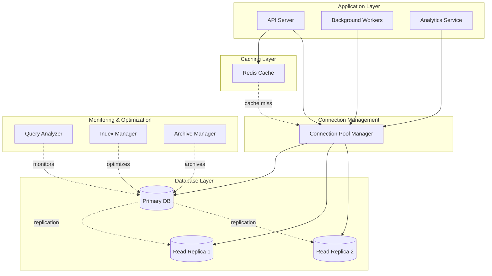
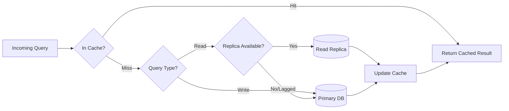
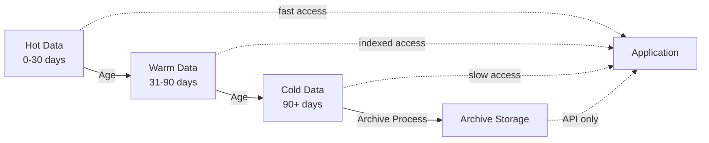

# Design Document: Database Optimization

## Overview

This design document outlines the database optimization strategy for PricePilot, a multi-tenant SaaS platform handling large volumes of e-commerce price intelligence data. The optimization focuses on five key areas: query performance monitoring, strategic indexing, connection pooling, intelligent caching, and data lifecycle management.

The solution implements a comprehensive approach to database performance that includes:
- Real-time slow query detection and analysis
- Automated index management and optimization
- Efficient connection pooling with health monitoring
- Multi-layer caching strategy using Redis
- Automated data archival for historical records
- Read replica configuration for load distribution
- Performance benchmarking and regression detection

This design ensures the database can scale efficiently as the platform grows while maintaining sub-second response times for critical user operations.

## Architecture

### High-Level Architecture



### Query Routing Strategy



### Data Lifecycle Flow



## Components and Interfaces

### 1. Query Analyzer Component

**Purpose:** Monitors query performance and identifies optimization opportunities.

**Interface:**
```typescript
interface QueryAnalyzer {
  // Monitor and log slow queries
  logSlowQuery(query: SlowQueryData): Promise<void>;
  
  // Get top slow queries
  getTopSlowQueries(limit: number, timeRange: TimeRange): Promise<SlowQuery[]>;
  
  // Analyze query execution plan
  analyzeQueryPlan(query: string, params: any[]): Promise<QueryPlan>;
  
  // Generate optimization recommendations
  generateRecommendations(query: string): Promise<Recommendation[]>;
  
  // Get query performance trends
  getPerformanceTrends(timeRange: TimeRange): Promise<PerformanceTrend[]>;
}

interface SlowQueryData {
  query: string;
  params: any[];
  executionTime: number;
  affectedRows: number;
  tenantId: string;
  timestamp: Date;
  executionPlan: string;
}

interface SlowQuery {
  query: string;
  avgExecutionTime: number;
  maxExecutionTime: number;
  executionCount: number;
  lastExecuted: Date;
}

interface QueryPlan {
  planText: string;
  estimatedCost: number;
  actualCost: number;
  indexesUsed: string[];
  sequentialScans: boolean;
}

interface Recommendation {
  type: 'index' | 'rewrite' | 'partition' | 'cache';
  description: string;
  estimatedImprovement: string;
  implementation: string;
}
```

**Implementation Details:**
- Uses PostgreSQL's `pg_stat_statements` extension for query statistics
- Captures EXPLAIN ANALYZE output for slow queries
- Stores slow query logs in a dedicated `slow_queries` table
- Aggregates metrics daily for trend analysis
- Implements query fingerprinting to group similar queries

### 2. Index Manager Component

**Purpose:** Manages database indexes for optimal query performance.

**Interface:**
```typescript
interface IndexManager {
  // Analyze and suggest missing indexes
  suggestIndexes(): Promise<IndexSuggestion[]>;
  
  // Identify unused indexes
  findUnusedIndexes(minDaysSinceUse: number): Promise<UnusedIndex[]>;
  
  // Create index concurrently
  createIndexConcurrently(indexDef: IndexDefinition): Promise<void>;
  
  // Rebuild fragmented indexes
  rebuildFragmentedIndexes(fragmentationThreshold: number): Promise<void>;
  
  // Get index usage statistics
  getIndexStats(): Promise<IndexStats[]>;
}

interface IndexSuggestion {
  tableName: string;
  columns: string[];
  reason: string;
  estimatedImpact: 'high' | 'medium' | 'low';
  createStatement: string;
}

interface UnusedIndex {
  indexName: string;
  tableName: string;
  sizeBytes: number;
  lastUsed: Date | null;
  dropStatement: string;
}

interface IndexDefinition {
  name: string;
  tableName: string;
  columns: string[];
  unique: boolean;
  where?: string;
}

interface IndexStats {
  indexName: string;
  tableName: string;
  sizeBytes: number;
  scans: number;
  tuplesRead: number;
  tuplesReturned: number;
  fragmentation: number;
}
```

**Implementation Details:**
- Analyzes query patterns from `pg_stat_statements`
- Uses `pg_stat_user_indexes` for index usage statistics
- Implements concurrent index creation to avoid blocking
- Monitors index bloat using `pgstattuple` extension
- Schedules maintenance during configured windows

### 3. Connection Pool Manager

**Purpose:** Manages database connections efficiently across the application.

**Interface:**
```typescript
interface ConnectionPoolManager {
  // Get connection pool instance
  getPool(): Pool;
  
  // Get pool statistics
  getPoolStats(): PoolStats;
  
  // Health check
  healthCheck(): Promise<HealthStatus>;
  
  // Drain pool for shutdown
  drain(): Promise<void>;
}

interface PoolStats {
  totalConnections: number;
  idleConnections: number;
  activeConnections: number;
  waitingRequests: number;
  utilizationPercent: number;
}

interface HealthStatus {
  healthy: boolean;
  primaryReachable: boolean;
  replicasReachable: number;
  avgResponseTime: number;
}

interface PoolConfig {
  min: number;
  max: number;
  idleTimeoutMillis: number;
  connectionTimeoutMillis: number;
  maxLifetimeMillis: number;
  healthCheckIntervalMillis: number;
}
```

**Implementation Details:**
- Uses `pg-pool` library with custom configuration
- Implements connection health checks via `SELECT 1` queries
- Monitors pool metrics and logs warnings at 80% utilization
- Implements exponential backoff for connection failures
- Supports graceful shutdown with connection draining

### 4. Cache Layer Component

**Purpose:** Implements multi-layer caching strategy to reduce database load.

**Interface:**
```typescript
interface CacheLayer {
  // Get cached value
  get<T>(key: string): Promise<T | null>;
  
  // Set cached value with TTL
  set<T>(key: string, value: T, ttlSeconds: number): Promise<void>;
  
  // Invalidate cache entries
  invalidate(pattern: string): Promise<number>;
  
  // Warm cache with frequently accessed data
  warmCache(tenantId: string): Promise<void>;
  
  // Get cache statistics
  getCacheStats(): Promise<CacheStats>;
}

interface CacheStats {
  hitRate: number;
  missRate: number;
  totalKeys: number;
  memoryUsedBytes: number;
  evictions: number;
}

interface CacheKey {
  // Generate cache key for product comparison
  productComparison(tenantId: string, filters: any): string;
  
  // Generate cache key for competitor products
  competitorProducts(competitorId: string): string;
  
  // Generate cache key for price history
  priceHistory(productId: string, range: TimeRange): string;
}
```

**Implementation Details:**
- Uses Redis as the caching backend
- Implements cache key namespacing by tenant
- Uses Redis pub/sub for cache invalidation across instances
- Implements cache warming during off-peak hours (2-4 AM UTC)
- Monitors cache hit rates and alerts when below 60%
- Uses Redis TTL for automatic expiration

### 5. Archive Manager Component

**Purpose:** Manages data lifecycle and archival of historical records.

**Interface:**
```typescript
interface ArchiveManager {
  // Archive old price history records
  archivePriceHistory(olderThanDays: number): Promise<ArchiveResult>;
  
  // Archive old audit logs
  archiveAuditLogs(olderThanDays: number): Promise<ArchiveResult>;
  
  // Query archived data
  queryArchive(table: string, filters: any): Promise<any[]>;
  
  // Get archive statistics
  getArchiveStats(): Promise<ArchiveStats>;
  
  // Schedule archival job
  scheduleArchival(config: ArchivalConfig): Promise<void>;
}

interface ArchiveResult {
  recordsArchived: number;
  recordsDeleted: number;
  durationMs: number;
  spaceFreedBytes: number;
}

interface ArchiveStats {
  priceHistoryArchived: number;
  auditLogsArchived: number;
  totalArchiveSizeBytes: number;
  oldestArchivedRecord: Date;
}

interface ArchivalConfig {
  table: string;
  retentionDays: number;
  scheduleTime: string; // Cron expression
  compressionEnabled: boolean;
}
```

**Implementation Details:**
- Creates separate archive tables with `_archive` suffix
- Uses partitioning for archive tables by year/month
- Implements batch archival (10,000 records per transaction)
- Compresses archived data using PostgreSQL's TOAST compression
- Maintains foreign key relationships in archive tables
- Runs during maintenance windows (2-4 AM UTC)
- Provides read-only API access to archived data

### 6. Read Replica Router

**Purpose:** Routes read queries to replicas and monitors replication health.

**Interface:**
```typescript
interface ReadReplicaRouter {
  // Route query to appropriate database
  route(query: Query): Promise<Connection>;
  
  // Check replication lag
  checkReplicationLag(): Promise<ReplicationStatus[]>;
  
  // Mark replica as unhealthy
  markUnhealthy(replicaId: string): Promise<void>;
  
  // Get routing statistics
  getRoutingStats(): Promise<RoutingStats>;
}

interface Query {
  sql: string;
  params: any[];
  type: 'read' | 'write';
  tenantId: string;
}

interface ReplicationStatus {
  replicaId: string;
  lagSeconds: number;
  healthy: boolean;
  lastCheck: Date;
}

interface RoutingStats {
  primaryQueries: number;
  replicaQueries: number;
  failoverCount: number;
  avgReplicationLag: number;
}
```

**Implementation Details:**
- Automatically detects query type (SELECT vs INSERT/UPDATE/DELETE)
- Routes all writes to primary database
- Routes reads to least-lagged healthy replica
- Monitors replication lag using `pg_stat_replication`
- Fails over to primary when lag exceeds 30 seconds
- Implements circuit breaker pattern for unhealthy replicas

## Data Models

### Slow Query Log Table

```sql
CREATE TABLE slow_queries (
  id SERIAL PRIMARY KEY,
  query_fingerprint TEXT NOT NULL,
  query_text TEXT NOT NULL,
  execution_time_ms INTEGER NOT NULL,
  affected_rows INTEGER,
  tenant_id VARCHAR(255),
  execution_plan TEXT,
  params JSONB,
  created_at TIMESTAMP DEFAULT NOW()
);

CREATE INDEX idx_slow_queries_fingerprint ON slow_queries(query_fingerprint);
CREATE INDEX idx_slow_queries_execution_time ON slow_queries(execution_time_ms DESC);
CREATE INDEX idx_slow_queries_created_at ON slow_queries(created_at DESC);
```

### Query Performance Metrics Table

```sql
CREATE TABLE query_performance_metrics (
  id SERIAL PRIMARY KEY,
  query_fingerprint TEXT NOT NULL,
  date DATE NOT NULL,
  execution_count INTEGER NOT NULL,
  avg_execution_time_ms NUMERIC(10, 2) NOT NULL,
  max_execution_time_ms INTEGER NOT NULL,
  min_execution_time_ms INTEGER NOT NULL,
  p95_execution_time_ms INTEGER NOT NULL,
  total_rows_affected BIGINT,
  created_at TIMESTAMP DEFAULT NOW(),
  UNIQUE(query_fingerprint, date)
);

CREATE INDEX idx_qpm_fingerprint_date ON query_performance_metrics(query_fingerprint, date DESC);
```

### Index Recommendations Table

```sql
CREATE TABLE index_recommendations (
  id SERIAL PRIMARY KEY,
  table_name VARCHAR(255) NOT NULL,
  columns TEXT[] NOT NULL,
  reason TEXT NOT NULL,
  estimated_impact VARCHAR(20) NOT NULL,
  create_statement TEXT NOT NULL,
  status VARCHAR(20) DEFAULT 'pending',
  created_at TIMESTAMP DEFAULT NOW(),
  applied_at TIMESTAMP
);

CREATE INDEX idx_index_recommendations_status ON index_recommendations(status);
```

### Archive Tables Structure

```sql
-- Price history archive (partitioned by year)
CREATE TABLE price_history_archive (
  id BIGINT PRIMARY KEY,
  tenant_id VARCHAR(255) NOT NULL,
  product_id VARCHAR(255) NOT NULL,
  product_type VARCHAR(50) NOT NULL,
  price NUMERIC(10, 2) NOT NULL,
  recorded_at TIMESTAMP NOT NULL,
  created_at TIMESTAMP NOT NULL,
  archived_at TIMESTAMP DEFAULT NOW()
) PARTITION BY RANGE (recorded_at);

-- Create partitions for each year
CREATE TABLE price_history_archive_2023 PARTITION OF price_history_archive
  FOR VALUES FROM ('2023-01-01') TO ('2024-01-01');

CREATE TABLE price_history_archive_2024 PARTITION OF price_history_archive
  FOR VALUES FROM ('2024-01-01') TO ('2025-01-01');

-- Audit logs archive (partitioned by year)
CREATE TABLE audit_logs_archive (
  id BIGINT PRIMARY KEY,
  tenant_id VARCHAR(255) NOT NULL,
  user_id VARCHAR(255),
  action VARCHAR(100) NOT NULL,
  entity_type VARCHAR(100) NOT NULL,
  entity_id VARCHAR(255),
  old_value JSONB,
  new_value JSONB,
  ip_address VARCHAR(45),
  user_agent TEXT,
  created_at TIMESTAMP NOT NULL,
  archived_at TIMESTAMP DEFAULT NOW()
) PARTITION BY RANGE (created_at);

CREATE INDEX idx_price_history_archive_tenant ON price_history_archive(tenant_id, recorded_at DESC);
CREATE INDEX idx_audit_logs_archive_tenant ON audit_logs_archive(tenant_id, created_at DESC);
```

### Enhanced Indexes for Existing Tables

```sql
-- User products optimizations
CREATE INDEX CONCURRENTLY idx_user_products_tenant_status_price 
  ON user_products(tenant_id, status, current_price) 
  WHERE status = 'active';

CREATE INDEX CONCURRENTLY idx_user_products_last_sync 
  ON user_products(tenant_id, last_sync_at DESC);

-- Competitor products optimizations
CREATE INDEX CONCURRENTLY idx_competitor_products_tenant_website_scraped 
  ON competitor_products(tenant_id, competitor_website_id, last_scraped_at DESC);

CREATE INDEX CONCURRENTLY idx_competitor_products_sku 
  ON competitor_products(tenant_id, sku) 
  WHERE sku IS NOT NULL;

-- Product matches optimizations
CREATE INDEX CONCURRENTLY idx_product_matches_user_product_active 
  ON product_matches(user_product_id, status) 
  WHERE status = 'active';

CREATE INDEX CONCURRENTLY idx_product_matches_competitor_product 
  ON product_matches(competitor_product_id, status) 
  WHERE status = 'active';

-- Price history optimizations
CREATE INDEX CONCURRENTLY idx_price_history_product_recorded 
  ON price_history(product_id, product_type, recorded_at DESC);

CREATE INDEX CONCURRENTLY idx_price_history_tenant_recorded 
  ON price_history(tenant_id, recorded_at DESC);

-- Audit logs optimizations
CREATE INDEX CONCURRENTLY idx_audit_logs_tenant_created 
  ON audit_logs(tenant_id, created_at DESC);

CREATE INDEX CONCURRENTLY idx_audit_logs_entity 
  ON audit_logs(tenant_id, entity_type, entity_id);

-- Price updates optimizations
CREATE INDEX CONCURRENTLY idx_price_updates_tenant_status_executed 
  ON price_updates(tenant_id, status, executed_at DESC);
```

### Materialized Views for Analytics

```sql
-- Daily price comparison summary
CREATE MATERIALIZED VIEW daily_price_comparison_summary AS
SELECT 
  up.tenant_id,
  up.id as user_product_id,
  up.name as product_name,
  up.current_price as user_price,
  COUNT(DISTINCT pm.competitor_product_id) as competitor_count,
  AVG(cp.current_price) as avg_competitor_price,
  MIN(cp.current_price) as min_competitor_price,
  MAX(cp.current_price) as max_competitor_price,
  CASE 
    WHEN MIN(cp.current_price) < up.current_price THEN 'RED'
    WHEN MIN(cp.current_price) > up.current_price THEN 'GREEN'
    ELSE 'NEUTRAL'
  END as price_status,
  NOW() as refreshed_at
FROM user_products up
JOIN product_matches pm ON pm.user_product_id = up.id AND pm.status = 'active'
JOIN competitor_products cp ON cp.id = pm.competitor_product_id
WHERE up.status = 'active'
GROUP BY up.tenant_id, up.id, up.name, up.current_price;

CREATE UNIQUE INDEX idx_dpcs_tenant_product ON daily_price_comparison_summary(tenant_id, user_product_id);
CREATE INDEX idx_dpcs_price_status ON daily_price_comparison_summary(tenant_id, price_status);

-- Refresh schedule: every 15 minutes
-- Implemented via cron job or pg_cron extension
```

## Correctness Properties

*A property is a characteristic or behavior that should hold true across all valid executions of a system—essentially, a formal statement about what the system should do. Properties serve as the bridge between human-readable specifications and machine-verifiable correctness guarantees.*


### Property 1: Complete Slow Query Logging

*For any* database query with execution time exceeding 1000ms, the Query_Analyzer should log the query with all required details including query text, execution plan, timing, parameters, affected rows, and execution context.

**Validates: Requirements 1.1, 1.2**

### Property 2: Optimization Recommendations Generation

*For any* slow query pattern detected by the system, at least one optimization recommendation should be generated with type, description, and implementation details.

**Validates: Requirements 1.4**

### Property 3: Daily Query Metrics Aggregation

*For any* query fingerprint, daily aggregations should correctly calculate execution count, average execution time, max/min times, and p95 from individual query logs.

**Validates: Requirements 1.5**

### Property 4: Missing Index Detection

*For any* query with sequential scans on tables exceeding 10,000 rows, the Index_Manager should generate index suggestions for the scanned columns.

**Validates: Requirements 2.2**

### Property 5: Unused Index Identification

*For any* database index with zero scans over a specified time period, the Index_Manager should flag it as unused with size and drop statement.

**Validates: Requirements 2.3**

### Property 6: Index Statistics Completeness

*For any* database index in the system, usage statistics should be maintained including scans, tuples read, size, and fragmentation percentage.

**Validates: Requirements 2.5**

### Property 7: Fragmented Index Scheduling

*For any* index with fragmentation exceeding 30%, the Index_Manager should schedule a rebuild operation during the next maintenance window.

**Validates: Requirements 2.6**

### Property 8: Connection Pool Boundaries

*For any* point in time, the connection pool should maintain between the configured minimum and maximum number of connections (inclusive).

**Validates: Requirements 3.1**

### Property 9: High Utilization Warnings

*For any* moment when connection pool utilization exceeds 80%, a warning should be logged with current connection metrics including total, active, idle, and waiting counts.

**Validates: Requirements 3.2**

### Property 10: Failed Connection Replacement

*For any* connection that fails health checks, the Connection_Pool should remove it from the pool and create a new connection to maintain pool size.

**Validates: Requirements 3.4**

### Property 11: Connection Lifetime Enforcement

*For any* connection exceeding the maximum lifetime threshold, the Connection_Pool should close and replace it with a new connection.

**Validates: Requirements 3.5**

### Property 12: Exponential Backoff Retry

*For any* failed connection attempt, retry delays should increase exponentially (e.g., 100ms, 200ms, 400ms, 800ms, 1600ms) and stop after the maximum retry count.

**Validates: Requirements 3.6**

### Property 13: Tenant-Specific Cache Keys

*For any* cached data, the cache key should include the tenant ID to ensure tenant isolation and prevent cross-tenant data leakage.

**Validates: Requirements 4.1**

### Property 14: Cache Invalidation on Updates

*For any* database update operation, all related cache entries should be invalidated to prevent serving stale data.

**Validates: Requirements 4.2, 4.3**

### Property 15: Cache Hit Rate Monitoring

*For any* time period, cache hit rate should be calculated as (hits / (hits + misses)) and warnings should be logged when the rate falls below 60%.

**Validates: Requirements 4.5**

### Property 16: Parameterized Query Usage

*For any* database query executed by the system, it should use parameterized queries (prepared statements) rather than string concatenation to prevent SQL injection and enable plan caching.

**Validates: Requirements 5.1**

### Property 17: Cursor Pagination for Large Tables

*For any* table with more than 10,000 rows, pagination queries should use cursor-based pagination (WHERE id > last_id) instead of offset-based pagination.

**Validates: Requirements 5.2**

### Property 18: Tenant ID Filtering

*For any* multi-tenant query, the WHERE clause should include tenantId as a filter condition to enforce tenant isolation.

**Validates: Requirements 5.4**

### Property 19: Age-Based Data Archival

*For any* archival operation, records older than the configured retention period (90 days for price_history, 365 days for audit_logs) should be moved to archive tables while preserving referential integrity.

**Validates: Requirements 6.1, 6.2, 6.3**

### Property 20: Bulk Operation Batching

*For any* bulk operation exceeding the batch size threshold, the operation should be split into chunks where each chunk size does not exceed the maximum (1000 for inserts, 10,000 for general operations).

**Validates: Requirements 7.1, 7.4**

### Property 21: Bulk Update Query Consolidation

*For any* bulk update operation on multiple records, a single UPDATE statement with WHERE IN clause should be generated instead of multiple individual UPDATE statements.

**Validates: Requirements 7.2**

### Property 22: Bulk Operation Transactions

*For any* bulk operation (insert, update, delete), all operations within a batch should be wrapped in a database transaction to ensure atomicity.

**Validates: Requirements 7.3**

### Property 23: COPY for Large Loads

*For any* initial data load exceeding 50,000 records, the system should use PostgreSQL COPY operations instead of INSERT statements.

**Validates: Requirements 7.5**

### Property 24: Table Bloat Monitoring

*For any* table with bloat exceeding 20%, a VACUUM FULL operation should be scheduled for the next maintenance window.

**Validates: Requirements 8.3**

### Property 25: Growth Rate Alerting

*For any* table or index with size growth exceeding 20% per week, an alert should be generated with current size, growth rate, and projected size.

**Validates: Requirements 8.4**

### Property 26: Statistics History Retention

*For any* database statistics collection, historical data should be retained for at least 90 days to support capacity planning and trend analysis.

**Validates: Requirements 8.5**

### Property 27: Query Type Routing

*For any* database query, SELECT queries should be routed to read replicas while INSERT, UPDATE, and DELETE queries should be routed to the primary database.

**Validates: Requirements 9.1, 9.2**

### Property 28: Replica Failover

*For any* read query when all replicas are unavailable or unhealthy, the query should be automatically routed to the primary database.

**Validates: Requirements 9.3**

### Property 29: Replication Lag Monitoring

*For any* read replica, replication lag should be monitored and warnings should be logged when lag exceeds 5 seconds.

**Validates: Requirements 9.4**

### Property 30: Lag-Based Routing

*For any* read replica with replication lag exceeding 30 seconds, read queries should be routed to the primary database until lag recovers below the threshold.

**Validates: Requirements 9.5**

### Property 31: Percentile Calculation Accuracy

*For any* set of query execution times, p50, p95, and p99 percentiles should be calculated correctly using appropriate statistical methods.

**Validates: Requirements 10.2**

### Property 32: Performance Regression Detection

*For any* critical query with an established baseline, performance degradation exceeding 20% should be detected and flagged as a regression.

**Validates: Requirements 10.4**

## Error Handling

### Query Analyzer Errors

**Slow Query Logging Failures:**
- If logging fails, capture error but don't block query execution
- Implement retry logic with exponential backoff
- Alert on persistent logging failures

**Query Plan Analysis Errors:**
- Handle EXPLAIN failures gracefully
- Log error and continue without execution plan
- Provide partial analysis when possible

### Index Manager Errors

**Index Creation Failures:**
- Detect and log index creation errors
- Rollback failed index creation attempts
- Notify administrators of persistent failures
- Implement retry logic for transient errors

**Index Analysis Errors:**
- Handle missing statistics gracefully
- Provide degraded recommendations when data incomplete
- Log analysis errors for investigation

### Connection Pool Errors

**Connection Failures:**
- Implement circuit breaker pattern
- Exponential backoff for reconnection attempts
- Failover to backup connection strings
- Alert on connection pool exhaustion

**Health Check Failures:**
- Mark connections as unhealthy
- Remove from pool immediately
- Create replacement connections
- Log health check failures

### Cache Layer Errors

**Redis Connection Failures:**
- Degrade gracefully to direct database access
- Log cache misses due to connection failures
- Implement connection retry logic
- Alert on persistent Redis unavailability

**Cache Invalidation Failures:**
- Log invalidation errors
- Implement retry logic
- Consider cache entry TTL as fallback
- Monitor invalidation failure rates

### Archive Manager Errors

**Archival Operation Failures:**
- Rollback partial archival on error
- Log detailed error information
- Retry failed archival in next window
- Alert on repeated failures

**Archive Query Errors:**
- Return appropriate error messages
- Log archive access failures
- Provide fallback to main tables if needed

### Read Replica Errors

**Replication Lag Errors:**
- Failover to primary when lag excessive
- Log replication issues
- Alert on persistent lag problems
- Monitor replica health continuously

**Replica Unavailability:**
- Automatic failover to primary
- Circuit breaker for unhealthy replicas
- Periodic health checks for recovery
- Load balancing across healthy replicas

## Testing Strategy

### Dual Testing Approach

This feature requires both unit tests and property-based tests to ensure comprehensive coverage:

**Unit Tests** focus on:
- Specific configuration values (connection pool min/max, TTL values)
- Error handling scenarios (connection failures, cache misses)
- Edge cases (empty result sets, null values)
- Integration points (Redis connection, PostgreSQL extensions)
- Specific examples (dashboard queries, archive operations)

**Property-Based Tests** focus on:
- Universal properties across all inputs (query logging, batching, routing)
- Randomized workloads (concurrent connections, varied query patterns)
- Data integrity (archival preservation, cache consistency)
- Performance characteristics (percentile calculations, growth monitoring)

### Property-Based Testing Configuration

**Testing Library:** Use `fast-check` for TypeScript/Node.js property-based testing

**Test Configuration:**
- Minimum 100 iterations per property test
- Each test tagged with feature name and property number
- Tag format: `Feature: database-optimization, Property N: [property description]`

**Example Property Test Structure:**
```typescript
import fc from 'fast-check';

describe('Database Optimization Properties', () => {
  it('Property 1: Complete Slow Query Logging', () => {
    // Feature: database-optimization, Property 1: Complete slow query logging
    fc.assert(
      fc.property(
        fc.record({
          query: fc.string(),
          executionTime: fc.integer({ min: 1001, max: 60000 }),
          params: fc.array(fc.anything()),
          affectedRows: fc.nat(),
        }),
        async (slowQuery) => {
          const logged = await queryAnalyzer.logSlowQuery(slowQuery);
          
          expect(logged).toHaveProperty('query');
          expect(logged).toHaveProperty('executionPlan');
          expect(logged).toHaveProperty('executionTime');
          expect(logged).toHaveProperty('params');
          expect(logged).toHaveProperty('affectedRows');
          expect(logged).toHaveProperty('timestamp');
        }
      ),
      { numRuns: 100 }
    );
  });
});
```

### Unit Testing Strategy

**Query Analyzer Tests:**
- Test slow query threshold detection
- Test query fingerprinting logic
- Test recommendation generation for known patterns
- Test dashboard query returns exactly 20 results
- Test trend aggregation calculations

**Index Manager Tests:**
- Test concurrent index creation SQL generation
- Test unused index detection logic
- Test fragmentation threshold detection
- Test index suggestion formatting

**Connection Pool Tests:**
- Test pool initialization with min/max bounds
- Test connection health check logic
- Test connection replacement on failure
- Test utilization warning threshold
- Test exponential backoff calculation

**Cache Layer Tests:**
- Test cache key generation with tenant ID
- Test TTL expiration behavior
- Test cache invalidation patterns
- Test cache warming function
- Test hit rate calculation

**Archive Manager Tests:**
- Test age-based record selection
- Test batch archival transaction handling
- Test referential integrity preservation
- Test archive table compression
- Test archive query API

**Read Replica Router Tests:**
- Test query type detection (SELECT vs write)
- Test replica selection logic
- Test failover on replica unavailability
- Test lag-based routing decisions
- Test replication lag monitoring

### Integration Testing

**Database Integration Tests:**
- Test actual PostgreSQL connection pooling
- Test real index creation and usage
- Test materialized view refresh
- Test archival operations on test data
- Test replication lag monitoring

**Cache Integration Tests:**
- Test Redis connection and operations
- Test cache invalidation across instances
- Test distributed caching behavior
- Test cache warming with real data

**Performance Testing:**
- Benchmark query performance before/after optimization
- Test concurrent connection handling (100+ connections)
- Test bulk operation performance
- Test cache hit rate under load
- Test replica routing under various lag scenarios

### Test Data Generation

**Generators for Property Tests:**
- Query generators (various SQL patterns)
- Connection state generators (healthy, unhealthy, lagged)
- Cache key generators (with tenant isolation)
- Bulk operation generators (various sizes)
- Time series data generators (for trends)

### Continuous Monitoring

**Production Metrics:**
- Query performance percentiles (p50, p95, p99)
- Connection pool utilization
- Cache hit rates
- Replication lag
- Archive operation success rates
- Index usage statistics

**Alerting Thresholds:**
- Query execution time > 5 seconds
- Connection pool utilization > 90%
- Cache hit rate < 50%
- Replication lag > 30 seconds
- Archive operation failures
- Rapid table growth (> 30% per week)
