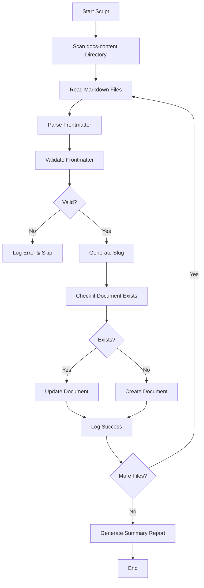
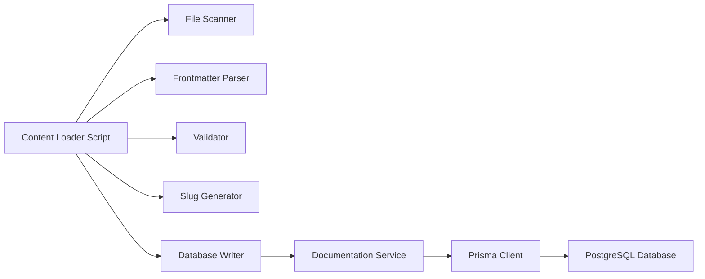

# Design Document: Documentation Content Population

## Overview

This feature implements a content loading system to populate PricePilot's documentation database from markdown files stored in the `docs-content` directory. The system will read markdown files with YAML frontmatter, validate their structure, and create or update database records using the existing `documentationService`.

### Goals

1. Populate the empty documentation database with comprehensive content
2. Enable users to access documentation at `/docs/getting-started` and other routes
3. Provide an idempotent, error-resilient loading mechanism
4. Support both tenant and admin documentation types
5. Enable easy content updates through re-running the script

### Non-Goals

1. Creating new documentation content (content already exists in `docs-content`)
2. Modifying the existing documentation service or database schema
3. Building a real-time file watcher for automatic updates
4. Implementing a web-based content management interface

## Architecture

### High-Level Flow



### Component Architecture



## Components and Interfaces

### 1. Content Loader Script (`scripts/seed-documentation.ts`)

Main entry point for the content loading system.

**Responsibilities:**
- Parse command-line arguments
- Orchestrate the loading process
- Generate summary reports
- Handle top-level error catching

**Interface:**
```typescript
interface LoaderOptions {
  dryRun: boolean;
  verify: boolean;
  verbose: boolean;
}

interface LoaderResult {
  totalFiles: number;
  created: number;
  updated: number;
  skipped: number;
  errors: LoaderError[];
  duration: number;
}

interface LoaderError {
  file: string;
  error: string;
  type: 'read' | 'parse' | 'validate' | 'database';
}
```

### 2. File Scanner

Recursively scans directories and collects markdown files.

**Responsibilities:**
- Traverse `docs-content/tenant` and `docs-content/admin` directories
- Filter for `.md` files
- Extract file metadata (path, type, category)

**Interface:**
```typescript
interface FileInfo {
  path: string;
  type: 'tenant' | 'admin';
  category: string;
  subcategory?: string;
  filename: string;
}

class FileScanner {
  async scanDirectory(basePath: string, type: 'tenant' | 'admin'): Promise<FileInfo[]>;
  private extractCategory(filePath: string): { category: string; subcategory?: string };
}
```

### 3. Frontmatter Parser

Parses YAML frontmatter from markdown files.

**Responsibilities:**
- Extract frontmatter from markdown content
- Parse YAML into JavaScript object
- Separate frontmatter from markdown content

**Interface:**
```typescript
interface ParsedDocument {
  frontmatter: DocumentFrontmatter;
  content: string;
}

interface DocumentFrontmatter {
  title: string;
  description?: string;
  category: string;
  subcategory?: string;
  tags: string[];
  author?: string;
  lastReviewed?: string;
  relatedDocs?: string[];
}

class FrontmatterParser {
  parse(fileContent: string): ParsedDocument;
}
```

### 4. Validator

Validates frontmatter structure and content.

**Responsibilities:**
- Validate required fields exist
- Validate field types
- Validate field values (e.g., date format)
- Return detailed validation errors

**Interface:**
```typescript
interface ValidationResult {
  isValid: boolean;
  errors: ValidationError[];
}

interface ValidationError {
  field: string;
  message: string;
}

class FrontmatterValidator {
  validate(frontmatter: DocumentFrontmatter, fileInfo: FileInfo): ValidationResult;
  private validateRequiredFields(frontmatter: DocumentFrontmatter): ValidationError[];
  private validateFieldTypes(frontmatter: DocumentFrontmatter): ValidationError[];
  private validateCategory(frontmatter: DocumentFrontmatter, fileInfo: FileInfo): ValidationError[];
}
```

### 5. Slug Generator

Generates URL-safe slugs from filenames.

**Responsibilities:**
- Convert filename to slug
- Ensure slug uniqueness
- Handle special characters

**Interface:**
```typescript
class SlugGenerator {
  generate(filename: string): string;
  private sanitize(slug: string): string;
}
```

### 6. Database Writer

Writes documents to the database using the documentation service.

**Responsibilities:**
- Check for existing documents
- Create or update documents
- Handle database errors
- Track created vs updated counts

**Interface:**
```typescript
interface WriteResult {
  action: 'created' | 'updated' | 'skipped';
  documentId?: string;
  error?: string;
}

class DatabaseWriter {
  constructor(private dryRun: boolean);
  
  async writeDocument(
    type: 'tenant' | 'admin',
    slug: string,
    frontmatter: DocumentFrontmatter,
    content: string,
    fileInfo: FileInfo
  ): Promise<WriteResult>;
  
  private async checkExists(type: 'tenant' | 'admin', slug: string): Promise<boolean>;
}
```

## Data Models

### Frontmatter Schema

```yaml
# Required fields
title: string          # Document title
category: string       # Must match directory name
tags: string[]         # Array of keywords
lastReviewed: string   # ISO date (YYYY-MM-DD)

# Optional fields
description: string    # Brief description
subcategory: string    # Optional subcategory
author: string         # Author name
relatedDocs: string[]  # Array of related document slugs
```

### Database Mapping

```typescript
// Frontmatter → DocumentationService.createDocument()
{
  slug: string,                    // Generated from filename
  title: frontmatter.title,
  content: string,                 // Markdown content
  category: frontmatter.category,
  subcategory: frontmatter.subcategory,
  metadata: {
    description: frontmatter.description,
    tags: frontmatter.tags,
    author: frontmatter.author,
    lastReviewed: new Date(frontmatter.lastReviewed),
    relatedDocs: frontmatter.relatedDocs || []
  }
}
```

## Error Handling

### Error Types

1. **File Read Errors**
   - File not found
   - Permission denied
   - Invalid encoding

2. **Parse Errors**
   - Invalid YAML syntax
   - Missing frontmatter delimiters
   - Malformed markdown

3. **Validation Errors**
   - Missing required fields
   - Invalid field types
   - Invalid date format
   - Category mismatch

4. **Database Errors**
   - Connection failures
   - Constraint violations
   - Timeout errors

### Error Handling Strategy

```typescript
// Continue processing on individual file errors
try {
  const result = await processFile(file);
  results.push(result);
} catch (error) {
  errors.push({
    file: file.path,
    error: error.message,
    type: categorizeError(error)
  });
  // Continue to next file
}

// Report all errors at the end
if (errors.length > 0) {
  console.error(`\n❌ Encountered ${errors.length} errors:`);
  errors.forEach(err => {
    console.error(`  ${err.file}: ${err.error}`);
  });
  process.exit(1);
}
```

## Testing Strategy

### Manual Testing Approach

Since this project follows a test-free development policy, validation will be performed through:

1. **Dry Run Testing**
   - Run script with `--dry-run` flag
   - Verify all files are detected
   - Check validation logic catches errors
   - Confirm no database modifications occur

2. **Incremental Loading**
   - Load a single category first
   - Verify documents appear in database
   - Check documents render correctly in UI
   - Confirm metadata is correct

3. **Full Load Testing**
   - Run complete load on development database
   - Verify all categories populated
   - Check document counts match file counts
   - Test idempotency by running twice

4. **Error Scenario Testing**
   - Test with invalid frontmatter
   - Test with missing required fields
   - Test with duplicate slugs
   - Verify error messages are helpful

5. **Verification Testing**
   - Run with `--verify` flag
   - Compare database content with source files
   - Check for missing or mismatched documents

### Validation Checklist

- [ ] All markdown files in `docs-content/tenant` are loaded
- [ ] All markdown files in `docs-content/admin` are loaded
- [ ] Documents accessible at `/docs/getting-started`
- [ ] Documents accessible at `/admin-docs/system-monitoring`
- [ ] Table of contents displays all categories
- [ ] Search functionality finds loaded documents
- [ ] Related documents links work correctly
- [ ] Running script twice doesn't create duplicates
- [ ] Invalid files are skipped with clear errors
- [ ] Summary report shows accurate counts

## Implementation Notes

### Dependencies

- **gray-matter**: YAML frontmatter parsing
- **fs/promises**: Async file operations
- **path**: Path manipulation
- **@/lib/documentation/service**: Existing documentation service
- **@/lib/prisma**: Database client

### File Structure

```
scripts/
  seed-documentation.ts          # Main script
  lib/
    documentation-loader/
      file-scanner.ts             # File scanning logic
      frontmatter-parser.ts       # Frontmatter parsing
      validator.ts                # Validation logic
      slug-generator.ts           # Slug generation
      database-writer.ts          # Database operations
      types.ts                    # Shared types
```

### Command-Line Interface

```bash
# Normal execution
npx tsx scripts/seed-documentation.ts

# Dry run (no database changes)
npx tsx scripts/seed-documentation.ts --dry-run

# Verification mode
npx tsx scripts/seed-documentation.ts --verify

# Verbose output
npx tsx scripts/seed-documentation.ts --verbose

# Combined flags
npx tsx scripts/seed-documentation.ts --dry-run --verbose
```

### Progress Output

```
📚 Documentation Content Loader
================================

Scanning directories...
  ✓ Found 45 files in docs-content/tenant
  ✓ Found 23 files in docs-content/admin

Processing tenant documentation...
  [1/45] getting-started/introduction.md ... ✓ created
  [2/45] getting-started/quick-start.md ... ✓ created
  [3/45] products/product-setup.md ... ✓ created
  ...

Processing admin documentation...
  [1/23] system-monitoring/health-checks.md ... ✓ created
  [2/23] tenant-management/tenant-operations.md ... ✓ created
  ...

Summary
=======
Total files: 68
Created: 68
Updated: 0
Skipped: 0
Errors: 0
Duration: 3.2s

✅ Documentation database populated successfully!
```

## Security Considerations

### Input Validation

- Validate all frontmatter fields before database insertion
- Sanitize markdown content (handled by existing markdown parser)
- Prevent path traversal attacks in file scanning
- Validate category names against whitelist

### Database Security

- Use existing documentation service (already implements security)
- No raw SQL queries
- Leverage Prisma's parameterized queries
- Respect tenant isolation (not applicable for documentation)

### Error Messages

- Don't expose sensitive file system paths in production
- Sanitize error messages before logging
- Don't include database connection details in errors

## Performance Considerations

### Optimization Strategies

1. **Batch Processing**
   - Process files in batches of 10
   - Avoid overwhelming database with concurrent writes

2. **Caching**
   - Cache parsed frontmatter during validation
   - Reuse slug generation results

3. **Database Queries**
   - Use single query to check existing documents
   - Batch document existence checks where possible

4. **File I/O**
   - Read files asynchronously
   - Use streaming for large files (if needed)

### Expected Performance

- **Small dataset** (< 100 files): < 5 seconds
- **Medium dataset** (100-500 files): < 30 seconds
- **Large dataset** (> 500 files): < 2 minutes

## Deployment

### Pre-Deployment

1. Backup production database
2. Test script on staging environment
3. Verify all markdown files have valid frontmatter
4. Run dry-run mode to preview changes

### Deployment Steps

1. Deploy code changes (if any)
2. Run script on production database
3. Verify documentation is accessible
4. Check for any errors in logs
5. Test key documentation pages

### Rollback Plan

If issues occur:
1. Restore database from backup
2. Investigate errors
3. Fix markdown files or script
4. Re-run on staging
5. Re-deploy to production

## Future Enhancements

### Potential Improvements

1. **Incremental Updates**
   - Only process files modified since last run
   - Track file modification timestamps

2. **Content Validation**
   - Validate internal links
   - Check for broken external links
   - Verify code block syntax

3. **Automated Scheduling**
   - Run script on a schedule (e.g., daily)
   - Automatically sync content changes

4. **Content Versioning**
   - Track content changes over time
   - Enable rollback to previous versions

5. **Multi-Language Support**
   - Support multiple language versions
   - Automatic translation integration


## Correctness Properties

*A property is a characteristic or behavior that should hold true across all valid executions of a system—essentially, a formal statement about what the system should do. Properties serve as the bridge between human-readable specifications and machine-verifiable correctness guarantees.*

### Property 1: Frontmatter Parsing Success

*For any* valid markdown file with YAML frontmatter, parsing should successfully extract both the frontmatter object and the markdown content without errors.

**Validates: Requirements 1.3, 1.4**

### Property 2: Document Creation Integration

*For any* valid parsed document, the Content_Loader should successfully call `documentationService.createDocument()` with correctly mapped fields from the frontmatter.

**Validates: Requirements 1.5, 1.6**

### Property 3: Error Resilience

*For any* set of files where some files have errors, the Content_Loader should continue processing all remaining files and not terminate early.

**Validates: Requirements 1.7, 7.4**

### Property 4: Required Field Validation

*For any* frontmatter object missing required fields (title, category, tags, lastReviewed), validation should fail and return appropriate error messages.

**Validates: Requirements 2.1**

### Property 5: Title Validation

*For any* frontmatter where the title field is empty, null, undefined, or not a string, validation should fail.

**Validates: Requirements 2.2**

### Property 6: Category Validation

*For any* frontmatter where the category field doesn't match the parent directory name, validation should fail.

**Validates: Requirements 2.3**

### Property 7: Tags Type Validation

*For any* frontmatter where the tags field is not an array, validation should fail.

**Validates: Requirements 2.4**

### Property 8: Date Format Validation

*For any* frontmatter where the lastReviewed field is not a valid ISO date string (YYYY-MM-DD), validation should fail.

**Validates: Requirements 2.5**

### Property 9: Validation Failure Handling

*For any* file with invalid frontmatter, the Content_Loader should skip the file, log a warning, and continue processing other files.

**Validates: Requirements 2.6**

### Property 10: Detailed Error Messages

*For any* validation failure, the error message should include the field name and the specific validation rule that failed.

**Validates: Requirements 2.7**

### Property 11: Slug Generation Format

*For any* markdown filename, the generated slug should have the `.md` extension removed and preserve kebab-case formatting.

**Validates: Requirements 3.1, 3.2, 3.3**

### Property 12: Slug Uniqueness

*For any* set of files within the same documentation type (tenant or admin), all generated slugs should be unique, and duplicate slugs should be detected and logged.

**Validates: Requirements 3.4, 3.5**

### Property 13: Category Extraction

*For any* file path in the docs-content directory, the category should be correctly extracted from the parent directory name.

**Validates: Requirements 4.1**

### Property 14: Subcategory Extraction

*For any* file in a nested directory structure, the subcategory should be correctly extracted from the directory hierarchy.

**Validates: Requirements 4.4, 4.5**

### Property 15: Idempotent Loading

*For any* document, running the loader twice should result in the document being created once and updated once, not created twice, and the document ID should remain unchanged.

**Validates: Requirements 5.1, 5.2, 5.3**

### Property 16: Action Logging

*For any* document processed, the log output should indicate whether the document was created or updated.

**Validates: Requirements 5.4**

### Property 17: Summary Accuracy

*For any* loader execution, the summary counts (created, updated, skipped, errors) should exactly match the actual number of operations performed.

**Validates: Requirements 5.5, 7.5**

### Property 18: Comprehensive Error Logging

*For any* error encountered (file read, parse, validation, database), the error log should contain both the filename and a descriptive error message.

**Validates: Requirements 7.1, 7.2, 7.3**

### Property 19: Error Exit Code

*For any* loader execution where errors occurred, the script should exit with a non-zero status code.

**Validates: Requirements 7.6**

### Property 20: Dry Run Database Isolation

*For any* loader execution with the `--dry-run` flag, no database modifications should occur, and the database state should be identical before and after execution.

**Validates: Requirements 8.1**

### Property 21: Dry Run Logging Completeness

*For any* loader execution in dry-run mode, all documents that would be created or updated should be logged.

**Validates: Requirements 8.2**

### Property 22: Dry Run Validation

*For any* loader execution in dry-run mode, all frontmatter validation should still execute and report errors.

**Validates: Requirements 8.3, 8.4**

### Property 23: Progress Logging Frequency

*For any* loader execution processing multiple files, progress should be logged at regular intervals (e.g., every 10 files or every 10%).

**Validates: Requirements 9.2**

### Property 24: Progress Percentage Accuracy

*For any* progress indicator displayed, the percentage should accurately reflect the number of files processed divided by the total number of files.

**Validates: Requirements 9.3**

### Property 25: Per-File Logging

*For any* file being processed, the filename should appear in the log output.

**Validates: Requirements 9.4**

### Property 26: Verification Mode Completeness

*For any* loader execution in verification mode, all documents in the database should be queried and compared against source files.

**Validates: Requirements 10.2, 10.3**

### Property 27: Missing Document Detection

*For any* source file that exists but has no corresponding database record, verification mode should report it as missing.

**Validates: Requirements 10.4**

### Property 28: Content Mismatch Detection

*For any* database document whose content differs from its source file, verification mode should report it as mismatched.

**Validates: Requirements 10.5**
