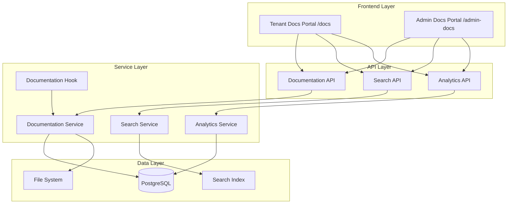

# Design Document: Dual Documentation System

## Overview

The dual documentation system provides separate, role-appropriate documentation portals for PricePilot tenants and system administrators. The system consists of two Next.js-based documentation portals with distinct content, access controls, and search capabilities, along with an automated documentation maintenance system that keeps content synchronized with code changes.

### Key Design Goals

1. **Clear Separation**: Distinct portals with appropriate content for each user type
2. **Automated Maintenance**: Documentation updates triggered by code changes
3. **Excellent UX**: Clean, searchable, responsive documentation following project UI principles
4. **Content Migration**: Seamless reorganization of existing documentation
5. **Analytics & Insights**: Understanding how users interact with documentation

## Architecture

### High-Level Architecture



### Technology Stack

- **Frontend**: Next.js 14 with App Router
- **Styling**: Tailwind CSS (matching existing PricePilot design system)
- **Markdown Processing**: unified, remark, rehype ecosystem
- **Search**: PostgreSQL full-text search with pg_trgm extension
- **Syntax Highlighting**: Shiki
- **Diagrams**: Mermaid
- **Authentication**: Existing PricePilot auth system
- **Storage**: PostgreSQL for metadata, file system for content

### Directory Structure

```
/docs-content/
  /tenant/
    /getting-started/
      introduction.md
      quick-start.md
    /products/
      product-setup.md
      product-matching.md
    /competitors/
      adding-competitors.md
      scraping-configuration.md
    /pricing/
      price-updates.md
      update-strategies.md
    /integrations/
      opencart-setup.md
      laravel-setup.md
    /troubleshooting/
      common-issues.md
      faq.md
  /admin/
    /system-monitoring/
      health-checks.md
      performance-metrics.md
    /tenant-management/
      tenant-operations.md
      user-management.md
    /database/
      schema-management.md
      backup-restore.md
    /security/
      authentication-config.md
      api-security.md
    /performance/
      optimization-guide.md
      caching-strategies.md
    /alerting/
      alert-configuration.md
      incident-response.md

/src/app/
  /docs/
    page.tsx
    layout.tsx
    /[...slug]/
      page.tsx
  /admin-docs/
    page.tsx
    layout.tsx
    /[...slug]/
      page.tsx
  /api/
    /documentation/
      /[type]/
        /[slug]/
          route.ts
      /search/
        route.ts
      /analytics/
        route.ts

/src/lib/
  /documentation/
    service.ts
    parser.ts
    search.ts
    analytics.ts
    hook.ts
```

## Components and Interfaces

### 1. Documentation Service

**Responsibilities:**
- Load and parse Markdown documentation files
- Manage documentation metadata
- Handle version history
- Process content updates

**Interface:**

```typescript
interface DocumentationService {
  // Content retrieval
  getDocument(type: 'tenant' | 'admin', slug: string): Promise<Document>;
  listDocuments(type: 'tenant' | 'admin', category?: string): Promise<DocumentMetadata[]>;
  getDocumentHistory(documentId: string): Promise<DocumentVersion[]>;
  
  // Content management
  createDocument(type: 'tenant' | 'admin', data: CreateDocumentInput): Promise<Document>;
  updateDocument(documentId: string, content: string, userId: string): Promise<Document>;
  revertDocument(documentId: string, versionId: string, userId: string): Promise<Document>;
  
  // Navigation
  getTableOfContents(type: 'tenant' | 'admin'): Promise<TOCNode[]>;
  getBreadcrumbs(type: 'tenant' | 'admin', slug: string): Promise<Breadcrumb[]>;
  
  // Migration
  migrateExistingDocs(): Promise<MigrationReport>;
  classifyDocument(content: string): Promise<'tenant' | 'admin' | 'both'>;
}

interface Document {
  id: string;
  type: 'tenant' | 'admin';
  slug: string;
  title: string;
  content: string; // Raw Markdown
  htmlContent: string; // Processed HTML
  category: string;
  subcategory?: string;
  metadata: DocumentMetadata;
  createdAt: Date;
  updatedAt: Date;
  updatedBy: string;
}

interface DocumentMetadata {
  description?: string;
  tags: string[];
  author?: string;
  lastReviewed?: Date;
  relatedDocs: string[];
}

interface DocumentVersion {
  id: string;
  documentId: string;
  content: string;
  changeDescription: string;
  createdBy: string;
  createdAt: Date;
}

interface TOCNode {
  title: string;
  slug: string;
  children?: TOCNode[];
  order: number;
}

interface Breadcrumb {
  title: string;
  slug: string;
}

interface MigrationReport {
  totalDocuments: number;
  tenantDocs: number;
  adminDocs: number;
  splitDocs: number;
  redirectsCreated: number;
  errors: string[];
}
```

### 2. Search Service

**Responsibilities:**
- Index documentation content
- Execute search queries
- Rank and filter results
- Maintain search index

**Interface:**

```typescript
interface SearchService {
  // Indexing
  indexDocument(document: Document): Promise<void>;
  reindexAll(type: 'tenant' | 'admin'): Promise<void>;
  removeFromIndex(documentId: string): Promise<void>;
  
  // Searching
  search(query: string, type: 'tenant' | 'admin', options?: SearchOptions): Promise<SearchResults>;
  suggest(query: string, type: 'tenant' | 'admin'): Promise<string[]>;
  
  // Analytics
  recordSearch(query: string, type: 'tenant' | 'admin', resultsCount: number): Promise<void>;
}

interface SearchOptions {
  category?: string;
  tags?: string[];
  limit?: number;
  offset?: number;
}

interface SearchResults {
  query: string;
  results: SearchResult[];
  total: number;
  suggestions?: string[];
}

interface SearchResult {
  documentId: string;
  title: string;
  slug: string;
  excerpt: string;
  breadcrumbs: Breadcrumb[];
  relevanceScore: number;
  matchedTerms: string[];
}
```

### 3. Documentation Hook

**Responsibilities:**
- Monitor task completion events
- Analyze changes for documentation impact
- Generate documentation update suggestions
- Determine appropriate documentation type

**Interface:**

```typescript
interface DocumentationHook {
  // Event handling
  onTaskCompleted(task: Task): Promise<void>;
  onCodeChanged(changes: CodeChange[]): Promise<void>;
  
  // Analysis
  analyzeDocumentationImpact(task: Task): Promise<DocumentationImpact>;
  classifyDocumentationType(task: Task): Promise<'tenant' | 'admin' | 'both'>;
  
  // Suggestion generation
  generateUpdateSuggestion(impact: DocumentationImpact): Promise<DocumentationSuggestion>;
  findAffectedDocuments(impact: DocumentationImpact): Promise<Document[]>;
}

interface Task {
  id: string;
  title: string;
  description: string;
  category: string;
  completedAt: Date;
  completedBy: string;
}

interface CodeChange {
  file: string;
  type: 'added' | 'modified' | 'deleted';
  diff: string;
}

interface DocumentationImpact {
  hasImpact: boolean;
  impactType: 'feature' | 'bugfix' | 'configuration' | 'api' | 'ui';
  affectedAreas: string[];
  suggestedUpdates: string[];
  targetAudience: 'tenant' | 'admin' | 'both';
}

interface DocumentationSuggestion {
  id: string;
  documentId?: string; // null if new document needed
  suggestedTitle?: string;
  suggestedContent: string;
  targetType: 'tenant' | 'admin';
  category: string;
  status: 'pending' | 'approved' | 'rejected';
  createdAt: Date;
  reviewedBy?: string;
  reviewedAt?: Date;
}
```

### 4. Analytics Service

**Responsibilities:**
- Track page views
- Record search queries
- Aggregate usage metrics
- Generate analytics reports

**Interface:**

```typescript
interface AnalyticsService {
  // Event tracking
  trackPageView(documentId: string, type: 'tenant' | 'admin', userId?: string): Promise<void>;
  trackSearch(query: string, type: 'tenant' | 'admin', resultsCount: number): Promise<void>;
  trackFeedback(documentId: string, rating: number, comment?: string, userId?: string): Promise<void>;
  
  // Metrics retrieval
  getPopularPages(type: 'tenant' | 'admin', timeRange: TimeRange): Promise<PageMetric[]>;
  getSearchMetrics(type: 'tenant' | 'admin', timeRange: TimeRange): Promise<SearchMetric[]>;
  getBounceRates(type: 'tenant' | 'admin', timeRange: TimeRange): Promise<BounceRateMetric[]>;
  getRelatedPages(documentId: string): Promise<RelatedPageMetric[]>;
  getFeedbackSummary(documentId: string): Promise<FeedbackSummary>;
}

interface TimeRange {
  start: Date;
  end: Date;
}

interface PageMetric {
  documentId: string;
  title: string;
  slug: string;
  views: number;
  uniqueVisitors: number;
  avgTimeOnPage: number;
}

interface SearchMetric {
  query: string;
  searchCount: number;
  avgResultsCount: number;
  clickThroughRate: number;
}

interface BounceRateMetric {
  documentId: string;
  title: string;
  bounceRate: number;
  views: number;
}

interface RelatedPageMetric {
  documentId: string;
  title: string;
  coOccurrenceCount: number;
}

interface FeedbackSummary {
  documentId: string;
  averageRating: number;
  totalFeedback: number;
  ratingDistribution: Record<number, number>;
  recentComments: FeedbackComment[];
}

interface FeedbackComment {
  rating: number;
  comment: string;
  createdAt: Date;
}
```

### 5. Frontend Components

**Key React Components:**

```typescript
// Documentation Portal Layout
interface DocsLayoutProps {
  type: 'tenant' | 'admin';
  children: React.ReactNode;
}

// Navigation Sidebar
interface DocsSidebarProps {
  toc: TOCNode[];
  currentSlug: string;
  type: 'tenant' | 'admin';
}

// Document Page
interface DocumentPageProps {
  document: Document;
  breadcrumbs: Breadcrumb[];
  relatedDocs: Document[];
}

// Search Component
interface DocsSearchProps {
  type: 'tenant' | 'admin';
  onSearch: (query: string) => void;
}

// Code Block with Copy Button
interface CodeBlockProps {
  code: string;
  language: string;
  filename?: string;
}

// Feedback Widget
interface FeedbackWidgetProps {
  documentId: string;
  onSubmit: (rating: number, comment?: string) => void;
}

// Version History Viewer
interface VersionHistoryProps {
  documentId: string;
  versions: DocumentVersion[];
  onRevert: (versionId: string) => void;
}
```

## Data Models

### Database Schema

```sql
-- Documentation documents
CREATE TABLE documentation_documents (
  id UUID PRIMARY KEY DEFAULT gen_random_uuid(),
  type VARCHAR(10) NOT NULL CHECK (type IN ('tenant', 'admin')),
  slug VARCHAR(255) NOT NULL,
  title VARCHAR(500) NOT NULL,
  content TEXT NOT NULL,
  html_content TEXT NOT NULL,
  category VARCHAR(100) NOT NULL,
  subcategory VARCHAR(100),
  metadata JSONB DEFAULT '{}',
  created_at TIMESTAMP NOT NULL DEFAULT NOW(),
  updated_at TIMESTAMP NOT NULL DEFAULT NOW(),
  updated_by UUID REFERENCES users(id),
  UNIQUE(type, slug)
);

CREATE INDEX idx_docs_type_category ON documentation_documents(type, category);
CREATE INDEX idx_docs_slug ON documentation_documents(slug);
CREATE INDEX idx_docs_updated_at ON documentation_documents(updated_at DESC);

-- Full-text search index
CREATE INDEX idx_docs_search ON documentation_documents 
  USING GIN(to_tsvector('english', title || ' ' || content));

-- Document versions
CREATE TABLE documentation_versions (
  id UUID PRIMARY KEY DEFAULT gen_random_uuid(),
  document_id UUID NOT NULL REFERENCES documentation_documents(id) ON DELETE CASCADE,
  content TEXT NOT NULL,
  change_description TEXT,
  created_by UUID NOT NULL REFERENCES users(id),
  created_at TIMESTAMP NOT NULL DEFAULT NOW()
);

CREATE INDEX idx_versions_document ON documentation_versions(document_id, created_at DESC);

-- Documentation suggestions (from automation hook)
CREATE TABLE documentation_suggestions (
  id UUID PRIMARY KEY DEFAULT gen_random_uuid(),
  document_id UUID REFERENCES documentation_documents(id),
  suggested_title VARCHAR(500),
  suggested_content TEXT NOT NULL,
  target_type VARCHAR(10) NOT NULL CHECK (target_type IN ('tenant', 'admin')),
  category VARCHAR(100) NOT NULL,
  status VARCHAR(20) NOT NULL DEFAULT 'pending' CHECK (status IN ('pending', 'approved', 'rejected')),
  task_id VARCHAR(255),
  created_at TIMESTAMP NOT NULL DEFAULT NOW(),
  reviewed_by UUID REFERENCES users(id),
  reviewed_at TIMESTAMP
);

CREATE INDEX idx_suggestions_status ON documentation_suggestions(status, created_at DESC);

-- Page view analytics
CREATE TABLE documentation_page_views (
  id UUID PRIMARY KEY DEFAULT gen_random_uuid(),
  document_id UUID NOT NULL REFERENCES documentation_documents(id) ON DELETE CASCADE,
  type VARCHAR(10) NOT NULL,
  user_id UUID REFERENCES users(id),
  session_id VARCHAR(255),
  viewed_at TIMESTAMP NOT NULL DEFAULT NOW(),
  time_on_page INTEGER -- seconds
);

CREATE INDEX idx_page_views_document ON documentation_page_views(document_id, viewed_at DESC);
CREATE INDEX idx_page_views_type_date ON documentation_page_views(type, viewed_at DESC);

-- Search analytics
CREATE TABLE documentation_searches (
  id UUID PRIMARY KEY DEFAULT gen_random_uuid(),
  query TEXT NOT NULL,
  type VARCHAR(10) NOT NULL,
  results_count INTEGER NOT NULL,
  clicked_result_id UUID REFERENCES documentation_documents(id),
  searched_at TIMESTAMP NOT NULL DEFAULT NOW()
);

CREATE INDEX idx_searches_type_date ON documentation_searches(type, searched_at DESC);
CREATE INDEX idx_searches_query ON documentation_searches(query);

-- User feedback
CREATE TABLE documentation_feedback (
  id UUID PRIMARY KEY DEFAULT gen_random_uuid(),
  document_id UUID NOT NULL REFERENCES documentation_documents(id) ON DELETE CASCADE,
  rating INTEGER NOT NULL CHECK (rating >= 1 AND rating <= 5),
  comment TEXT,
  user_id UUID REFERENCES users(id),
  created_at TIMESTAMP NOT NULL DEFAULT NOW()
);

CREATE INDEX idx_feedback_document ON documentation_feedback(document_id, created_at DESC);

-- URL redirects (for migration)
CREATE TABLE documentation_redirects (
  id UUID PRIMARY KEY DEFAULT gen_random_uuid(),
  old_path VARCHAR(500) NOT NULL UNIQUE,
  new_path VARCHAR(500) NOT NULL,
  created_at TIMESTAMP NOT NULL DEFAULT NOW()
);

CREATE INDEX idx_redirects_old_path ON documentation_redirects(old_path);
```

### File System Structure

Documentation content is stored as Markdown files with frontmatter:

```markdown
---
title: "Getting Started with PricePilot"
description: "Learn how to set up your first product and competitor tracking"
category: "getting-started"
subcategory: null
tags: ["beginner", "setup", "tutorial"]
author: "PricePilot Team"
lastReviewed: "2024-01-15"
relatedDocs: ["product-setup", "competitor-tracking"]
---

# Getting Started with PricePilot

Your documentation content here...
```

## Correctness Properties

*A property is a characteristic or behavior that should hold true across all valid executions of a system—essentially, a formal statement about what the system should do. Properties serve as the bridge between human-readable specifications and machine-verifiable correctness guarantees.*


### Property Reflection

After analyzing all acceptance criteria, I've identified the following redundancies:

**Redundant Properties:**
- 4.1 is identical to 1.4 (tenant search isolation)
- 4.2 is identical to 2.6 (admin search isolation)

**Combined Properties:**
- Properties about authentication/authorization (1.6, 2.2, 2.3, 10.2, 10.3) can be consolidated into comprehensive access control properties
- Properties about rendering elements (1.7, 4.4, 8.4, 8.5) can be combined into a single property about required UI elements
- Properties about version tracking (7.1, 7.2, 7.6) can be combined into a comprehensive versioning property

After reflection, the following properties provide unique validation value:

### Property 1: Documentation Type Isolation in Search

*For any* search query in the tenant portal, all returned results should be from tenant documentation only, and *for any* search query in the admin portal, all returned results should be from admin documentation only.

**Validates: Requirements 1.4, 2.6, 4.1, 4.2**

### Property 2: Access Control for Admin Documentation

*For any* admin documentation route, unauthenticated requests should redirect to login, authenticated non-admin requests should return 403 Forbidden, and authenticated admin requests should succeed.

**Validates: Requirements 2.2, 2.3, 10.3**

### Property 3: Tenant Documentation Public Access

*For any* tenant documentation route, unauthenticated requests should succeed and return valid content.

**Validates: Requirements 1.6, 10.2**

### Property 4: Required UI Elements in Documentation Pages

*For any* rendered documentation page, the output should include navigation breadcrumbs, table of contents, code block copy buttons (if code blocks present), and a feedback widget.

**Validates: Requirements 1.7, 4.4, 8.4, 8.5**

### Property 5: Documentation Organization by Categories

*For any* documentation portal (tenant or admin), the displayed content should be organized into hierarchical categories with proper nesting.

**Validates: Requirements 1.2, 2.4, 3.7**

### Property 6: File System Organization

*For any* documentation file in the system, it should be stored in the correct directory corresponding to its type (tenant or admin).

**Validates: Requirements 3.1, 3.2**

### Property 7: Markdown Processing

*For any* valid Markdown content, the system should successfully parse it and generate HTML output.

**Validates: Requirements 3.3**

### Property 8: Syntax Highlighting for Code Blocks

*For any* code block in documentation content, the rendered output should include syntax highlighting appropriate to the specified language.

**Validates: Requirements 3.4**

### Property 9: Mermaid Diagram Support

*For any* valid Mermaid diagram syntax in documentation, the system should render it as a visual diagram.

**Validates: Requirements 3.5**

### Property 10: Internal Link Validation

*For any* internal link in documentation content, the system should validate that the target document exists and the link is not broken.

**Validates: Requirements 3.6, 6.7**

### Property 11: Search Result Ranking

*For any* search query, results with title matches should rank higher than results with only content matches, and results with heading matches should rank between title and content matches.

**Validates: Requirements 4.3**

### Property 12: Search Index Synchronization

*For any* documentation content modification, the search index should update to reflect the changes within a reasonable time period.

**Validates: Requirements 4.5**

### Property 13: Documentation Hook Triggering

*For any* completed task, the documentation hook should trigger and analyze whether the task has documentation impact.

**Validates: Requirements 5.1**

### Property 14: Documentation Suggestion Generation

*For any* task with documentation impact, the system should generate a documentation suggestion with appropriate classification (tenant/admin/both).

**Validates: Requirements 5.2, 5.3**

### Property 15: Suggestion Requires Review

*For any* generated documentation suggestion, it should be created in pending status and require explicit approval before being published.

**Validates: Requirements 5.4**

### Property 16: Affected Document Identification

*For any* documentation suggestion, the system should identify which existing documents are affected or indicate that a new document is needed.

**Validates: Requirements 5.5, 5.6**

### Property 17: Suggestion Audit Trail

*For any* documentation suggestion created by the automation hook, it should be recorded in the audit log with status tracking.

**Validates: Requirements 5.7**

### Property 18: Document Classification

*For any* document processed by the migration tool, it should be classified as tenant, admin, or both based on content analysis.

**Validates: Requirements 6.2**

### Property 19: Document Splitting for Dual Classification

*For any* document classified as both tenant and admin, the system should create two separate versions with appropriate content for each portal.

**Validates: Requirements 6.3**

### Property 20: Content Preservation During Migration

*For any* document migrated, the content should be identical before and after migration (no data loss).

**Validates: Requirements 6.4**

### Property 21: Redirect Creation for Moved Documents

*For any* document that changes URL during migration, a redirect should be created from the old URL to the new URL.

**Validates: Requirements 6.5**

### Property 22: Migration Report Completeness

*For any* migration operation, the generated report should include counts of all processed documents and any errors encountered.

**Validates: Requirements 6.6**

### Property 23: Version History Recording

*For any* documentation modification, the system should create a version record containing the previous content, the user who made the change, timestamp, and change description.

**Validates: Requirements 7.1, 7.2**

### Property 24: Version History Accessibility

*For any* documentation page with modification history, users should be able to access the version history and view diffs between versions.

**Validates: Requirements 7.3, 7.4**

### Property 25: Document Reversion

*For any* documentation page with version history, reverting to a previous version should restore that content and create a new version entry recording the revert.

**Validates: Requirements 7.5, 7.6**

### Property 26: Theme Support

*For any* documentation page, the system should apply appropriate theme styling (light or dark) based on user preferences.

**Validates: Requirements 8.2**

### Property 27: Navigation State Highlighting

*For any* documentation page being viewed, the navigation menu should highlight the current page and expand its parent sections.

**Validates: Requirements 8.6**

### Property 28: Page View Tracking

*For any* documentation page view, the system should record an analytics event with document ID, type, and timestamp.

**Validates: Requirements 9.1**

### Property 29: Search Query Logging

*For any* search performed, the system should log the query, portal type, and result count.

**Validates: Requirements 9.2**

### Property 30: Analytics Aggregation

*For any* set of analytics events, the system should correctly calculate metrics including bounce rates, popular pages, and co-occurrence patterns.

**Validates: Requirements 9.3, 9.4**

### Property 31: Feedback Aggregation

*For any* documentation page with user feedback, the system should correctly calculate average ratings and rating distributions.

**Validates: Requirements 9.5**

### Property 32: Privacy Compliance in Analytics

*For any* analytics record, it should not contain personally identifiable information beyond user IDs (which are pseudonymous).

**Validates: Requirements 9.7**

### Property 33: API Content Filtering

*For any* API request with category or tag filters, the returned results should only include documents matching all specified filters.

**Validates: Requirements 10.4**

### Property 34: API Format Support

*For any* documentation requested via API, the response should include both Markdown and HTML representations of the content.

**Validates: Requirements 10.5**

### Property 35: API Metadata Completeness

*For any* documentation returned via API, the response should include metadata fields including last updated date, author, category, and tags.

**Validates: Requirements 10.6**

### Property 36: API Pagination

*For any* API list request with pagination parameters, the response should return the correct page of results and include pagination metadata (total count, current page, page size).

**Validates: Requirements 10.7**

## Error Handling

### Error Categories

**1. Content Errors**
- Invalid Markdown syntax
- Broken internal links
- Missing required frontmatter fields
- Invalid Mermaid diagram syntax

**Error Response:**
```typescript
{
  type: 'CONTENT_ERROR',
  message: 'Invalid Markdown syntax in document',
  documentId: 'uuid',
  details: {
    line: 42,
    column: 15,
    issue: 'Unclosed code block'
  }
}
```

**2. Access Control Errors**
- Unauthorized access to admin documentation
- Invalid authentication token
- Insufficient permissions

**Error Response:**
```typescript
{
  type: 'ACCESS_DENIED',
  message: 'Admin authentication required',
  requiredRole: 'admin',
  userRole: 'user'
}
```

**3. Search Errors**
- Search index unavailable
- Invalid search query syntax
- Search timeout

**Error Response:**
```typescript
{
  type: 'SEARCH_ERROR',
  message: 'Search index temporarily unavailable',
  retryAfter: 5000 // milliseconds
}
```

**4. Migration Errors**
- Document classification failure
- Content parsing errors
- File system errors

**Error Response:**
```typescript
{
  type: 'MIGRATION_ERROR',
  message: 'Failed to classify document',
  documentPath: '/docs/existing-doc.md',
  reason: 'Ambiguous content - manual review required'
}
```

**5. Version Control Errors**
- Version not found
- Revert conflicts
- History corruption

**Error Response:**
```typescript
{
  type: 'VERSION_ERROR',
  message: 'Cannot revert to specified version',
  versionId: 'uuid',
  reason: 'Version content is corrupted'
}
```

### Error Handling Strategies

**Graceful Degradation:**
- If search is unavailable, show popular pages instead
- If syntax highlighting fails, show plain code
- If Mermaid rendering fails, show raw diagram code
- If analytics tracking fails, don't block page rendering

**Retry Logic:**
- Search queries: 3 retries with exponential backoff
- Index updates: Queue for later processing if immediate update fails
- External API calls: 3 retries with 1s, 2s, 4s delays

**User Feedback:**
- Clear error messages for content authors
- Helpful suggestions for fixing issues
- Link to troubleshooting documentation
- Contact support option for persistent errors

**Logging:**
- Log all errors with full context
- Include stack traces for debugging
- Track error rates and patterns
- Alert on error rate spikes

## Testing Strategy

### Dual Testing Approach

This feature requires both unit tests and property-based tests to ensure comprehensive coverage:

**Unit Tests** focus on:
- Specific example routes (`/docs`, `/admin-docs`)
- Specific required sections in each portal
- Edge cases (empty search results, zero feedback)
- Integration points between components
- Error conditions and error messages

**Property Tests** focus on:
- Universal access control rules across all routes
- Search isolation across all queries
- Content organization across all documentation sets
- Version tracking across all modifications
- Analytics tracking across all events

### Property-Based Testing Configuration

**Testing Library:** fast-check (for TypeScript/JavaScript)

**Configuration:**
- Minimum 100 iterations per property test
- Each test tagged with feature name and property number
- Tag format: `Feature: dual-documentation-system, Property N: [property description]`

### Test Organization

```
/src/__tests__/
  /documentation/
    /unit/
      service.test.ts
      parser.test.ts
      search.test.ts
      analytics.test.ts
      hook.test.ts
    /property/
      access-control.property.test.ts
      search-isolation.property.test.ts
      content-organization.property.test.ts
      versioning.property.test.ts
      analytics.property.test.ts
    /integration/
      documentation-flow.test.ts
      migration.test.ts
      api.test.ts
```

### Key Test Scenarios

**Unit Test Examples:**
- Verify `/docs` route returns 200
- Verify `/admin-docs` redirects unauthenticated users
- Verify tenant portal includes "Product Setup" section
- Verify admin portal includes "System Monitoring" section
- Verify empty search returns suggestions
- Verify migration report includes all expected fields

**Property Test Examples:**
- For all tenant search queries, no admin docs in results
- For all admin routes, non-admin users get 403
- For all documentation modifications, versions are created
- For all internal links, targets exist
- For all code blocks, syntax highlighting is applied
- For all analytics events, no PII is stored

### Testing the Documentation Hook

**Approach:**
- Create mock task completion events
- Verify hook triggers and analyzes tasks
- Verify suggestions are generated for relevant tasks
- Verify classification logic (tenant vs admin)
- Verify affected documents are identified correctly

**Test Data:**
- Tasks related to UI features → tenant docs
- Tasks related to database operations → admin docs
- Tasks related to API endpoints → both docs
- Tasks related to bug fixes → check affected area

### Testing Migration

**Approach:**
- Create test documentation set with known structure
- Run migration tool
- Verify all documents are classified correctly
- Verify content is preserved
- Verify redirects are created
- Verify links are updated

**Test Cases:**
- Pure tenant documentation
- Pure admin documentation
- Mixed documentation (should split)
- Documents with internal links
- Documents with images and assets

### Performance Testing

**Metrics to Track:**
- Search query response time (target: <200ms)
- Page render time (target: <1s)
- Index update time (target: <5s)
- Migration time for 100 documents (target: <30s)

**Load Testing:**
- Concurrent search queries (100 simultaneous)
- Concurrent page views (1000 simultaneous)
- Large documentation sets (1000+ documents)

### Accessibility Testing

**Tools:**
- axe-core for automated accessibility testing
- Manual keyboard navigation testing
- Screen reader testing (NVDA, JAWS)

**Requirements:**
- All interactive elements keyboard accessible
- Proper heading hierarchy
- Alt text for images
- ARIA labels where appropriate
- Color contrast ratios meet WCAG AA

## Implementation Notes

### Phase 1: Core Infrastructure (Week 1)
- Database schema setup
- Basic documentation service
- File system structure
- Markdown parser with frontmatter

### Phase 2: Portal UI (Week 2)
- Tenant documentation portal at `/docs`
- Admin documentation portal at `/admin-docs`
- Navigation and breadcrumbs
- Search UI components

### Phase 3: Search Functionality (Week 3)
- Search service implementation
- Full-text search indexing
- Search result ranking
- Search analytics

### Phase 4: Documentation Hook (Week 4)
- Task completion monitoring
- Impact analysis
- Suggestion generation
- Classification logic

### Phase 5: Migration Tool (Week 5)
- Content analysis and classification
- Document splitting for dual content
- Redirect creation
- Link validation and updates

### Phase 6: Version Control (Week 6)
- Version history tracking
- Diff generation
- Revert functionality
- Audit logging

### Phase 7: Analytics & API (Week 7)
- Analytics tracking
- Metrics aggregation
- REST API endpoints
- API documentation

### Phase 8: Polish & Testing (Week 8)
- Comprehensive testing
- Performance optimization
- Accessibility improvements
- Documentation and guides

## Security Considerations

### Access Control
- Admin documentation requires authentication and admin role
- Tenant documentation is public but rate-limited
- API endpoints follow same access rules
- Session management for admin users

### Content Security
- Sanitize user-generated content (feedback comments)
- Validate Markdown to prevent XSS
- Escape HTML in rendered content
- CSP headers for documentation pages

### Data Privacy
- Analytics data anonymized
- No PII in logs or analytics
- User IDs are pseudonymous
- GDPR compliance for feedback data

### Rate Limiting
- Search queries: 100 per minute per IP
- API requests: 1000 per hour per token
- Feedback submissions: 10 per hour per user
- Page views: No limit (read-only)

## Monitoring and Observability

### Metrics to Track
- Documentation page views by type
- Search query volume and success rate
- Documentation hook trigger rate
- Suggestion approval rate
- Error rates by category
- API response times
- Search index update lag

### Alerts
- Search index update failures
- High error rates (>5%)
- Slow search queries (>1s)
- Migration failures
- Broken link detection
- Low feedback scores (<3.0 average)

### Logging
- All documentation modifications
- All suggestion generations
- All access control denials
- All search queries (for analytics)
- All errors with full context

## Future Enhancements

### Phase 2 Features (Post-MVP)
- Multi-language support
- PDF export for documentation
- Offline documentation access
- Video embedding support
- Interactive code playgrounds
- Documentation comments/discussions
- AI-powered documentation suggestions
- Automated screenshot generation
- Documentation quality scoring
- A/B testing for documentation content
