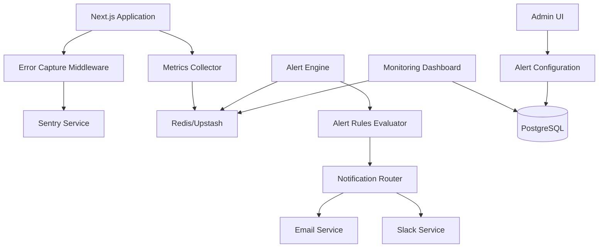

# Design Document: Monitoring and Alerting System

## Overview

The monitoring and alerting system provides comprehensive observability for the PricePilot SaaS platform. It integrates Sentry for error tracking, implements custom metric collection for business-critical operations, and delivers multi-channel notifications to ensure rapid incident response.

The system is designed to be:
- **Non-intrusive**: Minimal performance overhead (<5ms per request)
- **Reliable**: Graceful degradation when external services are unavailable
- **Actionable**: Alerts include context and remediation guidance
- **Scalable**: Handles multi-tenant architecture with per-tenant metrics
- **Testable**: Comprehensive testing capabilities for alert delivery

## Architecture

### High-Level Architecture



### Component Layers

1. **Capture Layer**: Intercepts errors and collects metrics from application
2. **Storage Layer**: Stores metrics and alert state in Redis and PostgreSQL
3. **Evaluation Layer**: Evaluates alert rules against collected metrics
4. **Notification Layer**: Delivers alerts through configured channels
5. **Presentation Layer**: Displays metrics and alerts in dashboard

## Components and Interfaces

### 1. Error Capture Middleware

**Purpose**: Intercepts application errors and sends them to Sentry with context

**Interface**:
```typescript
interface ErrorCaptureMiddleware {
  captureError(error: Error, context: ErrorContext): Promise<void>;
  captureException(exception: unknown, context: ErrorContext): Promise<void>;
  setUserContext(userId: string, tenantId: string): void;
}

interface ErrorContext {
  userId?: string;
  tenantId?: string;
  requestId: string;
  endpoint: string;
  method: string;
  statusCode?: number;
  additionalData?: Record<string, any>;
}
```

**Responsibilities**:
- Capture unhandled errors and exceptions
- Sanitize sensitive data before sending to Sentry
- Add request context (user, tenant, endpoint)
- Handle Sentry service unavailability gracefully

### 2. Metrics Collector

**Purpose**: Collects and aggregates application metrics

**Interface**:
```typescript
interface MetricsCollector {
  recordResponseTime(endpoint: string, duration: number, tenantId?: string): Promise<void>;
  recordError(endpoint: string, errorType: string, tenantId?: string): Promise<void>;
  recordScrapingResult(competitorId: string, success: boolean, blocked: boolean): Promise<void>;
  recordPriceUpdate(tenantId: string, success: boolean, productCount: number): Promise<void>;
  recordAuthFailure(ipAddress: string): Promise<void>;
  getMetrics(metricType: string, timeWindow: number): Promise<MetricData>;
}

interface MetricData {
  metricType: string;
  timeWindow: number;
  dataPoints: Array<{
    timestamp: number;
    value: number;
    labels?: Record<string, string>;
  }>;
  aggregates: {
    count: number;
    sum: number;
    avg: number;
    min: number;
    max: number;
    p50?: number;
    p95?: number;
    p99?: number;
  };
}
```

**Implementation Details**:
- Uses Redis sorted sets for time-series data
- Stores metrics with TTL (7 days for detailed, 90 days for aggregated)
- Calculates percentiles using Redis ZRANGE operations
- Batches writes to reduce Redis operations

### 3. Alert Rules Evaluator

**Purpose**: Evaluates metrics against configured alert rules

**Interface**:
```typescript
interface AlertRulesEvaluator {
  evaluateRules(): Promise<TriggeredAlert[]>;
  evaluateRule(rule: AlertRule): Promise<TriggeredAlert | null>;
  registerRule(rule: AlertRule): Promise<void>;
  updateRule(ruleId: string, updates: Partial<AlertRule>): Promise<void>;
  disableRule(ruleId: string): Promise<void>;
}

interface AlertRule {
  id: string;
  name: string;
  description: string;
  severity: 'critical' | 'warning' | 'info';
  enabled: boolean;
  metricType: string;
  condition: AlertCondition;
  timeWindow: number; // seconds
  threshold: number;
  notificationChannels: string[];
  tenantId?: string; // null for system-wide rules
}

interface AlertCondition {
  operator: 'gt' | 'gte' | 'lt' | 'lte' | 'eq';
  aggregation: 'count' | 'avg' | 'sum' | 'max' | 'min' | 'p95' | 'p99';
}

interface TriggeredAlert {
  ruleId: string;
  ruleName: string;
  severity: 'critical' | 'warning' | 'info';
  triggeredAt: Date;
  metricValue: number;
  threshold: number;
  tenantId?: string;
  context: Record<string, any>;
}
```

**Built-in Alert Rules**:
1. High Error Rate: error_rate > 1% over 5 minutes
2. Slow Response Time: avg_response_time > 500ms over 5 minutes
3. High Block Rate: scraping_block_rate > 30% over 15 minutes
4. Price Update Failures: price_update_failure_rate > 10% over 10 minutes
5. Authentication Failures: auth_failures > 10 from single IP over 1 minute
6. Database Connection Issues: db_connection_errors > 0 over 1 minute
7. Redis Connection Issues: redis_connection_errors > 0 over 1 minute

### 4. Alert Deduplication Manager

**Purpose**: Prevents duplicate alerts and manages alert lifecycle

**Interface**:
```typescript
interface AlertDeduplicationManager {
  shouldSendAlert(alert: TriggeredAlert): Promise<boolean>;
  recordAlertSent(alert: TriggeredAlert): Promise<void>;
  recordAlertResolved(ruleId: string): Promise<void>;
  isInMaintenanceWindow(): Promise<boolean>;
}
```

**Implementation Details**:
- Uses Redis to track sent alerts with 15-minute TTL
- Generates alert fingerprint from rule ID + tenant ID + metric type
- Tracks alert state (triggered, sent, resolved)
- Sends resolution notification when condition clears

### 5. Notification Router

**Purpose**: Routes alerts to appropriate notification channels

**Interface**:
```typescript
interface NotificationRouter {
  sendNotification(alert: TriggeredAlert, channels: string[]): Promise<NotificationResult[]>;
  testNotification(channel: string): Promise<boolean>;
}

interface NotificationResult {
  channel: string;
  success: boolean;
  error?: string;
  deliveredAt?: Date;
}
```

**Responsibilities**:
- Determines which channels to use based on alert configuration
- Handles channel-specific formatting
- Implements retry logic for failed deliveries
- Falls back to alternative channels on failure

### 6. Email Notification Service

**Purpose**: Sends alert notifications via email

**Interface**:
```typescript
interface EmailNotificationService {
  sendAlert(alert: TriggeredAlert, recipients: string[]): Promise<boolean>;
  formatAlertEmail(alert: TriggeredAlert): EmailContent;
}

interface EmailContent {
  subject: string;
  htmlBody: string;
  textBody: string;
}
```

**Email Template Structure**:
- Subject: `[{SEVERITY}] PricePilot Alert: {RULE_NAME}`
- Body includes:
  - Alert severity with color coding
  - Triggered timestamp
  - Metric value vs threshold
  - Affected component/tenant
  - Link to monitoring dashboard
  - Suggested remediation steps
  - Alert context data

### 7. Slack Notification Service

**Purpose**: Sends alert notifications to Slack channels

**Interface**:
```typescript
interface SlackNotificationService {
  sendAlert(alert: TriggeredAlert, channels: string[]): Promise<boolean>;
  formatSlackMessage(alert: TriggeredAlert): SlackMessage;
}

interface SlackMessage {
  channel: string;
  text: string;
  attachments: SlackAttachment[];
}

interface SlackAttachment {
  color: string; // red, yellow, green
  title: string;
  text: string;
  fields: Array<{
    title: string;
    value: string;
    short: boolean;
  }>;
  actions?: Array<{
    type: string;
    text: string;
    url: string;
  }>;
}
```

**Slack Message Format**:
- Color-coded based on severity (red=critical, yellow=warning, blue=info)
- Includes metric value, threshold, and trend
- Action buttons: "View Dashboard", "Acknowledge", "Mute"
- Threaded updates for alert resolution

### 8. Monitoring Dashboard Service

**Purpose**: Provides data for the monitoring dashboard UI

**Interface**:
```typescript
interface MonitoringDashboardService {
  getSystemHealth(): Promise<SystemHealth>;
  getMetricHistory(metricType: string, timeRange: TimeRange): Promise<MetricData>;
  getActiveAlerts(): Promise<TriggeredAlert[]>;
  getAlertHistory(limit: number): Promise<AlertHistoryEntry[]>;
  getTenantMetrics(tenantId: string): Promise<TenantMetrics>;
}

interface SystemHealth {
  status: 'healthy' | 'degraded' | 'critical';
  errorRate: number;
  avgResponseTime: number;
  activeAlerts: number;
  lastUpdated: Date;
  components: Array<{
    name: string;
    status: 'healthy' | 'degraded' | 'critical';
    message?: string;
  }>;
}

interface TimeRange {
  start: Date;
  end: Date;
  granularity: '1m' | '5m' | '15m' | '1h' | '1d';
}

interface TenantMetrics {
  tenantId: string;
  errorRate: number;
  apiUsage: number;
  priceUpdateSuccessRate: number;
  scrapingSuccessRate: number;
}
```

### 9. Alert Configuration Service

**Purpose**: Manages alert rule configuration

**Interface**:
```typescript
interface AlertConfigurationService {
  listRules(): Promise<AlertRule[]>;
  getRule(ruleId: string): Promise<AlertRule>;
  createRule(rule: Omit<AlertRule, 'id'>): Promise<AlertRule>;
  updateRule(ruleId: string, updates: Partial<AlertRule>): Promise<AlertRule>;
  deleteRule(ruleId: string): Promise<void>;
  testRule(ruleId: string): Promise<TriggeredAlert | null>;
  setMaintenanceWindow(start: Date, end: Date): Promise<void>;
}
```

## Data Models

### Alert Rule Configuration (PostgreSQL)

```typescript
interface AlertRuleModel {
  id: string; // UUID
  name: string;
  description: string;
  severity: 'critical' | 'warning' | 'info';
  enabled: boolean;
  metricType: string;
  conditionOperator: 'gt' | 'gte' | 'lt' | 'lte' | 'eq';
  conditionAggregation: 'count' | 'avg' | 'sum' | 'max' | 'min' | 'p95' | 'p99';
  timeWindowSeconds: number;
  threshold: number;
  notificationChannels: string[]; // JSON array
  tenantId?: string; // null for system-wide
  createdAt: Date;
  updatedAt: Date;
}
```

### Notification Channel Configuration (PostgreSQL)

```typescript
interface NotificationChannelModel {
  id: string; // UUID
  type: 'email' | 'slack';
  name: string;
  enabled: boolean;
  config: NotificationChannelConfig; // JSON
  createdAt: Date;
  updatedAt: Date;
}

interface EmailChannelConfig {
  recipients: string[];
  fromAddress: string;
  fromName: string;
}

interface SlackChannelConfig {
  webhookUrl: string;
  channel: string;
  username: string;
  iconEmoji: string;
}
```

### Alert History (PostgreSQL)

```typescript
interface AlertHistoryModel {
  id: string; // UUID
  ruleId: string;
  ruleName: string;
  severity: 'critical' | 'warning' | 'info';
  triggeredAt: Date;
  resolvedAt?: Date;
  metricValue: number;
  threshold: number;
  tenantId?: string;
  context: Record<string, any>; // JSON
  notificationsSent: Array<{
    channel: string;
    success: boolean;
    sentAt: Date;
    error?: string;
  }>; // JSON
}
```

### Metrics Storage (Redis)

**Time-series metrics** stored as sorted sets:
- Key pattern: `metrics:{metricType}:{tenantId}:{timeWindow}`
- Score: timestamp (Unix milliseconds)
- Value: JSON-encoded metric data

**Alert state** stored as hashes:
- Key pattern: `alert:state:{ruleId}:{fingerprint}`
- Fields: triggeredAt, sentAt, metricValue, notificationsSent
- TTL: 15 minutes

**Maintenance windows** stored as strings:
- Key: `maintenance:window`
- Value: JSON with start/end timestamps
- TTL: duration of maintenance window

## Correctness Properties


*A property is a characteristic or behavior that should hold true across all valid executions of a system—essentially, a formal statement about what the system should do. Properties serve as the bridge between human-readable specifications and machine-verifiable correctness guarantees.*

### Property Reflection

After analyzing all acceptance criteria, I identified several opportunities to consolidate related properties:

**Consolidations Made:**
- Alert triggering properties (3.1-3.7) can be consolidated into a single comprehensive property about threshold-based alerting
- Notification content properties (4.2, 4.3, 4.4 and 5.2, 5.3) can be consolidated into properties about notification completeness
- Dashboard display properties (6.1-6.6) can be consolidated into a single property about dashboard data completeness
- Tenant isolation properties (9.1-9.3) can be consolidated into a single property about tenant metric isolation

This reduces redundancy while maintaining comprehensive coverage of all requirements.

### Properties

**Property 1: Error Capture Completeness**
*For any* application error that occurs, the error capture system should successfully capture the error and include all required context fields (user ID, tenant ID, request details, stack trace) in the captured data.
**Validates: Requirements 1.1, 1.2**

**Property 2: Sensitive Data Sanitization**
*For any* error containing sensitive data patterns (passwords, API tokens, credit card numbers), the captured error data should have all sensitive values redacted or removed.
**Validates: Requirements 1.3**

**Property 3: Error Grouping Consistency**
*For any* set of errors with identical error types and stack traces, the monitoring system should group them together and track their aggregate frequency.
**Validates: Requirements 1.4**

**Property 4: Graceful Degradation on External Service Failure**
*For any* external service failure (Sentry, Slack), the monitoring system should continue operating and fall back to alternative mechanisms (local logging, email notifications).
**Validates: Requirements 1.5, 5.5**

**Property 5: Response Time Tracking Completeness**
*For any* API request, the monitoring system should record the response time with endpoint and tenant context.
**Validates: Requirements 2.1**

**Property 6: Slow Request Detection**
*For any* request with response time exceeding 500ms, the monitoring system should flag it as slow and capture detailed request context.
**Validates: Requirements 2.4**

**Property 7: Percentile Calculation Accuracy**
*For any* set of response time measurements, the calculated percentile values (p50, p95, p99) should accurately represent the distribution within acceptable error margins (±2%).
**Validates: Requirements 2.5**

**Property 8: Threshold-Based Alert Triggering**
*For any* metric that exceeds its configured threshold over the specified time window, the monitoring system should trigger an alert with the correct severity level.
**Validates: Requirements 3.1, 3.2, 3.3, 3.4, 3.5, 3.6, 3.7**

**Property 9: Notification Delivery to All Channels**
*For any* triggered alert with configured notification channels, the monitoring system should attempt to deliver notifications to all specified channels.
**Validates: Requirements 4.1, 5.1**

**Property 10: Email Notification Completeness**
*For any* email notification sent, the email should contain all required elements: severity, timestamp, affected component, metric values, dashboard link, and remediation steps.
**Validates: Requirements 4.2, 4.3, 4.4**

**Property 11: Notification Channel Routing**
*For any* alert rule with configured notification channels, notifications should be routed only to the channels specified in that rule's configuration.
**Validates: Requirements 4.5, 5.4**

**Property 12: Notification Retry with Exponential Backoff**
*For any* failed notification delivery, the system should retry up to 3 times with exponentially increasing delays (1s, 2s, 4s).
**Validates: Requirements 4.6**

**Property 13: Slack Message Formatting**
*For any* Slack notification, the message should be color-coded based on severity (red=critical, yellow=warning, blue=info) and include all required fields and action buttons.
**Validates: Requirements 5.2, 5.3**

**Property 14: Dashboard Data Completeness**
*For any* dashboard data request, the response should include all required metrics: error rate, response times, scraping metrics, price update metrics, active alerts, and resource utilization.
**Validates: Requirements 6.1, 6.2, 6.3, 6.4, 6.5, 6.6**

**Property 15: Dashboard Access Control**
*For any* user attempting to access the monitoring dashboard, access should be granted only if the user has admin role.
**Validates: Requirements 6.8**

**Property 16: Alert Configuration Validation**
*For any* alert rule configuration update, the system should validate all fields (threshold, time window, channels) and reject invalid configurations with descriptive error messages.
**Validates: Requirements 7.5**

**Property 17: Alert Rule Toggle Effectiveness**
*For any* disabled alert rule, no alerts should be triggered even when the rule's conditions are met.
**Validates: Requirements 7.2**

**Property 18: Maintenance Window Alert Suppression**
*For any* time period within a configured maintenance window, no alerts should be sent regardless of metric values.
**Validates: Requirements 7.4**

**Property 19: Alert Deduplication Within Time Window**
*For any* alert condition that remains triggered, only one notification should be sent per 15-minute window for that specific alert.
**Validates: Requirements 8.1**

**Property 20: Alert Resolution Notification**
*For any* alert that was previously triggered, when the alert condition clears, a resolution notification should be sent to the same channels.
**Validates: Requirements 8.2**

**Property 21: Alert Grouping for Related Alerts**
*For any* set of alerts triggered simultaneously with related contexts (same tenant, same component), they should be grouped into a single notification.
**Validates: Requirements 8.3**

**Property 22: Tenant Metric Isolation**
*For any* two different tenants, their metrics (error rates, API usage, price update success rates) should be tracked and stored separately with no cross-contamination.
**Validates: Requirements 9.1, 9.2, 9.3**

**Property 23: Tenant Context in Alerts**
*For any* tenant-specific alert, the alert notification should include the tenant ID and tenant name in the alert context.
**Validates: Requirements 9.4**

**Property 24: Dashboard Tenant Filtering**
*For any* dashboard query filtered by tenant ID, the returned metrics should include only data for that specific tenant.
**Validates: Requirements 9.5**

**Property 25: Test Alert Delivery**
*For any* test alert triggered, notifications should be sent through all configured channels with a clear "TEST" marker in the notification content.
**Validates: Requirements 10.2, 10.3**

**Property 26: Alert Delivery Logging**
*For any* alert notification attempt, the system should log the delivery attempt with timestamp, channel, success/failure status, and error details if failed.
**Validates: Requirements 10.4**

**Property 27: Security Alert Triggering**
*For any* security event (repeated auth failures, rate limit exceeded, suspicious patterns, unauthorized access), the system should trigger a security alert with appropriate severity.
**Validates: Requirements 11.1, 11.2, 11.3, 11.4**

**Property 28: Security Alert Context Completeness**
*For any* security alert, the alert should include IP address, user agent, and detailed request information in the alert context.
**Validates: Requirements 11.5**

**Property 29: Monitoring Performance Overhead**
*For any* API request with monitoring enabled, the additional processing time added by monitoring should be less than 5ms.
**Validates: Requirements 12.4**

## Error Handling

### Error Capture Failures

**Scenario**: Sentry service is unavailable
- **Handling**: Log errors to local file system with rotation
- **Recovery**: Retry Sentry connection with exponential backoff
- **User Impact**: None - errors still captured locally

**Scenario**: Error context extraction fails
- **Handling**: Capture error with partial context, log extraction failure
- **Recovery**: Continue with available context data
- **User Impact**: Reduced debugging information

### Notification Delivery Failures

**Scenario**: Email service is unavailable
- **Handling**: Queue notifications for retry, attempt up to 3 times
- **Recovery**: Fall back to Slack if configured
- **User Impact**: Delayed notification delivery

**Scenario**: Slack API is unavailable
- **Handling**: Fall back to email notifications immediately
- **Recovery**: Log Slack failure for investigation
- **User Impact**: Notifications via email instead of Slack

**Scenario**: All notification channels fail
- **Handling**: Log alert to database, mark as undelivered
- **Recovery**: Display undelivered alerts prominently in dashboard
- **User Impact**: Must check dashboard for missed alerts

### Metrics Collection Failures

**Scenario**: Redis is unavailable
- **Handling**: Buffer metrics in memory (max 1000 entries)
- **Recovery**: Flush to Redis when connection restored
- **User Impact**: Temporary gap in metrics if buffer overflows

**Scenario**: Metric calculation fails
- **Handling**: Log calculation error, skip that metric update
- **Recovery**: Continue with next metric calculation
- **User Impact**: Missing data point in time series

### Alert Evaluation Failures

**Scenario**: Alert rule evaluation throws exception
- **Handling**: Log error, skip that rule, continue with other rules
- **Recovery**: Retry on next evaluation cycle
- **User Impact**: Potential missed alert for one evaluation cycle

**Scenario**: Invalid alert rule configuration
- **Handling**: Disable rule, send notification to admins
- **Recovery**: Admin must fix configuration
- **User Impact**: Alert rule not active until fixed

## Testing Strategy

### Dual Testing Approach

The monitoring and alerting system requires both unit tests and property-based tests for comprehensive coverage:

**Unit Tests** focus on:
- Specific error scenarios and edge cases
- Integration with external services (Sentry, Slack, email)
- Configuration validation logic
- Dashboard API endpoints
- Alert rule CRUD operations

**Property-Based Tests** focus on:
- Error capture completeness across all error types
- Metric calculation accuracy across value distributions
- Alert triggering logic across threshold variations
- Notification delivery across channel combinations
- Tenant isolation across concurrent operations

### Property-Based Testing Configuration

**Library**: fast-check (for TypeScript/Node.js)

**Test Configuration**:
- Minimum 100 iterations per property test
- Seed-based reproducibility for failed tests
- Timeout: 30 seconds per property test

**Generators Needed**:
- Error objects with various stack traces and contexts
- Metric data points with realistic distributions
- Alert configurations with valid/invalid combinations
- Tenant IDs and user contexts
- Timestamp ranges for time-window calculations

### Unit Testing Focus Areas

**Error Capture**:
- Test Sentry integration with mock Sentry client
- Test sensitive data sanitization with known patterns
- Test error grouping with identical errors
- Test local logging fallback

**Metrics Collection**:
- Test Redis storage and retrieval
- Test percentile calculations with known distributions
- Test time-window aggregations
- Test tenant isolation in metrics

**Alert Evaluation**:
- Test each built-in alert rule
- Test threshold comparisons
- Test time-window calculations
- Test alert deduplication logic

**Notification Delivery**:
- Test email formatting and delivery
- Test Slack message formatting and delivery
- Test retry logic with mock failures
- Test fallback behavior

**Dashboard**:
- Test API endpoints with various query parameters
- Test access control with different user roles
- Test metric aggregation for dashboard display
- Test tenant filtering

### Integration Testing

**End-to-End Alert Flow**:
1. Generate metric that exceeds threshold
2. Verify alert is triggered
3. Verify notifications are sent to all channels
4. Verify alert appears in dashboard
5. Verify alert is logged to database

**Multi-Tenant Isolation**:
1. Generate metrics for multiple tenants simultaneously
2. Verify metrics are isolated per tenant
3. Verify alerts are tenant-specific
4. Verify dashboard filtering works correctly

**Graceful Degradation**:
1. Simulate external service failures
2. Verify fallback mechanisms activate
3. Verify system continues operating
4. Verify recovery when services restore

### Performance Testing

**Monitoring Overhead**:
- Measure request processing time with/without monitoring
- Verify overhead is less than 5ms per request
- Test under load (1000 requests/second)

**Alert Evaluation Performance**:
- Measure time to evaluate all alert rules
- Verify evaluation completes within 1 second
- Test with 100+ active alert rules

**Notification Delivery Performance**:
- Measure time to send notifications to multiple channels
- Verify delivery completes within 5 seconds
- Test with 10+ simultaneous alerts

### Test Tagging Convention

All property-based tests must include a comment tag referencing the design property:

```typescript
// Feature: monitoring-and-alerting, Property 1: Error Capture Completeness
test('error capture includes all required context fields', async () => {
  await fc.assert(
    fc.asyncProperty(
      errorGenerator(),
      async (error) => {
        const captured = await errorCapture.captureError(error);
        expect(captured).toHaveProperty('userId');
        expect(captured).toHaveProperty('tenantId');
        expect(captured).toHaveProperty('requestId');
        expect(captured).toHaveProperty('stackTrace');
      }
    ),
    { numRuns: 100 }
  );
});
```

## Implementation Notes

### Sentry Integration

Use `@sentry/nextjs` package for seamless Next.js integration:
- Automatic error boundary wrapping
- API route error capture
- Performance transaction tracking
- Source map upload for production debugging

### Redis Data Structures

**Time-series metrics**: Use sorted sets for efficient time-range queries
```
ZADD metrics:error_rate:tenant123:5m {timestamp} {value}
ZRANGEBYSCORE metrics:error_rate:tenant123:5m {start} {end}
```

**Alert state**: Use hashes with TTL for deduplication
```
HSET alert:state:rule123:fingerprint456 triggeredAt {timestamp}
EXPIRE alert:state:rule123:fingerprint456 900
```

### Alert Evaluation Scheduling

Use a cron job or scheduled task to evaluate alert rules:
- Run every 1 minute for critical rules
- Run every 5 minutes for warning rules
- Use distributed locking to prevent duplicate evaluations in multi-instance deployments

### Notification Rate Limiting

Implement rate limiting to prevent notification storms:
- Max 10 notifications per channel per minute
- Queue excess notifications for next cycle
- Log rate limit events for monitoring

### Dashboard Real-Time Updates

Use Server-Sent Events (SSE) or WebSocket for real-time dashboard updates:
- Push new metrics every 30 seconds
- Push alert updates immediately
- Implement reconnection logic for connection drops
