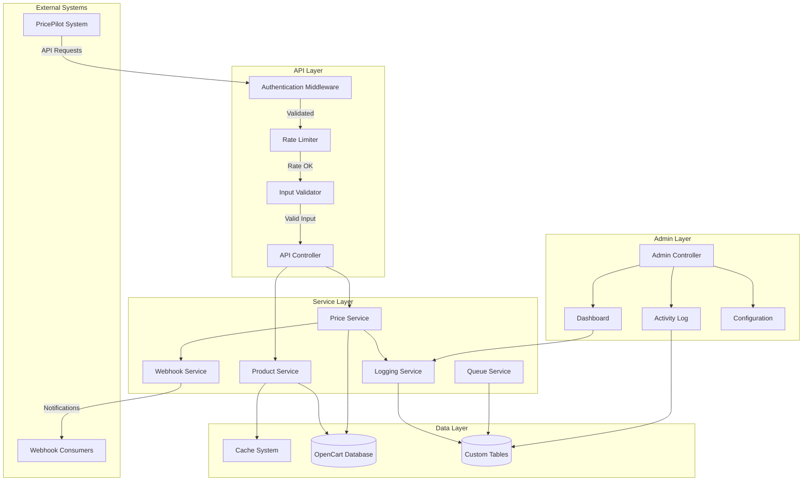

# Design Document: OpenCart Plugin Improvements

## Overview

This design document outlines the comprehensive improvements to the PricePilot OpenCart plugin, transforming it from a basic price synchronization tool into a robust, secure, and feature-rich integration platform. The improvements are structured in priority order to ensure critical security vulnerabilities are addressed first, followed by core functionality enhancements and advanced features.

The plugin architecture follows OpenCart's MVC pattern with clear separation between API controllers (catalog layer), admin controllers (admin layer), and business logic services. The design emphasizes security-first principles, comprehensive error handling, and scalability to support large product catalogs and high-volume API traffic.

Key architectural improvements include:
- **Security Layer**: Input validation, SQL injection prevention, rate limiting, and enhanced token management
- **Service Layer**: Business logic separation from controllers for maintainability
- **Logging Layer**: Comprehensive activity and API request logging
- **Webhook System**: Real-time event notifications for product changes
- **Queue System**: Background processing for long-running operations
- **Caching Layer**: Performance optimization for frequently accessed data

## Architecture

### High-Level Architecture



### Component Architecture

The plugin is organized into the following major components:

1. **API Controllers** (`catalog/controller/api/pricepilot.php`)
   - Product listing endpoint
   - Single product update endpoint
   - Bulk product update endpoint
   - Stock synchronization endpoint
   - Search and filter endpoint

2. **Admin Controllers** (`admin/controller/extension/module/pricepilot.php`)
   - Configuration management
   - Dashboard with statistics
   - Activity log viewer
   - Token management
   - Webhook configuration
   - Connection testing

3. **Service Classes** (new architecture)
   - `ProductService`: Product data retrieval and manipulation
   - `PriceService`: Price update logic and validation
   - `AuthenticationService`: Token validation and security
   - `RateLimitService`: Request throttling
   - `LoggingService`: Activity and API logging
   - `WebhookService`: Event notification delivery
   - `QueueService`: Background job processing
   - `ValidationService`: Input validation and sanitization

4. **Database Schema**
   - `pricepilot_activity_log`: Price change history
   - `pricepilot_api_logs`: API request/response logs
   - `pricepilot_product_mapping`: Competitor product mappings
   - `pricepilot_webhooks`: Webhook configurations
   - `pricepilot_queue`: Background job queue

## Components and Interfaces

### 1. Authentication Service

**Purpose**: Centralized authentication and authorization logic

**Interface**:
```php
class AuthenticationService {
    /**
     * Validate API token from request
     * @param string $token Token from request
     * @return bool True if valid, false otherwise
     */
    public function validateToken(string $token): bool;
    
    /**
     * Generate new API token
     * @return string 64-character hexadecimal token
     */
    public function generateToken(): string;
    
    /**
     * Check if IP address is whitelisted
     * @param string $ip IP address to check
     * @return bool True if whitelisted or whitelist disabled
     */
    public function isIpWhitelisted(string $ip): bool;
    
    /**
     * Log authentication attempt
     * @param string $ip IP address
     * @param bool $success Whether authentication succeeded
     */
    public function logAuthAttempt(string $ip, bool $success): void;
}
```

**Implementation Details**:
- Token validation uses constant-time comparison to prevent timing attacks
- Token generation uses `random_bytes()` for cryptographic security
- IP whitelist stored in configuration as comma-separated list
- Failed authentication attempts tracked for security alerting

### 2. Rate Limit Service

**Purpose**: Prevent API abuse through request throttling

**Interface**:
```php
class RateLimitService {
    /**
     * Check if request should be allowed
     * @param string $ip IP address
     * @param string $endpoint Endpoint being accessed
     * @return array ['allowed' => bool, 'retry_after' => int|null]
     */
    public function checkLimit(string $ip, string $endpoint): array;
    
    /**
     * Record a request for rate limiting
     * @param string $ip IP address
     * @param string $endpoint Endpoint accessed
     */
    public function recordRequest(string $ip, string $endpoint): void;
    
    /**
     * Reset rate limit for an IP
     * @param string $ip IP address
     */
    public function resetLimit(string $ip): void;
}
```

**Implementation Details**:
- Uses OpenCart cache system with TTL for request counting
- Default limit: 100 requests per 60 seconds per IP
- Sliding window algorithm for accurate rate limiting
- Cache key format: `ratelimit_{ip}_{endpoint}_{window}`
- Returns `Retry-After` header value when limit exceeded

### 3. Validation Service

**Purpose**: Centralized input validation and sanitization

**Interface**:
```php
class ValidationService {
    /**
     * Validate product ID
     * @param mixed $productId Product ID to validate
     * @return array ['valid' => bool, 'value' => int|null, 'error' => string|null]
     */
    public function validateProductId($productId): array;
    
    /**
     * Validate price value
     * @param mixed $price Price to validate
     * @return array ['valid' => bool, 'value' => float|null, 'error' => string|null]
     */
    public function validatePrice($price): array;
    
    /**
     * Validate API token format
     * @param mixed $token Token to validate
     * @return array ['valid' => bool, 'error' => string|null]
     */
    public function validateTokenFormat($token): array;
    
    /**
     * Validate request payload size
     * @param string $payload JSON payload
     * @return array ['valid' => bool, 'error' => string|null]
     */
    public function validatePayloadSize(string $payload): array;
    
    /**
     * Sanitize and validate bulk update array
     * @param array $products Array of product updates
     * @return array ['valid' => bool, 'products' => array, 'errors' => array]
     */
    public function validateBulkUpdate(array $products): array;
}
```

**Implementation Details**:
- Product ID: Must be positive integer, max value 2147483647
- Price: Must be numeric, max 4 decimal places, range 0.0001 to 999999.9999
- Token: Must be 64-character hexadecimal string
- Payload size: Maximum 1MB (1048576 bytes)
- Bulk update: Maximum 1000 products per request
- Returns structured validation results with specific error messages

### 4. Product Service

**Purpose**: Product data retrieval and manipulation

**Interface**:
```php
class ProductService {
    /**
     * Get products with filters and pagination
     * @param array $filters Filter criteria
     * @param int $start Pagination start
     * @param int $limit Pagination limit
     * @return array ['products' => array, 'total' => int]
     */
    public function getProducts(array $filters, int $start, int $limit): array;
    
    /**
     * Get single product by ID
     * @param int $productId Product ID
     * @param int|null $storeId Store ID (null for default)
     * @return array|null Product data or null if not found
     */
    public function getProduct(int $productId, ?int $storeId = null): ?array;
    
    /**
     * Search products by name
     * @param string $query Search query
     * @param int $start Pagination start
     * @param int $limit Pagination limit
     * @return array ['products' => array, 'total' => int]
     */
    public function searchProducts(string $query, int $start, int $limit): array;
    
    /**
     * Get product with all variants
     * @param int $productId Product ID
     * @return array Product data with variants
     */
    public function getProductWithVariants(int $productId): array;
}
```

**Implementation Details**:
- Uses OpenCart's model layer for database access
- Implements caching with 5-minute TTL for product lists
- Supports filters: sku, category_id, manufacturer_id, status, store_id
- Returns complete product data including images, categories, manufacturer
- Handles multi-store filtering when store_id provided
- Includes variant/option data when requested

### 5. Price Service

**Purpose**: Price update operations with logging and validation

**Interface**:
```php
class PriceService {
    /**
     * Update single product price
     * @param int $productId Product ID
     * @param float $newPrice New price
     * @param int|null $storeId Store ID
     * @return array ['success' => bool, 'old_price' => float|null, 'error' => string|null]
     */
    public function updatePrice(int $productId, float $newPrice, ?int $storeId = null): array;
    
    /**
     * Update multiple product prices
     * @param array $updates Array of ['product_id' => int, 'price' => float]
     * @param int|null $storeId Store ID
     * @return array ['success_count' => int, 'failure_count' => int, 'failures' => array]
     */
    public function bulkUpdatePrices(array $updates, ?int $storeId = null): array;
    
    /**
     * Update product stock quantity
     * @param int $productId Product ID
     * @param int $quantity New quantity
     * @return array ['success' => bool, 'error' => string|null]
     */
    public function updateStock(int $productId, int $quantity): array;
    
    /**
     * Update special price with date range
     * @param int $productId Product ID
     * @param float $specialPrice Special price
     * @param string|null $dateStart Start date (Y-m-d)
     * @param string|null $dateEnd End date (Y-m-d)
     * @return array ['success' => bool, 'error' => string|null]
     */
    public function updateSpecialPrice(int $productId, float $specialPrice, ?string $dateStart, ?string $dateEnd): array;
    
    /**
     * Create price backup before bulk update
     * @param array $productIds Array of product IDs
     * @return string Backup ID
     */
    public function createPriceBackup(array $productIds): string;
    
    /**
     * Restore prices from backup
     * @param string $backupId Backup ID
     * @return array ['success' => bool, 'restored_count' => int, 'error' => string|null]
     */
    public function restorePriceBackup(string $backupId): array;
}
```

**Implementation Details**:
- Uses prepared statements for all database operations
- Logs all price changes to `pricepilot_activity_log` table
- Clears product cache after updates
- Triggers webhook events after successful updates
- Handles out-of-stock status when quantity reaches zero
- Validates price ranges and date formats
- Backup stored in JSON format in database with timestamp

### 6. Logging Service

**Purpose**: Comprehensive activity and API request logging

**Interface**:
```php
class LoggingService {
    /**
     * Log price change
     * @param int $productId Product ID
     * @param float $oldPrice Old price
     * @param float $newPrice New price
     * @param string $changedBy Source of change (API, Admin, etc.)
     */
    public function logPriceChange(int $productId, float $oldPrice, float $newPrice, string $changedBy): void;
    
    /**
     * Log API request
     * @param string $endpoint Endpoint path
     * @param string $method HTTP method
     * @param string $ip IP address
     * @param string|null $requestData Request payload
     * @param int $responseCode HTTP response code
     * @param float $responseTime Response time in seconds
     */
    public function logApiRequest(string $endpoint, string $method, string $ip, ?string $requestData, int $responseCode, float $responseTime): void;
    
    /**
     * Get activity log with filters
     * @param array $filters Filter criteria
     * @param int $start Pagination start
     * @param int $limit Pagination limit
     * @return array ['logs' => array, 'total' => int]
     */
    public function getActivityLog(array $filters, int $start, int $limit): array;
    
    /**
     * Get API usage statistics
     * @param string $period Period (today, week, month)
     * @return array Statistics data
     */
    public function getApiStatistics(string $period): array;
    
    /**
     * Clean old logs
     * @param int $daysToKeep Number of days to retain
     * @return int Number of logs deleted
     */
    public function cleanOldLogs(int $daysToKeep): int;
}
```

**Implementation Details**:
- Activity log includes product name, old/new prices, timestamp, source
- API log includes full request/response data for debugging
- Supports filtering by date range, product ID, source
- Statistics include request count, average response time, error rate
- Automatic cleanup of logs older than 90 days (configurable)
- Indexes on date_added columns for query performance

### 7. Webhook Service

**Purpose**: Real-time event notifications to external systems

**Interface**:
```php
class WebhookService {
    /**
     * Trigger webhook for product event
     * @param string $event Event type (product.created, product.updated, product.deleted)
     * @param array $data Event data
     */
    public function triggerEvent(string $event, array $data): void;
    
    /**
     * Send webhook notification
     * @param string $url Webhook URL
     * @param string $event Event type
     * @param array $data Event data
     * @return array ['success' => bool, 'response_code' => int|null, 'error' => string|null]
     */
    public function sendWebhook(string $url, string $event, array $data): array;
    
    /**
     * Get configured webhooks for event
     * @param string $event Event type
     * @return array Array of webhook configurations
     */
    public function getWebhooksForEvent(string $event): array;
    
    /**
     * Validate webhook URL
     * @param string $url URL to validate
     * @return array ['valid' => bool, 'error' => string|null]
     */
    public function validateWebhookUrl(string $url): array;
}
```

**Implementation Details**:
- Supports events: product.created, product.updated, product.deleted, price.changed
- Webhook payload includes event type, timestamp, store_id, and event data
- Includes HMAC signature in `X-PricePilot-Signature` header for verification
- Retry logic: 3 attempts with exponential backoff (1s, 2s, 4s)
- Timeout: 5 seconds per webhook request
- Failed webhooks logged for admin review
- Webhooks sent asynchronously to avoid blocking API responses

### 8. Queue Service

**Purpose**: Background processing for long-running operations

**Interface**:
```php
class QueueService {
    /**
     * Add job to queue
     * @param string $jobType Job type (bulk_update, webhook_batch, etc.)
     * @param array $jobData Job data
     * @return string Job ID
     */
    public function enqueue(string $jobType, array $jobData): string;
    
    /**
     * Process next job in queue
     * @return array ['success' => bool, 'job_id' => string|null, 'error' => string|null]
     */
    public function processNext(): array;
    
    /**
     * Get job status
     * @param string $jobId Job ID
     * @return array ['status' => string, 'progress' => int, 'result' => array|null]
     */
    public function getJobStatus(string $jobId): array;
    
    /**
     * Cancel job
     * @param string $jobId Job ID
     * @return bool Success
     */
    public function cancelJob(string $jobId): bool;
}
```

**Implementation Details**:
- Job statuses: pending, processing, completed, failed, cancelled
- Jobs stored in `pricepilot_queue` table with priority and retry count
- Bulk updates with >100 products automatically queued
- Progress tracking for long-running jobs
- Failed jobs retry up to 3 times before marking as failed
- Cron job or OpenCart task scheduler processes queue
- Admin interface shows job status and progress

## Data Models

### Database Schema

#### pricepilot_activity_log
```sql
CREATE TABLE `pricepilot_activity_log` (
  `log_id` int(11) NOT NULL AUTO_INCREMENT,
  `product_id` int(11) NOT NULL,
  `product_name` varchar(255) NOT NULL,
  `old_price` decimal(15,4) NOT NULL,
  `new_price` decimal(15,4) NOT NULL,
  `changed_by` varchar(255) DEFAULT 'API',
  `store_id` int(11) DEFAULT 0,
  `date_added` datetime NOT NULL,
  PRIMARY KEY (`log_id`),
  KEY `product_id` (`product_id`),
  KEY `date_added` (`date_added`),
  KEY `store_id` (`store_id`)
) ENGINE=InnoDB DEFAULT CHARSET=utf8mb4;
```

#### pricepilot_api_logs
```sql
CREATE TABLE `pricepilot_api_logs` (
  `log_id` int(11) NOT NULL AUTO_INCREMENT,
  `endpoint` varchar(255) NOT NULL,
  `method` varchar(10) NOT NULL,
  `ip_address` varchar(45) NOT NULL,
  `request_data` text,
  `response_code` int(3) NOT NULL,
  `response_time` decimal(10,4) NOT NULL,
  `date_added` datetime NOT NULL,
  PRIMARY KEY (`log_id`),
  KEY `date_added` (`date_added`),
  KEY `ip_address` (`ip_address`),
  KEY `endpoint` (`endpoint`)
) ENGINE=InnoDB DEFAULT CHARSET=utf8mb4;
```

#### pricepilot_product_mapping
```sql
CREATE TABLE `pricepilot_product_mapping` (
  `mapping_id` int(11) NOT NULL AUTO_INCREMENT,
  `product_id` int(11) NOT NULL,
  `competitor_url` varchar(500) NOT NULL,
  `competitor_name` varchar(100) NOT NULL,
  `date_added` datetime NOT NULL,
  `date_modified` datetime NOT NULL,
  PRIMARY KEY (`mapping_id`),
  KEY `product_id` (`product_id`),
  UNIQUE KEY `product_competitor` (`product_id`, `competitor_url`)
) ENGINE=InnoDB DEFAULT CHARSET=utf8mb4;
```

#### pricepilot_webhooks
```sql
CREATE TABLE `pricepilot_webhooks` (
  `webhook_id` int(11) NOT NULL AUTO_INCREMENT,
  `url` varchar(500) NOT NULL,
  `events` text NOT NULL,
  `secret` varchar(64) NOT NULL,
  `status` tinyint(1) DEFAULT 1,
  `date_added` datetime NOT NULL,
  `date_modified` datetime NOT NULL,
  PRIMARY KEY (`webhook_id`),
  KEY `status` (`status`)
) ENGINE=InnoDB DEFAULT CHARSET=utf8mb4;
```

#### pricepilot_queue
```sql
CREATE TABLE `pricepilot_queue` (
  `job_id` varchar(36) NOT NULL,
  `job_type` varchar(50) NOT NULL,
  `job_data` text NOT NULL,
  `status` enum('pending','processing','completed','failed','cancelled') DEFAULT 'pending',
  `progress` int(3) DEFAULT 0,
  `result` text,
  `retry_count` int(2) DEFAULT 0,
  `priority` int(2) DEFAULT 5,
  `date_added` datetime NOT NULL,
  `date_started` datetime DEFAULT NULL,
  `date_completed` datetime DEFAULT NULL,
  PRIMARY KEY (`job_id`),
  KEY `status` (`status`),
  KEY `priority` (`priority`),
  KEY `date_added` (`date_added`)
) ENGINE=InnoDB DEFAULT CHARSET=utf8mb4;
```

#### pricepilot_price_backups
```sql
CREATE TABLE `pricepilot_price_backups` (
  `backup_id` varchar(36) NOT NULL,
  `backup_data` longtext NOT NULL,
  `product_count` int(11) NOT NULL,
  `created_by` varchar(100) NOT NULL,
  `date_added` datetime NOT NULL,
  PRIMARY KEY (`backup_id`),
  KEY `date_added` (`date_added`)
) ENGINE=InnoDB DEFAULT CHARSET=utf8mb4;
```

### API Request/Response Models

#### Product List Response
```json
{
  "products": [
    {
      "product_id": 123,
      "name": "Product Name",
      "model": "MODEL-123",
      "sku": "SKU-123",
      "price": "99.99",
      "special": "79.99",
      "special_start": "2024-01-01",
      "special_end": "2024-12-31",
      "quantity": 50,
      "status": 1,
      "manufacturer": "Brand Name",
      "image": "https://store.com/image/product.jpg",
      "images": ["url1", "url2"],
      "category": "Category Name",
      "categories": [
        {"category_id": 1, "name": "Category 1"},
        {"category_id": 2, "name": "Category 2"}
      ],
      "variants": [
        {
          "option_id": 1,
          "option_name": "Size",
          "option_value_id": 10,
          "option_value": "Large",
          "price_modifier": "5.00"
        }
      ],
      "store_id": 0
    }
  ],
  "total": 1500,
  "start": 0,
  "limit": 100
}
```

#### Single Price Update Request
```json
{
  "product_id": 123,
  "price": 99.99,
  "store_id": 0
}
```

#### Bulk Price Update Request
```json
{
  "products": [
    {"product_id": 123, "price": 99.99},
    {"product_id": 124, "price": 149.99},
    {"product_id": 125, "price": 199.99}
  ],
  "store_id": 0
}
```

#### Bulk Update Response
```json
{
  "success_count": 2,
  "failure_count": 1,
  "failures": [
    {
      "product_id": 125,
      "error": "Product not found"
    }
  ],
  "job_id": "uuid-if-queued"
}
```

#### Error Response
```json
{
  "error": "Invalid API Token",
  "code": "AUTH_FAILED",
  "details": {
    "field": "api_token",
    "message": "Token format is invalid"
  }
}
```

#### Webhook Payload
```json
{
  "event": "product.updated",
  "timestamp": "2024-01-15T10:30:00Z",
  "store_id": 0,
  "data": {
    "product_id": 123,
    "name": "Product Name",
    "old_price": "89.99",
    "new_price": "99.99",
    "changes": ["price", "quantity"]
  }
}
```

### Configuration Model

Configuration stored in OpenCart's `oc_setting` table with prefix `module_pricepilot_`:

```php
[
    'module_pricepilot_status' => 1,  // Enabled/disabled
    'module_pricepilot_token' => 'hex64',  // API token
    'module_pricepilot_token_created' => '2024-01-15 10:00:00',  // Token creation date
    'module_pricepilot_ip_whitelist' => '192.168.1.1,10.0.0.1',  // Comma-separated IPs
    'module_pricepilot_rate_limit' => 100,  // Requests per minute
    'module_pricepilot_rate_window' => 60,  // Window in seconds
    'module_pricepilot_log_retention' => 90,  // Days to keep logs
    'module_pricepilot_queue_threshold' => 100,  // Products to trigger queueing
    'module_pricepilot_webhook_timeout' => 5,  // Webhook timeout in seconds
    'module_pricepilot_webhook_retries' => 3,  // Webhook retry attempts
    'module_pricepilot_cache_ttl' => 300,  // Cache TTL in seconds
    'module_pricepilot_admin_email' => 'admin@store.com',  // Notification email
    'module_pricepilot_notify_failures' => 1,  // Email on failures
    'module_pricepilot_notify_security' => 1,  // Email on security events
]
```


## Correctness Properties

*A property is a characteristic or behavior that should hold true across all valid executions of a system—essentially, a formal statement about what the system should do. Properties serve as the bridge between human-readable specifications and machine-verifiable correctness guarantees.*

### Acceptance Criteria Testing Prework

Before defining correctness properties, let me analyze each acceptance criterion for testability:

**Requirement 1: SQL Injection Prevention**
- 1.1: WHEN the API_Controller receives any user input, THE Plugin SHALL use prepared statements
  - Thoughts: This is about code structure and implementation approach, not a testable behavior from the outside
  - Testable: no (implementation detail)
- 1.2-1.5: Similar implementation requirements
  - Testable: no (implementation details)

**Requirement 2: Input Validation**
- 2.1: WHEN the API receives a product_id parameter, THE Plugin SHALL validate it is a positive integer
  - Thoughts: This is testable across all possible inputs. We can generate random inputs including negative numbers, zero, non-integers, and verify rejection
  - Testable: yes - property
- 2.2: WHEN the API receives a price parameter, THE Plugin SHALL validate it is a valid decimal
  - Thoughts: This applies to all price inputs. We can generate random invalid prices and verify they're rejected
  - Testable: yes - property
- 2.3: WHEN the API receives an api_token parameter, THE Plugin SHALL validate format
  - Thoughts: This applies to all token inputs. We can generate invalid tokens and verify rejection
  - Testable: yes - property
- 2.4: WHEN request payload size exceeds 1MB, THE Plugin SHALL reject with HTTP 413
  - Thoughts: This is a specific edge case we should test
  - Testable: yes - example
- 2.5: WHEN any required parameter is missing, THE Plugin SHALL return HTTP 400
  - Thoughts: This applies to all API endpoints. We can test each endpoint with missing parameters
  - Testable: yes - property
- 2.6: WHEN any parameter contains invalid data type, THE Plugin SHALL return HTTP 400
  - Thoughts: This applies across all parameters and endpoints
  - Testable: yes - property

**Requirement 3: Rate Limiting**
- 3.1: WHEN an IP makes more than 100 requests in 60 seconds, THE Rate_Limiter SHALL reject with HTTP 429
  - Thoughts: This is testable by simulating request patterns
  - Testable: yes - property
- 3.2: WHEN rate limit exceeded, THE Plugin SHALL return Retry-After header
  - Thoughts: This should happen for all rate-limited requests
  - Testable: yes - property
- 3.4: WHEN rate limit window expires, THE Rate_Limiter SHALL reset counter
  - Thoughts: This is a time-based property we can test
  - Testable: yes - property

**Requirement 5: Structured Error Handling**
- 5.1: WHEN API request succeeds, THE Plugin SHALL return HTTP 200
  - Thoughts: This should hold for all successful requests
  - Testable: yes - property
- 5.2: WHEN authentication fails, THE Plugin SHALL return HTTP 401
  - Thoughts: This should hold for all auth failures
  - Testable: yes - property
- 5.3: WHEN resource not found, THE Plugin SHALL return HTTP 404
  - Thoughts: This should hold for all not-found cases
  - Testable: yes - property
- 5.4: WHEN input validation fails, THE Plugin SHALL return HTTP 400
  - Thoughts: This should hold for all validation failures
  - Testable: yes - property
- 5.5: WHEN internal error occurs, THE Plugin SHALL return HTTP 500
  - Thoughts: This should hold for all internal errors
  - Testable: yes - property
- 5.6: FOR ALL error responses, THE Plugin SHALL return JSON with "error" field
  - Thoughts: This is a universal property about error response format
  - Testable: yes - property

**Requirement 7: Bulk Price Update**
- 7.1: WHEN POST to /bulk-update with array, THE Bulk_Update_Handler SHALL process all
  - Thoughts: This should work for any valid array of products
  - Testable: yes - property
- 7.2: WHEN bulk update completes, THE Plugin SHALL return summary with counts
  - Thoughts: This should hold for all bulk updates
  - Testable: yes - property
- 7.3: WHEN individual update fails, THE Plugin SHALL continue processing
  - Thoughts: This is about resilience across all bulk operations
  - Testable: yes - property
- 7.6: WHEN bulk update processed, THE Plugin SHALL clear product cache
  - Thoughts: This is testable by checking cache state
  - Testable: yes - property

**Requirement 8: Product Search and Filter**
- 8.1-8.6: Filter and search criteria
  - Thoughts: These are all about ensuring search results match criteria across all possible inputs
  - Testable: yes - property (for each filter type)
- 8.7: WHEN multiple filters applied, THE Plugin SHALL combine with AND logic
  - Thoughts: This is testable across all filter combinations
  - Testable: yes - property

**Requirement 10: Stock Synchronization**
- 10.1: WHEN product list called, THE Plugin SHALL include quantity field
  - Thoughts: This should hold for all products in all responses
  - Testable: yes - property
- 10.2: WHEN stock update sent, THE Plugin SHALL update stock level
  - Thoughts: This should work for all valid stock updates
  - Testable: yes - property
- 10.3: WHEN stock reaches zero, THE Plugin SHALL mark out of stock
  - Thoughts: This is a specific edge case
  - Testable: yes - example

**Requirement 15: Multi-Store Support**
- 15.1: WHEN API called with store_id, THE Plugin SHALL return products from that store only
  - Thoughts: This should hold for all store IDs and all products
  - Testable: yes - property
- 15.2: WHEN updating with store_id, THE Plugin SHALL update only in that store
  - Thoughts: This should hold for all updates
  - Testable: yes - property

**Requirement 19: Advanced Pricing**
- 19.1: WHEN product list called, THE Plugin SHALL include special price if configured
  - Thoughts: This should hold for all products with special prices
  - Testable: yes - property
- 19.5: WHEN special prices active, THE Plugin SHALL return both regular and special price
  - Thoughts: This should hold for all products with active special prices
  - Testable: yes - property

**Requirement 27: Caching**
- 27.3: WHEN any product updated, THE Plugin SHALL invalidate product list cache
  - Thoughts: This is testable by checking cache state after updates
  - Testable: yes - property
- 27.4: WHEN configuration changed, THE Plugin SHALL invalidate configuration cache
  - Thoughts: This is testable by checking cache state after config changes
  - Testable: yes - property

**Requirement 33: JSON Parsing and Serialization**
- 33.1: WHEN API receives JSON, THE Plugin SHALL parse into PHP structures
  - Thoughts: This should work for all valid JSON
  - Testable: yes - property
- 33.2: WHEN API sends responses, THE Plugin SHALL serialize to valid JSON
  - Thoughts: This should work for all response objects
  - Testable: yes - property
- 33.3: WHEN JSON parsing fails, THE Plugin SHALL return HTTP 400
  - Thoughts: This should hold for all invalid JSON
  - Testable: yes - property
- 33.5: FOR ALL valid response objects, parse→serialize→parse SHALL produce equivalent object
  - Thoughts: This is a classic round-trip property for serialization
  - Testable: yes - property

### Property Reflection

After analyzing all acceptance criteria, I've identified the following testable properties. Let me now check for redundancy:

- Input validation properties (2.1, 2.2, 2.3, 2.5, 2.6) can be combined into a comprehensive "invalid inputs are rejected" property
- HTTP status code properties (5.1-5.5) are distinct and should remain separate as they test different error conditions
- Filter properties (8.1-8.6) can be combined into a single "filters return matching results" property
- Cache invalidation properties (27.3, 27.4) are distinct (different triggers) and should remain separate

### Correctness Properties

**Property 1: Invalid Product IDs Are Rejected**

*For any* API endpoint that accepts a product_id parameter, when a non-positive integer or non-integer value is provided, the Plugin should return HTTP 400 with a descriptive error message.

**Validates: Requirements 2.1**

**Property 2: Invalid Prices Are Rejected**

*For any* API endpoint that accepts a price parameter, when a non-numeric value or a value with more than 4 decimal places is provided, the Plugin should return HTTP 400 with a descriptive error message.

**Validates: Requirements 2.2**

**Property 3: Invalid Token Format Is Rejected**

*For any* API request with an api_token parameter, when the token is not a 64-character hexadecimal string, the Plugin should return HTTP 401 with an authentication error.

**Validates: Requirements 2.3**

**Property 4: Missing Required Parameters Are Rejected**

*For any* API endpoint, when any required parameter is missing from the request, the Plugin should return HTTP 400 with a field-specific error message indicating which parameter is missing.

**Validates: Requirements 2.5**

**Property 5: Invalid Data Types Are Rejected**

*For any* API parameter, when a value of an incorrect data type is provided (e.g., string where integer expected), the Plugin should return HTTP 400 with a field-specific error message.

**Validates: Requirements 2.6**

**Property 6: Rate Limiting Enforces Request Limits**

*For any* IP address, when more than 100 requests are made to any API endpoint within a 60-second window, all subsequent requests within that window should be rejected with HTTP 429 and include a Retry-After header.

**Validates: Requirements 3.1, 3.2**

**Property 7: Rate Limit Counters Reset After Window**

*For any* IP address that has been rate-limited, when the 60-second window expires, the next request should be allowed (not rate-limited).

**Validates: Requirements 3.4**

**Property 8: Successful Requests Return HTTP 200**

*For any* valid API request with correct authentication and valid parameters, the Plugin should return HTTP 200 status code.

**Validates: Requirements 5.1**

**Property 9: Authentication Failures Return HTTP 401**

*For any* API request with an invalid or missing authentication token, the Plugin should return HTTP 401 status code with an error message.

**Validates: Requirements 5.2**

**Property 10: Not Found Resources Return HTTP 404**

*For any* API request referencing a non-existent resource (e.g., invalid product_id), the Plugin should return HTTP 404 status code with an error message.

**Validates: Requirements 5.3**

**Property 11: Validation Failures Return HTTP 400**

*For any* API request with invalid input parameters, the Plugin should return HTTP 400 status code with field-specific error details.

**Validates: Requirements 5.4**

**Property 12: Internal Errors Return HTTP 500**

*For any* API request that triggers an internal server error, the Plugin should return HTTP 500 status code with a generic error message (without exposing internal details).

**Validates: Requirements 5.5**

**Property 13: All Error Responses Include Error Field**

*For any* API error response (HTTP 4xx or 5xx), the response body should be valid JSON containing an "error" field with a descriptive message.

**Validates: Requirements 5.6**

**Property 14: Bulk Updates Process All Products**

*For any* valid bulk update request containing an array of product updates, the Plugin should attempt to process every product in the array and return a summary with success and failure counts.

**Validates: Requirements 7.1, 7.2**

**Property 15: Bulk Updates Continue After Individual Failures**

*For any* bulk update request where some products fail validation or don't exist, the Plugin should continue processing the remaining products and include failure details in the response.

**Validates: Requirements 7.3**

**Property 16: Bulk Updates Invalidate Cache**

*For any* bulk update operation that completes (regardless of individual successes/failures), the product cache should be cleared.

**Validates: Requirements 7.6**

**Property 17: SKU Filter Returns Matching Products**

*For any* product list request with a SKU filter parameter, all returned products should have a SKU that matches the filter value.

**Validates: Requirements 8.1**

**Property 18: Category Filter Returns Matching Products**

*For any* product list request with a category_id filter parameter, all returned products should belong to that category.

**Validates: Requirements 8.2**

**Property 19: Manufacturer Filter Returns Matching Products**

*For any* product list request with a manufacturer_id filter parameter, all returned products should have that manufacturer.

**Validates: Requirements 8.3**

**Property 20: Status Filter Returns Matching Products**

*For any* product list request with a status filter parameter, all returned products should have that status (enabled/disabled).

**Validates: Requirements 8.4**

**Property 21: Name Search Returns Matching Products**

*For any* product list request with a name search parameter, all returned products should have names containing the search term (case-insensitive).

**Validates: Requirements 8.5**

**Property 22: Multiple Filters Use AND Logic**

*For any* product list request with multiple filter parameters, all returned products should match ALL filter criteria (AND logic, not OR).

**Validates: Requirements 8.7**

**Property 23: Product List Includes Quantity**

*For any* product in a product list API response, the response should include a quantity field with the current stock level.

**Validates: Requirements 10.1**

**Property 24: Stock Updates Modify Quantity**

*For any* valid stock update request, the product's quantity should be updated to the new value and subsequent product list requests should reflect the new quantity.

**Validates: Requirements 10.2**

**Property 25: Store Filter Returns Store-Specific Products**

*For any* product list request with a store_id parameter, all returned products should belong to that specific store.

**Validates: Requirements 15.1**

**Property 26: Store-Specific Updates Only Affect That Store**

*For any* price or stock update request with a store_id parameter, only the product data in that specific store should be modified, leaving other stores unchanged.

**Validates: Requirements 15.2**

**Property 27: Special Prices Included When Active**

*For any* product with an active special price (current date within date range), the product list API response should include both the regular price and the special price.

**Validates: Requirements 19.1, 19.5**

**Property 28: Product Updates Invalidate Cache**

*For any* product update operation (price, stock, or other fields), the product list cache should be invalidated immediately after the update.

**Validates: Requirements 27.3**

**Property 29: Configuration Changes Invalidate Config Cache**

*For any* configuration setting change in the admin panel, the configuration cache should be invalidated immediately.

**Validates: Requirements 27.4**

**Property 30: Valid JSON Parses Successfully**

*For any* API request with a valid JSON payload, the Plugin should successfully parse it into PHP data structures without errors.

**Validates: Requirements 33.1**

**Property 31: Response Objects Serialize to Valid JSON**

*For any* API response object, the Plugin should serialize it to valid, well-formed JSON that can be parsed by standard JSON parsers.

**Validates: Requirements 33.2**

**Property 32: Invalid JSON Returns HTTP 400**

*For any* API request with malformed or invalid JSON in the request body, the Plugin should return HTTP 400 with a descriptive parsing error message.

**Validates: Requirements 33.3**

**Property 33: JSON Serialization Round-Trip Preserves Data**

*For any* valid API response object, serializing to JSON, then parsing back, then serializing again should produce an equivalent JSON output (round-trip property).

**Validates: Requirements 33.5**

## Error Handling

### Error Response Structure

All API errors follow a consistent JSON structure:

```json
{
  "error": "Human-readable error message",
  "code": "ERROR_CODE_CONSTANT",
  "details": {
    "field": "parameter_name",
    "message": "Field-specific details"
  }
}
```

### Error Codes

| HTTP Status | Error Code | Description | Example |
|-------------|------------|-------------|---------|
| 400 | INVALID_PARAMETER | Parameter validation failed | Invalid product_id format |
| 400 | MISSING_PARAMETER | Required parameter missing | product_id is required |
| 400 | INVALID_JSON | JSON parsing failed | Malformed JSON in request body |
| 400 | PAYLOAD_TOO_LARGE | Request payload exceeds limit | Payload exceeds 1MB limit |
| 401 | AUTH_FAILED | Authentication failed | Invalid or missing API token |
| 401 | INVALID_TOKEN_FORMAT | Token format invalid | Token must be 64-char hex |
| 403 | IP_NOT_WHITELISTED | IP address not allowed | Your IP is not whitelisted |
| 404 | PRODUCT_NOT_FOUND | Product doesn't exist | Product ID 123 not found |
| 404 | RESOURCE_NOT_FOUND | Resource doesn't exist | Endpoint not found |
| 413 | PAYLOAD_TOO_LARGE | Request too large | Bulk update exceeds 1000 products |
| 429 | RATE_LIMIT_EXCEEDED | Too many requests | Rate limit exceeded, retry after 60s |
| 500 | INTERNAL_ERROR | Server error occurred | An unexpected error occurred |
| 500 | DATABASE_ERROR | Database operation failed | Database connection failed |

### Error Handling Strategy

1. **Input Validation Errors (HTTP 400)**
   - Validate all inputs before processing
   - Return specific field-level errors
   - Include validation rules in error message
   - Log validation failures for monitoring

2. **Authentication Errors (HTTP 401/403)**
   - Validate token format before database lookup
   - Use constant-time comparison for token validation
   - Check IP whitelist if configured
   - Log failed authentication attempts
   - Send security alerts after threshold exceeded

3. **Resource Not Found Errors (HTTP 404)**
   - Check resource existence before operations
   - Return specific resource identifier in error
   - Distinguish between "not found" and "no access"

4. **Rate Limiting Errors (HTTP 429)**
   - Check rate limit before processing request
   - Include Retry-After header with seconds to wait
   - Log rate limit violations
   - Consider IP-based blocking for persistent abuse

5. **Internal Errors (HTTP 500)**
   - Catch all unhandled exceptions
   - Log full error details and stack trace
   - Return generic error message to client (don't expose internals)
   - Send admin notification for critical errors
   - Implement circuit breaker for external dependencies

### Error Logging

All errors are logged with the following information:
- Timestamp
- Error type and code
- Request details (endpoint, method, IP)
- User/token identifier (if authenticated)
- Full error message and stack trace
- Request payload (sanitized)

Error logs are stored in `pricepilot_api_logs` table and retained for 90 days.

### Error Recovery

1. **Transient Errors**: Implement retry logic with exponential backoff
2. **Database Errors**: Use connection pooling and automatic reconnection
3. **Cache Errors**: Fallback to database if cache unavailable
4. **Webhook Errors**: Queue failed webhooks for retry
5. **Queue Errors**: Implement dead letter queue for failed jobs

## Testing Strategy

### Dual Testing Approach

The plugin requires both unit testing and property-based testing for comprehensive coverage:

**Unit Tests**: Verify specific examples, edge cases, and error conditions
- Specific product ID validation examples (0, -1, "abc", null)
- Specific price validation examples (negative, too many decimals)
- Authentication with specific valid/invalid tokens
- Rate limiting with specific request patterns
- Bulk update with specific product arrays
- Cache invalidation after specific operations
- Webhook delivery with specific payloads
- Error responses for specific error conditions

**Property-Based Tests**: Verify universal properties across all inputs
- Input validation across randomly generated invalid inputs
- HTTP status codes across randomly generated request scenarios
- Rate limiting across randomly generated request patterns
- Bulk updates across randomly generated product arrays
- Filters and search across randomly generated criteria
- Cache behavior across randomly generated operations
- JSON serialization round-trips across randomly generated data structures

### Property-Based Testing Configuration

**Library**: Use [PHPUnit with Eris](https://github.com/giorgiosironi/eris) for property-based testing in PHP

**Configuration**:
- Minimum 100 iterations per property test
- Each property test references its design document property
- Tag format: `@group Feature: opencart-plugin-improvements, Property {number}: {property_text}`

**Example Property Test**:
```php
/**
 * @test
 * @group Feature: opencart-plugin-improvements, Property 1: Invalid Product IDs Are Rejected
 */
public function invalidProductIdsAreRejected() {
    $this->forAll(
        Generator\choose(-1000, 0), // Generate non-positive integers
        Generator\string() // Generate random strings
    )->then(function($invalidInt, $invalidString) {
        $response1 = $this->apiRequest('/api/pricepilot/update', [
            'product_id' => $invalidInt,
            'price' => 99.99
        ]);
        $this->assertEquals(400, $response1->getStatusCode());
        
        $response2 = $this->apiRequest('/api/pricepilot/update', [
            'product_id' => $invalidString,
            'price' => 99.99
        ]);
        $this->assertEquals(400, $response2->getStatusCode());
    });
}
```

### Unit Testing Strategy

**Test Coverage Goals**:
- Minimum 80% code coverage
- 100% coverage of service layer business logic
- 100% coverage of validation logic
- 100% coverage of error handling paths

**Test Organization**:
```
tests/
├── Unit/
│   ├── Services/
│   │   ├── AuthenticationServiceTest.php
│   │   ├── ValidationServiceTest.php
│   │   ├── ProductServiceTest.php
│   │   ├── PriceServiceTest.php
│   │   ├── LoggingServiceTest.php
│   │   ├── WebhookServiceTest.php
│   │   └── QueueServiceTest.php
│   ├── Controllers/
│   │   ├── ApiControllerTest.php
│   │   └── AdminControllerTest.php
│   └── Models/
│       └── DatabaseSchemaTest.php
├── Integration/
│   ├── ApiEndpointsTest.php
│   ├── WebhookDeliveryTest.php
│   ├── QueueProcessingTest.php
│   └── CacheInvalidationTest.php
└── Property/
    ├── InputValidationPropertiesTest.php
    ├── HttpStatusPropertiesTest.php
    ├── RateLimitingPropertiesTest.php
    ├── BulkUpdatePropertiesTest.php
    ├── FilterPropertiesTest.php
    ├── CachePropertiesTest.php
    └── SerializationPropertiesTest.php
```

### Integration Testing

Integration tests verify component interactions:
- API controller → Service layer → Database
- Price updates → Activity logging → Webhook delivery
- Bulk updates → Queue system → Background processing
- Cache invalidation → Database queries → Cache refresh
- Admin panel → Configuration → API behavior changes

### Testing Tools and Framework

- **PHPUnit**: Primary testing framework
- **Eris**: Property-based testing library for PHP
- **Mockery**: Mocking framework for unit tests
- **OpenCart Test Suite**: OpenCart-specific testing utilities
- **Database Fixtures**: Test data setup and teardown
- **HTTP Client Mock**: Mock external webhook endpoints

### Continuous Integration

- Run all tests on every commit
- Enforce minimum code coverage threshold
- Run property tests with increased iterations (1000+) in CI
- Generate coverage reports
- Fail build on test failures or coverage drops

### Performance Testing

- Load testing for API endpoints (1000+ requests/second)
- Bulk update performance with large product sets (10,000+ products)
- Cache performance under high load
- Database query performance with large catalogs (100,000+ products)
- Webhook delivery performance with multiple endpoints

### Security Testing

- SQL injection testing with malicious inputs
- Authentication bypass attempts
- Rate limiting effectiveness
- Token security and entropy
- Input validation boundary testing
- Error message information disclosure
