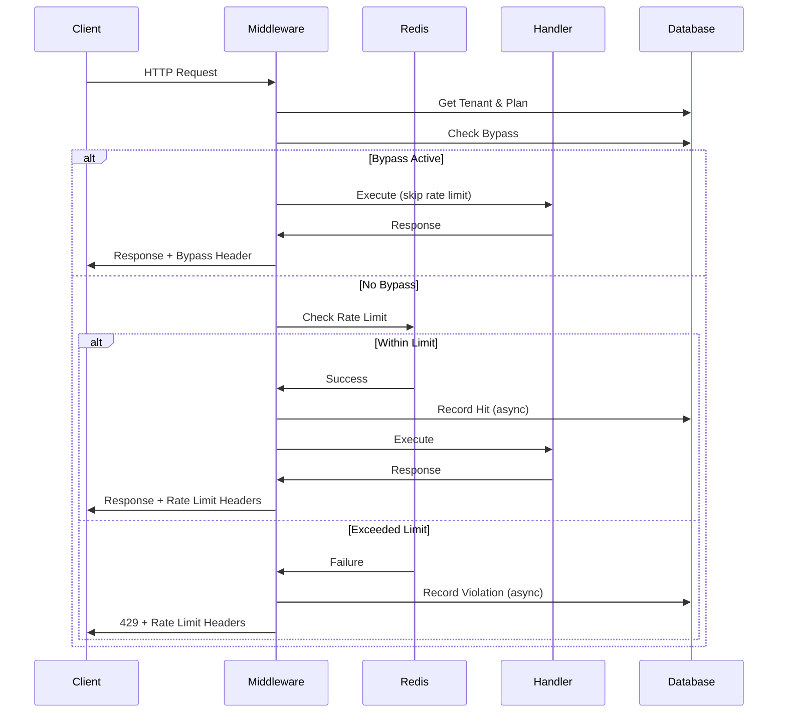

# Design Document: Rate Limiting Completion

## Overview

This design completes the rate limiting security feature for PricePilot by applying the existing rate limiting infrastructure to all API endpoints, adding comprehensive tests, and verifying configuration. The system already has a robust foundation with Upstash Redis integration, middleware, metrics tracking, and admin controls. This design focuses on systematic application of rate limiting across the API surface and ensuring correctness through testing.

### Existing Infrastructure

The following components are already implemented:

1. **Core Rate Limiting** (`lib/ratelimit.ts`):
   - Upstash Redis integration with sliding window algorithm
   - Six limiter types: auth, api, read, write, sync, importExport
   - Fallback to in-memory limiting when Redis is unavailable

2. **Middleware** (`lib/middleware/ratelimit.ts`):
   - `withRateLimit()` wrapper for API routes
   - Tenant-based rate limiting with plan multipliers
   - Bypass and custom multiplier support
   - Automatic header injection
   - Fail-open error handling

3. **Configuration** (`lib/services/rate-limit-config.ts`):
   - Plan multipliers (BASIC: 1.0x, PREMIUM: 2.0x, PRO: 5.0x)
   - Base endpoint limits
   - Alert thresholds

4. **Admin Controls** (`lib/services/rate-limit-admin.ts`):
   - Temporary bypasses
   - Custom multipliers
   - Status monitoring

5. **Metrics** (`lib/services/rate-limit-metrics.ts`):
   - Hit and violation tracking
   - Threshold-based alerting
   - Dashboard aggregation

6. **Database Models** (Prisma):
   - RateLimitMetric
   - RateLimitBypass
   - RateLimitCustomMultiplier

### Design Goals

1. **Comprehensive Coverage**: Apply rate limiting to all API endpoints with appropriate limiter types
2. **Minimal Changes**: Leverage existing infrastructure without major refactoring
3. **Testability**: Create comprehensive tests to verify correctness
4. **Documentation**: Provide clear guidance for developers and API consumers
5. **Monitoring**: Ensure visibility into rate limiting behavior

## Architecture

### Rate Limiting Flow



### Endpoint Classification Strategy

API endpoints are classified into categories based on their function:

1. **Authentication Endpoints** (`auth` limiter - 5 req/15min):
   - `/api/v1/auth/register`
   - `/api/v1/auth/login` (via NextAuth)
   - `/api/v1/auth/forgot-password`
   - `/api/v1/auth/reset-password`
   - `/api/v1/auth/change-password`
   - `/api/v1/auth/verify`

2. **Sync Endpoints** (`sync` limiter - 5 req/5min):
   - `/api/v1/sync/full`
   - `/api/v1/competitors/sync`
   - `/api/v1/integrations/sync`

3. **Import/Export Endpoints** (`importExport` limiter - 10 req/min):
   - `/api/v1/imports/products`
   - `/api/v1/imports/competitors`
   - `/api/v1/exports/products`
   - `/api/v1/exports/competitors`

4. **Write Endpoints** (`write` limiter - 30 req/min):
   - All POST, PUT, DELETE, PATCH requests not covered above
   - Examples: `/api/v1/products`, `/api/v1/competitors`, `/api/v1/price-update/bulk`

5. **Read Endpoints** (`read` limiter - 200 req/min):
   - All GET requests
   - Examples: `/api/v1/products`, `/api/v1/competitors`, `/api/v1/analytics/*`

6. **Unprotected Endpoints** (no rate limiting):
   - `/api/v1/health` - Health checks for monitoring
   - `/api/v1/cron/*` - Protected by authorization instead

### Admin Endpoint Strategy

Admin endpoints (`/api/v1/admin/*`) follow the same classification but with consideration for super admin status:

- Super admins can set bypasses for themselves if needed
- Admin endpoints use the same limiters (read/write/importExport) based on operation type
- No special rate limit exemptions by default (admins should use bypass feature if needed)

## Components and Interfaces

### Middleware Application Pattern

Each API route will use the `withRateLimit` middleware wrapper:

```typescript
// Example: Read endpoint
export async function GET(req: NextRequest) {
  return withRateLimit(req, 'read', async (req) => {
    // Handler logic
    return NextResponse.json({ data: [] });
  });
}

// Example: Write endpoint
export async function POST(req: NextRequest) {
  return withRateLimit(req, 'write', async (req) => {
    // Handler logic
    return NextResponse.json({ success: true });
  });
}

// Example: Auto-detect limiter type
export async function POST(req: NextRequest) {
  const limiterType = getRateLimiterType('POST', req.nextUrl.pathname);
  return withRateLimit(req, limiterType, async (req) => {
    // Handler logic
    return NextResponse.json({ success: true });
  });
}
```

### Endpoint Audit Structure

To systematically apply rate limiting, we'll create an audit structure:

```typescript
interface EndpointAudit {
  path: string;
  method: string;
  currentlyProtected: boolean;
  recommendedLimiter: RateLimiterType;
  requiresAuth: boolean;
  notes?: string;
}
```

### Configuration Verification

A configuration verification utility will check Upstash Redis setup:

```typescript
interface RedisConfigStatus {
  configured: boolean;
  urlPresent: boolean;
  tokenPresent: boolean;
  connectionHealthy: boolean;
  fallbackMode: boolean;
  warnings: string[];
}

async function verifyRedisConfig(): Promise<RedisConfigStatus> {
  // Check environment variables
  // Test connection
  // Return status
}
```

## Data Models

All required data models already exist in the Prisma schema:

### RateLimitMetric

```prisma
model RateLimitMetric {
  id             String   @id @default(uuid())
  tenantId       String
  limiterType    String   // 'auth', 'api', 'read', 'write', 'sync', 'importExport'
  identifier     String   // 'user:xxx' or 'ip:xxx'
  endpoint       String   // API route path
  hitCount       Int      @default(0)
  violationCount Int      @default(0)
  timestamp      DateTime @default(now())
  
  tenant         Tenant   @relation(fields: [tenantId], references: [id], onDelete: Cascade)
  
  @@index([tenantId, timestamp])
  @@index([limiterType, timestamp])
  @@index([tenantId, limiterType, timestamp])
}
```

### RateLimitBypass

```prisma
model RateLimitBypass {
  id         String   @id @default(uuid())
  tenantId   String
  setBy      String   // Admin user ID
  reason     String
  expiresAt  DateTime
  isActive   Boolean  @default(true)
  createdAt  DateTime @default(now())
  
  tenant     Tenant   @relation(fields: [tenantId], references: [id], onDelete: Cascade)
  
  @@index([tenantId, isActive, expiresAt])
}
```

### RateLimitCustomMultiplier

```prisma
model RateLimitCustomMultiplier {
  id         String   @id @default(uuid())
  tenantId   String   @unique
  multiplier Float
  setBy      String   // Admin user ID
  reason     String
  createdAt  DateTime @default(now())
  updatedAt  DateTime @updatedAt
  
  tenant     Tenant   @relation(fields: [tenantId], references: [id], onDelete: Cascade)
  
  @@index([tenantId])
}
```

No schema changes are required.
