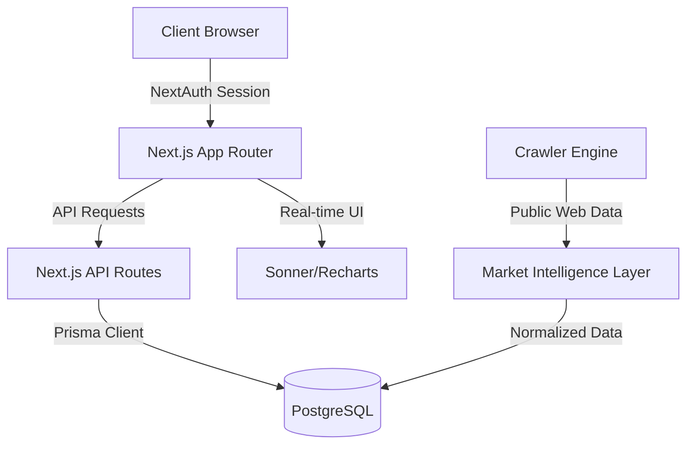

# 🛫 PricePilot

**Engineering the Future of E-commerce Yield Management.**

PricePilot is a professional-grade SaaS platform designed for high-velocity merchants. It provides real-time market intelligence, automated competitor monitoring, and tactical price execution to maximize margins and dominate market share.

---

## 🚀 Key Strategic Pillars

*   **⚡ Real-Time Intelligence**: Automated crawlers hunt for competitor price movements every 15 minutes.
*   **🎯 Tactical Execution**: Apply aggressive undercutting or margin-safe index scaling via the Execution Engine.
*   **📊 Market Command**: A high-fidelity dashboard provides a "Position Summary" of your standing (Cheapest, Neutral, Expensive).
*   **🔒 Enterprise Security**: Multi-tenant architecture with robust JWT-based route protection and encrypted API sync.

---

## 🛠 Technical Architecture

PricePilot is built on a modern, distributed stack designed for performance and vertical scaling.

### Core Stack
| Layer | Technology |
| :--- | :--- |
| **Framework** | [Next.js 16 (App Router)](https://nextjs.org/) |
| **Database** | [PostgreSQL](https://www.postgresql.org/) with [Prisma ORM](https://www.prisma.io/) |
| **Auth** | [NextAuth.js](https://next-auth.js.org/) (JWT Strategy) |
| **Styling** | [Tailwind CSS](https://tailwindcss.com/) & [Vanilla CSS](https://developer.mozilla.org/en-US/docs/Web/CSS) |
| **Charts** | [Recharts](https://recharts.org/) |
| **Icons** | [Lucide React](https://lucide.dev/) |
| **Alerts** | [Sonner](https://sonner.stevenly.me/) |

### System Flow


---

## ⚙️ Development Setup

### 1. Prerequisites
- Node.js 18.x or higher
- PostgreSQL instance (or Prisma Dev Proxy)

### 2. Environment Configuration
Create a `.env` file in the root directory:
```env
DATABASE_URL="your_postgresql_connection_string"
NEXTAUTH_SECRET="your_secure_random_hash"
NEXTAUTH_URL="http://localhost:3000"
```

### 3. Installation & Database Sync
```bash
# Install dependencies
npm install

# Generate Prisma client and run migrations
npx prisma generate
npx prisma db push

# Start the command center
npm run dev
```

---

## 🗺 Product Roadmap

- [x] **v1.0 (Current)**: UI/UX Redesign, Auth Integration, API Infrastructure.
- [ ] **v1.1**: Real-time Crawler Deployment (OpenCart/Laravel Integrations).
- [ ] **v1.2**: AI-Powered Dynamic Pricing Rules (ML model for elasticity).
- [ ] **v2.0**: Global Market Expansion & Multi-Currency Support.

---

## ⚖️ License

Distributed under the MIT License. See `LICENSE` for more information.

---

<p align="center">
  <b>Built for winners, by senior architects.</b><br>
  © 2026 PricePilot Engineering Team
</p>
