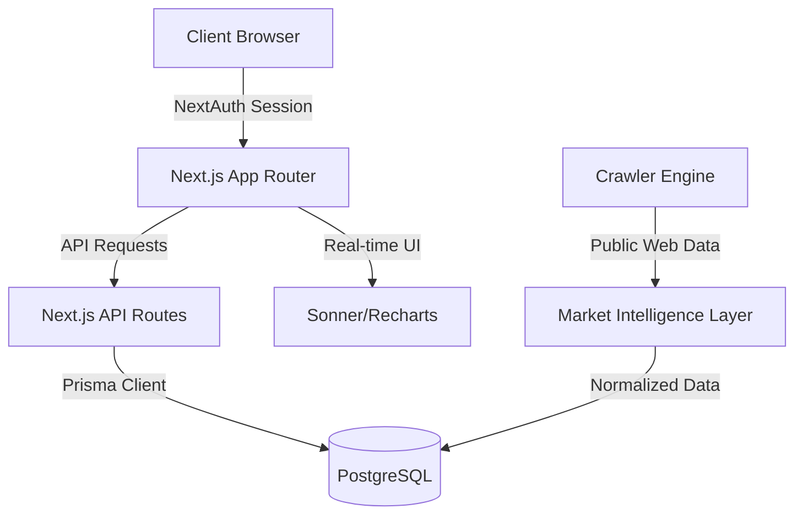

# 🛫 PricePilot

**Engineering the Future of E-commerce Yield Management.**

PricePilot is a professional-grade SaaS platform designed for high-velocity merchants. It provides real-time market intelligence, automated competitor monitoring, and tactical price execution to maximize margins and dominate market share.

**Version 1.5** | February 2026

---

## 🚀 Key Strategic Pillars

*   **⚡ Real-Time Intelligence**: Automated crawlers with advanced stealth capabilities monitor competitor prices every 24 hours.
*   **🎯 Tactical Execution**: Apply aggressive undercutting or margin-safe index scaling via the Execution Engine.
*   **📊 Market Command**: A high-fidelity dashboard provides a "Position Summary" of your standing (Cheapest, Neutral, Expensive).
*   **🔒 Enterprise Security**: Multi-tenant architecture with AES-256 encryption, rate limiting, and comprehensive audit trails.
*   **🕵️ Advanced Stealth**: Intelligent proxy management, challenge detection, and human behavior simulation to bypass anti-bot systems.
*   **🤖 Intelligent Automation**: Auto-approval rules, email notifications, and approval delegation for streamlined workflows.
*   **🔄 Rollback Capability**: Undo incorrect price changes with one click, complete with full audit trail.

---

## 🛠 Technical Architecture

PricePilot is built on a modern, distributed stack designed for performance and vertical scaling.

### Core Stack
| Layer | Technology |
| :--- | :--- |
| **Framework** | [Next.js 16 (App Router)](https://nextjs.org/) |
| **Database** | [PostgreSQL](https://www.postgresql.org/) with [Prisma ORM](https://www.prisma.io/) |
| **Auth** | [NextAuth.js](https://next-auth.js.org/) (JWT Strategy) |
| **Styling** | [Tailwind CSS](https://tailwindcss.com/) & [Vanilla CSS](https://developer.mozilla.org/en-US/docs/Web/CSS) |
| **Charts** | [Recharts](https://recharts.org/) |
| **Icons** | [Lucide React](https://lucide.dev/) |
| **Alerts** | [Sonner](https://sonner.stevenly.me/) |

### System Flow


---

## ⚙️ Development Setup

### 1. Prerequisites
- Node.js 18.x or higher
- PostgreSQL instance (or Prisma Dev Proxy)

### 2. Environment Configuration
Create a `.env` file in the root directory:
```env
# Database
DATABASE_URL="your_postgresql_connection_string"

# Authentication
NEXTAUTH_SECRET="your_secure_random_hash"
NEXTAUTH_URL="http://localhost:3000"

# Security (v1.5+)
ENCRYPTION_KEY="your_32_byte_hex_key"  # Generate with: openssl rand -hex 32

# Redis (for caching and rate limiting)
UPSTASH_REDIS_REST_URL="your_redis_url"
UPSTASH_REDIS_REST_TOKEN="your_redis_token"

# Email Notifications (Optional)
SMTP_HOST="smtp.gmail.com"
SMTP_PORT="587"
SMTP_SECURE="false"
SMTP_USER="your-email@gmail.com"
SMTP_PASS="your-app-password"
SMTP_FROM="noreply@pricepilot.com"

# Advanced Scraping (Optional)
SCRAPER_PROXIES="http://proxy1:8080,http://proxy2:8080"
PROXY_USERNAME="your_proxy_username"
PROXY_PASSWORD="your_proxy_password"
STEALTH_LEVEL="advanced"
BLOCK_RATE_THRESHOLD="0.3"
```

See [docs/ENVIRONMENT_VARIABLES.md](docs/ENVIRONMENT_VARIABLES.md) for complete configuration options.

### 3. Installation & Database Sync
```bash
# Install dependencies
npm install

# Generate Prisma client and run migrations
npx prisma generate
npx prisma db push

# Start the command center
npm run dev
```

---

## 📚 Documentation

### User Guides
- **[Main Documentation](DOCUMENTATION.md)**: Complete user guide for merchants and administrators
- **[Auto-Approval Rules Guide](DOCUMENTATION.md#auto-approval-rules-guide)**: Automate price approval workflows
- **[Email Notifications Guide](DOCUMENTATION.md#email-notifications)**: Configure email alerts and summaries
- **[Approval Delegation Guide](DOCUMENTATION.md#approval-delegation)**: Delegate approval authority to team members
- **[Rollback Procedures](DOCUMENTATION.md#rollback-procedures)**: Undo incorrect price changes
- **[Troubleshooting Guide](DOCUMENTATION.md#troubleshooting-guide)**: Common issues and solutions
- **[Admin Dashboard Guide](docs/ADMIN_GUIDE.md)**: Step-by-step guide for admin monitoring dashboards
- **[Tenant Dashboard Guide](docs/TENANT_GUIDE.md)**: Guide for tenant metrics and configuration

### Technical Documentation
- **[Architecture Guide](docs/ARCHITECTURE.md)**: System architecture and component overview
- **[API Documentation Index](docs/API_DOCUMENTATION_INDEX.md)**: Complete API reference
- **[API Authentication](docs/API_AUTHENTICATION.md)**: Authentication methods and security
- **[API Error Codes](docs/API_ERROR_CODES.md)**: Error code reference
- **[API Usage Examples](docs/API_USAGE_EXAMPLES.md)**: Code examples for common operations
- **[Stealth Scraping Guide](docs/STEALTH_SCRAPING.md)**: Advanced scraping features and configuration
- **[Monitoring UI Guide](docs/MONITORING_UI.md)**: Comprehensive monitoring dashboard documentation
- **[Site Profile Examples](docs/SITE_PROFILE_EXAMPLES.md)**: Configuration examples for various scenarios
- **[Environment Variables](docs/ENVIRONMENT_VARIABLES.md)**: Complete environment variable reference
- **[Deployment Guide](docs/DEPLOYMENT.md)**: Production deployment instructions
- **[Runbook](docs/RUNBOOK.md)**: Operational procedures and troubleshooting

### Security & Performance
- **[Security Requirements](docs/INPUT_VALIDATION_GUIDE.md)**: Input validation and security best practices
- **[Rate Limiting Guide](docs/RATE_LIMITING.md)**: Rate limiting configuration and enforcement
- **[Error Handling Guide](docs/ERROR_HANDLING_GUIDE.md)**: Error handling patterns and best practices
- **[Rollback Implementation](docs/ROLLBACK_PROCEDURES.md)**: Technical rollback implementation details

### Performance & Caching Documentation
- **[Cache Configuration Guide](docs/CACHE_CONFIGURATION.md)**: Complete cache setup and configuration
- **[Cache Quick Reference](docs/CACHE_QUICK_REFERENCE.md)**: Quick reference for cache operations
- **[Cache Invalidation Patterns](docs/CACHE_INVALIDATION_PATTERNS.md)**: Cache invalidation strategies
- **[Cache Warming Strategies](docs/CACHE_WARMING_STRATEGIES.md)**: Proactive cache loading techniques
- **[Cache Monitoring Guide](docs/CACHE_MONITORING.md)**: Performance monitoring and metrics
- **[Cache Troubleshooting Guide](docs/CACHE_TROUBLESHOOTING.md)**: Common issues and solutions
- **[Redis Configuration](docs/REDIS_CONFIGURATION.md)**: Redis setup and connectivity
- **[Redis Memory Configuration](docs/REDIS_MEMORY_CONFIGURATION.md)**: Memory limits and eviction
- **[Distributed Cache Invalidation](docs/DISTRIBUTED_CACHE_INVALIDATION.md)**: Multi-instance caching

---

## 🆕 What's New in v1.5 (February 2026)

### Security Enhancements
- **API Token Encryption**: AES-256-GCM encryption for all API tokens at rest
- **Rate Limiting**: Comprehensive rate limiting (100 req/hour API, 10 req/min scraping)
- **Input Validation**: Enhanced validation to prevent SQL injection and XSS attacks
- **Security Audit**: Complete security review and vulnerability fixes

### Performance Optimizations
- **Database Indexing**: 15+ strategic indexes for 10x faster queries
- **Redis Caching**: Intelligent caching with 1-hour TTL for expensive operations
- **Query Optimization**: Eliminated N+1 query problems across all services
- **Pagination**: Efficient pagination on all list endpoints (max 100 items/page)

### New Features
- **Rollback System**: Undo single or bulk price changes with full audit trail
- **Email Notifications**: Pending approvals, daily summaries, and auto-approval alerts
- **Approval Delegation**: Temporarily delegate approval authority to team members
- **Auto-Approval Rules**: Automate routine price approvals with intelligent conditions
- **Enhanced Error Handling**: Custom error classes with user-friendly messages
- **Comprehensive Monitoring**: Real-time dashboards for system health and performance

### Bug Fixes
- Removed mock data fallbacks in production code
- Completed OpenCart and Laravel price update APIs
- Fixed scraper edge cases and memory leaks
- Improved product matching accuracy
- Enhanced pricing rules engine reliability

See [DOCUMENTATION.md](DOCUMENTATION.md) for complete details.

---

## 🗺 Product Roadmap

- [x] **v1.0**: UI/UX Redesign, Auth Integration, API Infrastructure
- [x] **v1.5 (Current)**: Security, Performance, Auto-Approval, Rollback, Email Notifications
- [ ] **v1.6**: Real-time WebSocket price updates, Mobile app (iOS & Android)
- [ ] **v2.0**: AI-Powered Dynamic Pricing Rules (ML model for elasticity)
- [ ] **v2.1**: Global Market Expansion & Multi-Currency Support

---

## ⚖️ License

Distributed under the MIT License. See `LICENSE` for more information.

---

<p align="center">
  <b>Built for winners, by senior architects.</b><br>
  © 2026 PricePilot Engineering Team
</p>
