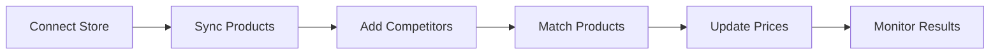

# Quick Start Guide

Get up and running with PricePilot in just 5 simple steps.

## Step 1: Connect Your Store

First, integrate your e-commerce platform with PricePilot:

### For OpenCart Users
1. Download the PricePilot module from your dashboard
2. Install the module in your OpenCart admin panel
3. Generate an API token
4. Enter the token in PricePilot settings

See the detailed [OpenCart Setup Guide](../integrations/opencart-setup) for more information.

### For Laravel Users
1. Install the PricePilot package via Composer
2. Publish the configuration
3. Generate an API token
4. Configure the token in your environment

See the detailed [Laravel Setup Guide](../integrations/laravel-setup) for more information.

## Step 2: Sync Your Products

Once connected, PricePilot will automatically sync your product catalog:

```bash
# Products are synced automatically every hour
# You can also trigger a manual sync from the dashboard
```

Navigate to **Products** → **My Products** to view your synced products.

## Step 3: Add Competitors

Add competitor websites you want to track:

1. Go to **Competitors** → **Add Competitor**
2. Enter the competitor's website URL
3. Configure scraping settings (optional)
4. Save the competitor

PricePilot will begin scraping competitor products within minutes. After the initial scrape, competitor prices are automatically updated every 24 hours to ensure you have fresh pricing data.

## Step 4: Match Products

PricePilot automatically matches your products with competitor products using:

- **SKU matching** - Exact SKU matches
- **Brand + Model** - Matches based on brand and model
- **Fuzzy matching** - Intelligent title matching

Review and confirm matches in **Products** → **Product Matching**.

## Step 5: Update Prices

Once products are matched, you can update your prices:

1. Go to **Pricing** → **Price Comparison**
2. Review the comparison table (RED = competitor cheaper, GREEN = you're cheaper)
3. Select products to update
4. Choose your update strategy:
   - Fixed undercut ($50, $100, custom)
   - Percentage undercut (5%, 10%)
5. Set safety constraints (min price, max discount)
6. Click **Update Prices**

Your prices will be updated on your store within seconds!

## Next Steps

Now that you're set up, explore these guides:

- [Product Setup Guide](../products/product-setup) - Learn about product management
- [Price Update Strategies](../pricing/update-strategies) - Master pricing strategies
- [Troubleshooting](../troubleshooting/common-issues) - Solve common issues

## Video Tutorial

Watch our 5-minute video tutorial for a visual walkthrough:



## Need Help?

If you encounter any issues during setup:
- Check our [Troubleshooting Guide](../troubleshooting/common-issues)
- Review the [FAQ](../troubleshooting/faq)
- Contact our support team
