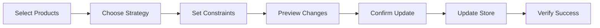

# Price Updates

Learn how to strategically update your product prices using PricePilot.

## Understanding the Price Comparison Table

The price comparison table shows your competitive position:

| Color | Meaning | Action |
|-------|---------|--------|
| 🔴 RED | Competitor price is lower | Consider price reduction |
| 🟢 GREEN | Your price is lower | Maintain competitive advantage |
| ⚪ NEUTRAL | Prices are equal | Monitor closely |

## Update Strategies

### Fixed Undercut
Reduce your price by a fixed amount:

```typescript
// Example: Undercut by $50
newPrice = competitorPrice - 50;

// Your price: $299
// Competitor: $349
// New price: $299 (already lower, no change)

// Your price: $399
// Competitor: $349
// New price: $299 ($50 below competitor)
```

**Best for**: Products with stable margins

### Percentage Undercut
Reduce your price by a percentage:

```typescript
// Example: Undercut by 5%
newPrice = competitorPrice * 0.95;

// Your price: $299
// Competitor: $349
// New price: $331.55 (5% below competitor)
```

**Best for**: Products with variable pricing

### Match Price
Set your price equal to competitor:

```typescript
// Example: Match competitor price
newPrice = competitorPrice;

// Your price: $299
// Competitor: $349
// New price: $349
```

**Best for**: Maintaining market parity

## Safety Constraints

Protect your margins with safety constraints:

### Minimum Price Floor
Never go below this price:

```typescript
{
  minPrice: 250.00,
  // Even if competitor is $200, your price stays at $250
}
```

### Maximum Discount Limit
Never discount more than this percentage:

```typescript
{
  maxDiscount: 0.20, // 20%
  currentPrice: 400,
  // Minimum allowed price: $320 (20% discount)
}
```

### Update Only RED Items
Only update products where competitors are cheaper:

```typescript
{
  updateOnlyRed: true,
  // GREEN products are not updated
}
```

## Performing Price Updates

### Single Product Update

1. Navigate to **Pricing** → **Price Comparison**
2. Find the product to update
3. Click **Update Price**
4. Choose strategy and constraints
5. Preview new price
6. Confirm update

### Bulk Price Update

Update multiple products at once:

1. Navigate to **Pricing** → **Price Comparison**
2. Select products using checkboxes
3. Click **Bulk Update**
4. Choose strategy:
   - Fixed undercut: $50, $100, or custom
   - Percentage: 5%, 10%, or custom
5. Set safety constraints:
   - Minimum price floor
   - Maximum discount
6. Preview changes
7. Confirm bulk update

```typescript
// Example bulk update
{
  products: [101, 102, 103],
  strategy: "percentage",
  value: 0.05, // 5%
  constraints: {
    minPrice: null, // Use product-specific minimums
    maxDiscount: 0.20, // 20% max discount
    updateOnlyRed: true
  }
}
```

## Update Execution

### Immediate Updates
Updates are applied to your store within seconds:



### Update Status

Track update status in real-time:

| Status | Description |
|--------|-------------|
| Pending | Update queued |
| In Progress | Updating store |
| Success | Update completed |
| Failed | Update error |

### Rollback

If needed, rollback price changes:

1. Go to **Pricing** → **Update History**
2. Find the update to rollback
3. Click **Rollback**
4. Confirm rollback

⚠️ **Note**: Rollback restores previous prices, not current competitor prices.

## Update History

View all price updates:

```typescript
{
  productId: "101",
  oldPrice: 399.99,
  newPrice: 349.99,
  strategy: "fixed",
  value: 50,
  executedBy: "user@example.com",
  executedAt: "2024-01-15T10:30:00Z",
  status: "success"
}
```

### Audit Trail
Every update is logged:
- Who made the update
- When it was made
- What changed
- Why it changed (strategy used)

## Best Practices

### 1. Start Conservative
Begin with small adjustments:

```typescript
// Good: Conservative start
strategy: "percentage",
value: 0.03 // 3%

// Risky: Aggressive start
strategy: "percentage",
value: 0.15 // 15%
```

### 2. Always Set Minimum Prices
Protect your margins:

```typescript
// Always set minimum prices
product.minPrice = costPrice * 1.20; // 20% margin minimum
```

### 3. Review Before Confirming
Always preview changes:
- Check new prices make sense
- Verify margins are acceptable
- Ensure no errors in calculation

### 4. Monitor Results
Track the impact of price changes:
- Sales volume changes
- Revenue impact
- Competitive position

### 5. Update Regularly
Keep prices competitive:
- Daily for fast-moving products
- Weekly for stable products
- Monthly for seasonal products

## Troubleshooting

### Update Failed?

**Possible causes:**
- Store API unavailable
- Invalid API token
- Product not found in store
- Price validation failed

**Solutions:**
- Check API connection
- Verify API token is valid
- Ensure product exists in store
- Check price constraints

### Price Not Updating?

**Possible causes:**
- Minimum price constraint blocking update
- Maximum discount constraint blocking update
- Product status is inactive

**Solutions:**
- Review safety constraints
- Check product status
- Verify update settings

### Wrong Price Applied?

**Possible causes:**
- Incorrect strategy selected
- Calculation error
- Stale competitor data

**Solutions:**
- Use rollback feature
- Verify strategy settings
- Refresh competitor data

## Next Steps

- Learn about [Update Strategies](update-strategies)
- Review [Product Matching](../products/product-matching)
- Check [Troubleshooting Guide](../troubleshooting/common-issues)
