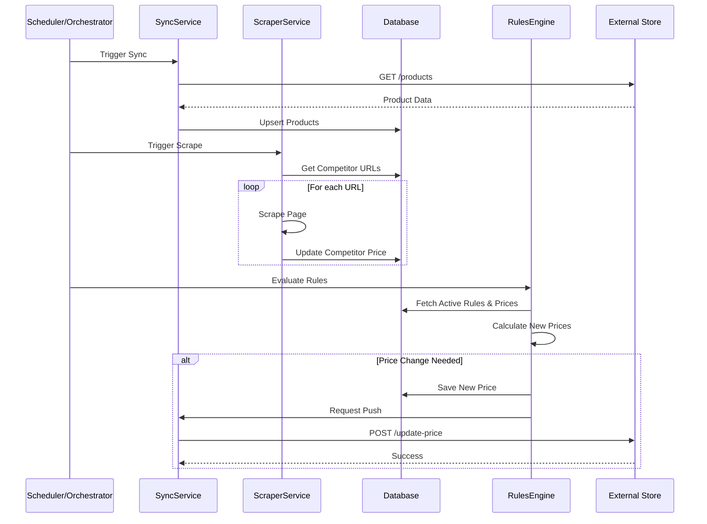

# System Architecture

## Overview

PricePilot is a competitive pricing intelligence and automation platform. It allows merchants to monitor competitor prices, define automated repricing rules, and sync optimal prices back to their e-commerce stores (OpenCart, Laravel, etc.).

## Tech Stack

- **Frontend**: Next.js 14 (App Router), React, Tailwind CSS, Lucide Icons, Shadcn UI.
- **Backend**: Next.js API Routes (Serverless functions).
- **Database**: MySQL (via Prisma ORM).
- **Automation**: Playwright (Scraping), Axios (API Sync).
- **Authentication**: NextAuth.js.

## High-Level Architecture

```mermaid
graph TD
    User[User / Merchant] -->|HTTPS| WebApp[Next.js Web Application]

    subgraph "Frontend Layer"
        WebApp -->|React| Dashboard[Dashboard UI]
        WebApp -->|React| AdminPanel[Admin Panel]
        WebApp -->|React| MonitoringUI[Monitoring Dashboards]
    end

    subgraph "Service Layer"
        WebApp -->|API Routes| APIGateway[Next.js API Routes]

        APIGateway --> SyncService[Sync Service]
        APIGateway --> RulesEngine[Rules Engine]
        APIGateway --> NotificationService[Notification Service]
        APIGateway --> ScraperService[Scraper Service]
        APIGateway --> ProxyManager[Proxy Manager]
        APIGateway --> ChallengeHandler[Challenge Handler]
        APIGateway --> MetricsTracker[Metrics Tracker]
    end

    subgraph "Data Layer"
        APIGateway --> Prisma[Prisma ORM]
        SyncService --> Prisma
        RulesEngine --> Prisma
        MetricsTracker --> Prisma
        Prisma --> DB[(MySQL Database)]
    end

    subgraph "External World"
        SyncService -->|REST API| UserStore[User Store (OpenCart/Laravel)]
        ScraperService -->|Headless Browser| CompetitorSite[Competitor Sites]
        NotificationService -->|Webhooks| Slack[Slack/Discord]
    end
```

## Core Data Flows

### 1. Product Sync & Pricing Logic

This is the core loop of the application:

1.  **Ingest**: `SyncOrchestrator` triggers a sync job.
2.  **Fetch**:
    *   `SyncService` pulls user product data from their external store (OpenCart/Laravel).
    *   `ScraperService` crawls competitor sites for matching products.
3.  **Process**: Data is normalized and saved to `Products` and `PriceHistory` tables.
4.  **Analyze**: `RulesEngine` evaluates active pricing rules (e.g., "Undercut by 5%") against new competitor data.
5.  **Act**:
    *   If a rule triggers, a new price is calculated.
    *   `SyncService` pushes the new price back to the User Store.
    *   `NotificationService` alerts the user.



## Key Services

### `SyncService` (`lib/services/sync.ts`)
Handles communication with the user's external e-commerce platforms.
- **Features**: Authentication, Validation (Zod), Retry Logic (Exponential Backoff).
- **Supported Platforms**: OpenCart, Laravel (extensible).

### `ScraperService` (`lib/services/scraper.ts`)
Responsible for gathering data from competitor websites with advanced stealth capabilities.
- **Technology**: Playwright (Headless Chromium) with playwright-extra stealth plugins.
- **Capabilities**: 
  - Advanced fingerprinting protection (canvas, audio, fonts, WebRTC)
  - Intelligent proxy rotation with health monitoring
  - Challenge detection and handling (Cloudflare, Turnstile, reCAPTCHA, PerimeterX, DataDome)
  - Human behavior simulation (realistic typing, mouse movement, scrolling)
  - Adaptive rate limiting and bot-evasion profiles
  - Comprehensive metrics tracking and alerting

### `ProxyManager` (`lib/services/proxy-manager.ts`)
Manages proxy pool with intelligent health monitoring and performance tracking.
- **Features**: Proxy classification (residential/datacenter), health status tracking, automatic rotation
- **Capabilities**: Performance metrics, failure threshold detection, periodic health checks, proxy recovery

### `ChallengeHandler` (`lib/services/challenge-handler.ts`)
Detects and handles anti-bot challenges from various protection systems.
- **Supported Systems**: Cloudflare, Turnstile, reCAPTCHA, PerimeterX, DataDome
- **Features**: Exponential backoff waiting, solve rate tracking, fallback strategy triggering

### `MetricsTracker` (`lib/services/metrics-tracker.ts`)
Tracks and persists scraping performance metrics.
- **Metrics**: Block rates, success rates, response times, proxy performance
- **Features**: Time-range filtering, threshold alerting, automatic persistence to database

### `MetricsTracker` (`lib/services/metrics-tracker.ts`)
Tracks and persists scraping performance metrics.
- **Metrics**: Block rates, success rates, response times, proxy performance
- **Features**: Time-range filtering, threshold alerting, automatic persistence to database

### `HumanSimulation` (`lib/services/human-simulation.ts`)
Simulates realistic human behavior patterns during scraping.
- **Features**: Realistic typing, mouse movement, form interaction, random pauses
- **Configurable**: Adjustable delays and behavior patterns via admin UI

### `SiteProfileManager` (`lib/config/site-profiles.ts`)
Manages per-site scraping configurations and adaptive behavior.
- **Features**: Rate limiting, adaptive delays, session warmup, referrer chain tracking
- **Templates**: Pre-configured profiles for common anti-bot systems

### `RulesEngine` (`lib/services/rules-engine.ts`)
The intelligence core that determines pricing.
- **Logic**: evaluating conditions (Match, Undercut, Margin Lock).
- **Optimization**: Batch processing for large datasets.

### `NotificationService` (`lib/services/notification.ts`)
Manages internal and external alerts.
- **Channels**: In-App (Db), Webhooks (planned: Email).

## Directory Structure

```
/
├── app/                  # Next.js App Router Pages & API
│   ├── api/              # Backend API Endpoints
│   │   └── v1/
│   │       ├── admin/    # Admin API endpoints
│   │       │   ├── proxy-health/
│   │       │   ├── challenge-stats/
│   │       │   ├── scraping-metrics/
│   │       │   ├── active-sessions/
│   │       │   ├── human-simulation-config/
│   │       │   ├── site-profiles/
│   │       │   └── alerts/
│   │       └── tenant/   # Tenant API endpoints
│   │           ├── scraping-metrics/
│   │           └── site-config/
│   ├── dashboard/        # Merchant UI
│   │   ├── metrics/      # Tenant metrics dashboard
│   │   └── site-config/  # Tenant site configuration
│   └── admin/            # Super Admin UI
│       ├── proxy-health/ # Proxy health dashboard
│       ├── challenge-stats/ # Challenge detection dashboard
│       ├── scraping-metrics/ # Scraping metrics dashboard
│       ├── monitor/      # Real-time scraping monitor
│       ├── human-simulation/ # Human simulation settings
│       ├── site-profiles/ # Site profile management
│       └── alerts/       # Alert management
├── components/           # React Components (UI Library)
├── lib/                  # Shared Business Logic
│   ├── services/         # Core Services (Sync, Scrape, etc.)
│   ├── validation/       # Zod Schemas
│   └── prisma.ts         # DB Client
├── prisma/               # Database Schema & Migrations
├── docs/                 # Documentation
│   ├── ARCHITECTURE.md   # System architecture
│   ├── STEALTH_SCRAPING.md # Stealth scraping guide
│   ├── MONITORING_UI.md  # Monitoring UI guide
│   └── API_MONITORING.md # Monitoring API reference
└── public/               # Static Assets
```
