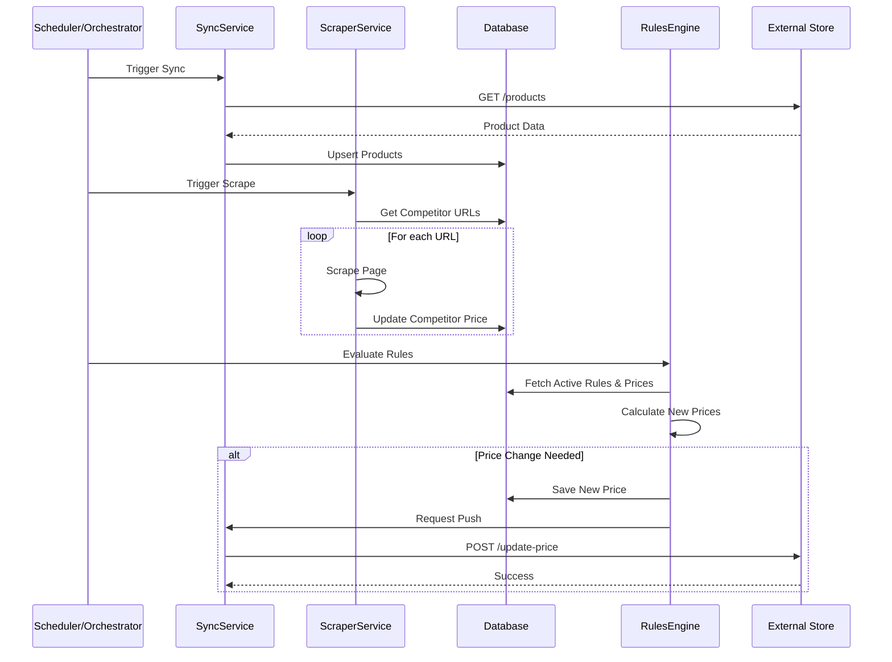

# System Architecture

## Overview

PricePilot is a competitive pricing intelligence and automation platform. It allows merchants to monitor competitor prices, define automated repricing rules, and sync optimal prices back to their e-commerce stores (OpenCart, Laravel, etc.).

## Tech Stack

- **Frontend**: Next.js 14 (App Router), React, Tailwind CSS, Lucide Icons, Shadcn UI.
- **Backend**: Next.js API Routes (Serverless functions).
- **Database**: MySQL (via Prisma ORM).
- **Automation**: Playwright (Scraping), Axios (API Sync).
- **Authentication**: NextAuth.js.

## High-Level Architecture

```mermaid
graph TD
    User[User / Merchant] -->|HTTPS| WebApp[Next.js Web Application]

    subgraph "Frontend Layer"
        WebApp -->|React| Dashboard[Dashboard UI]
        WebApp -->|React| AdminPanel[Admin Panel]
    end

    subgraph "Service Layer"
        WebApp -->|API Routes| APIGateway[Next.js API Routes]

        APIGateway --> SyncService[Sync Service]
        APIGateway --> RulesEngine[Rules Engine]
        APIGateway --> NotificationService[Notification Service]
        APIGateway --> ScraperService[Scraper Service]
    end

    subgraph "Data Layer"
        APIGateway --> Prisma[Prisma ORM]
        SyncService --> Prisma
        RulesEngine --> Prisma
        Prisma --> DB[(MySQL Database)]
    end

    subgraph "External World"
        SyncService -->|REST API| UserStore[User Store (OpenCart/Laravel)]
        ScraperService -->|Headless Browser| CompetitorSite[Competitor Sites]
        NotificationService -->|Webhooks| Slack[Slack/Discord]
    end
```

## Core Data Flows

### 1. Product Sync & Pricing Logic

This is the core loop of the application:

1.  **Ingest**: `SyncOrchestrator` triggers a sync job.
2.  **Fetch**:
    *   `SyncService` pulls user product data from their external store (OpenCart/Laravel).
    *   `ScraperService` crawls competitor sites for matching products.
3.  **Process**: Data is normalized and saved to `Products` and `PriceHistory` tables.
4.  **Analyze**: `RulesEngine` evaluates active pricing rules (e.g., "Undercut by 5%") against new competitor data.
5.  **Act**:
    *   If a rule triggers, a new price is calculated.
    *   `SyncService` pushes the new price back to the User Store.
    *   `NotificationService` alerts the user.



## Key Services

### `SyncService` (`lib/services/sync.ts`)
Handles communication with the user's external e-commerce platforms.
- **Features**: Authentication, Validation (Zod), Retry Logic (Exponential Backoff).
- **Supported Platforms**: OpenCart, Laravel (extensible).

### `ScraperService` (`lib/services/scraper.ts`)
Responsible for gathering data from competitor websites.
- **Technology**: Playwright (Headless Chromium).
- **Capabilities**: Proxy rotation, User-Agent rotation, DOM parsing, JSON-LD extraction.

### `RulesEngine` (`lib/services/rules-engine.ts`)
The intelligence core that determines pricing.
- **Logic**: evaluating conditions (Match, Undercut, Margin Lock).
- **Optimization**: Batch processing for large datasets.

### `NotificationService` (`lib/services/notification.ts`)
Manages internal and external alerts.
- **Channels**: In-App (Db), Webhooks (planned: Email).

## Directory Structure

```
/
├── app/                  # Next.js App Router Pages & API
│   ├── api/              # Backend API Endpoints
│   ├── dashboard/        # Merchant UI
│   └── admin/            # Super Admin UI
├── components/           # React Components (UI Library)
├── lib/                  # Shared Business Logic
│   ├── services/         # Core Services (Sync, Scrape, etc.)
│   ├── validation/       # Zod Schemas
│   └── prisma.ts         # DB Client
├── prisma/               # Database Schema & Migrations
└── public/               # Static Assets
```
