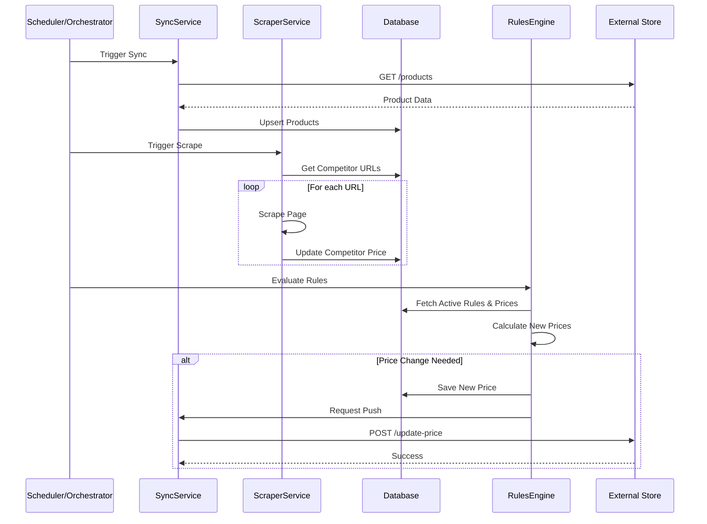
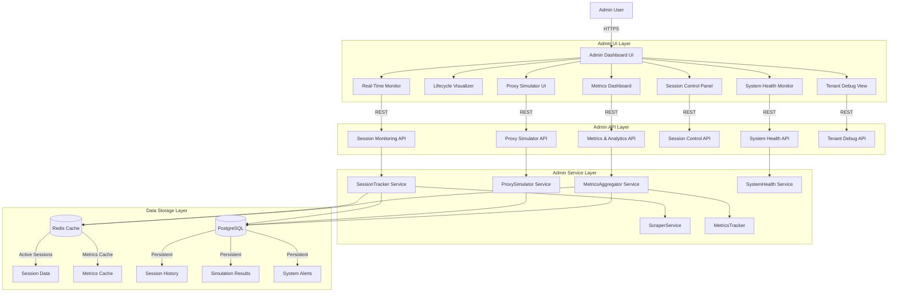
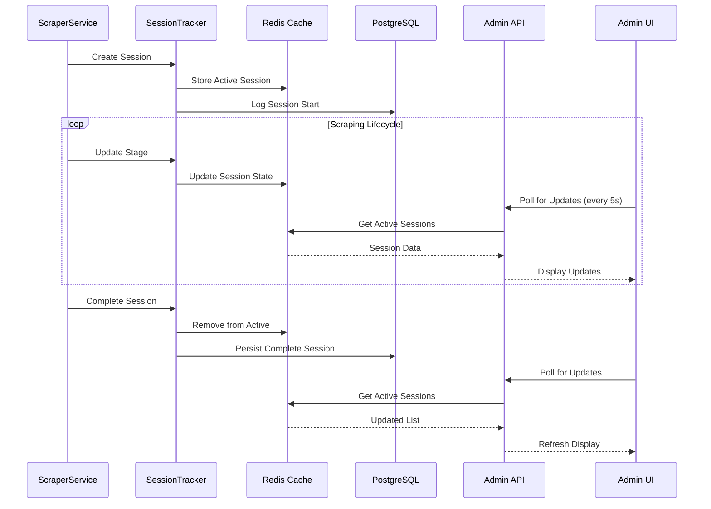

# System Architecture

## Overview

PricePilot is a competitive pricing intelligence and automation platform. It allows merchants to monitor competitor prices, define automated repricing rules, and sync optimal prices back to their e-commerce stores (OpenCart, Laravel, etc.).

## Tech Stack

- **Frontend**: Next.js 14 (App Router), React, Tailwind CSS, Lucide Icons, Shadcn UI.
- **Backend**: Next.js API Routes (Serverless functions).
- **Database**: MySQL (via Prisma ORM).
- **Automation**: Playwright (Scraping), Axios (API Sync).
- **Authentication**: NextAuth.js.

## High-Level Architecture

```mermaid
graph TD
    User[User / Merchant] -->|HTTPS| WebApp[Next.js Web Application]

    subgraph "Frontend Layer"
        WebApp -->|React| Dashboard[Dashboard UI]
        WebApp -->|React| AdminPanel[Admin Panel]
        WebApp -->|React| MonitoringUI[Monitoring Dashboards]
    end

    subgraph "Service Layer"
        WebApp -->|API Routes| APIGateway[Next.js API Routes]

        APIGateway --> SyncService[Sync Service]
        APIGateway --> RulesEngine[Rules Engine]
        APIGateway --> NotificationService[Notification Service]
        APIGateway --> ScraperService[Scraper Service]
        APIGateway --> ProxyManager[Proxy Manager]
        APIGateway --> ChallengeHandler[Challenge Handler]
        APIGateway --> MetricsTracker[Metrics Tracker]
    end

    subgraph "Data Layer"
        APIGateway --> Prisma[Prisma ORM]
        SyncService --> Prisma
        RulesEngine --> Prisma
        MetricsTracker --> Prisma
        Prisma --> DB[(MySQL Database)]
    end

    subgraph "External World"
        SyncService -->|REST API| UserStore[User Store (OpenCart/Laravel)]
        ScraperService -->|Headless Browser| CompetitorSite[Competitor Sites]
        NotificationService -->|Webhooks| Slack[Slack/Discord]
    end
```

## Core Data Flows

### 1. Product Sync & Pricing Logic

This is the core loop of the application:

1.  **Ingest**: `SyncOrchestrator` triggers a sync job.
2.  **Fetch**:
    *   `SyncService` pulls user product data from their external store (OpenCart/Laravel).
    *   `ScraperService` crawls competitor sites for matching products.
3.  **Process**: Data is normalized and saved to `Products` and `PriceHistory` tables.
4.  **Analyze**: `RulesEngine` evaluates active pricing rules (e.g., "Undercut by 5%") against new competitor data.
5.  **Act**:
    *   If a rule triggers, a new price is calculated.
    *   `SyncService` pushes the new price back to the User Store.
    *   `NotificationService` alerts the user.



## Key Services

### `SyncService` (`lib/services/sync.ts`)
Handles communication with the user's external e-commerce platforms.
- **Features**: Authentication, Validation (Zod), Retry Logic (Exponential Backoff).
- **Supported Platforms**: OpenCart, Laravel (extensible).

### `ScraperService` (`lib/services/scraper.ts`)
Responsible for gathering data from competitor websites with advanced stealth capabilities.
- **Technology**: Playwright (Headless Chromium) with playwright-extra stealth plugins.
- **Capabilities**: 
  - Advanced fingerprinting protection (canvas, audio, fonts, WebRTC)
  - Intelligent proxy rotation with health monitoring
  - Challenge detection and handling (Cloudflare, Turnstile, reCAPTCHA, PerimeterX, DataDome)
  - Human behavior simulation (realistic typing, mouse movement, scrolling)
  - Adaptive rate limiting and bot-evasion profiles
  - Comprehensive metrics tracking and alerting

### `ProxyManager` (`lib/services/proxy-manager.ts`)
Manages proxy pool with intelligent health monitoring and performance tracking.
- **Features**: Proxy classification (residential/datacenter), health status tracking, automatic rotation
- **Capabilities**: Performance metrics, failure threshold detection, periodic health checks, proxy recovery

### `ChallengeHandler` (`lib/services/challenge-handler.ts`)
Detects and handles anti-bot challenges from various protection systems.
- **Supported Systems**: Cloudflare, Turnstile, reCAPTCHA, PerimeterX, DataDome
- **Features**: Exponential backoff waiting, solve rate tracking, fallback strategy triggering

### `MetricsTracker` (`lib/services/metrics-tracker.ts`)
Tracks and persists scraping performance metrics.
- **Metrics**: Block rates, success rates, response times, proxy performance
- **Features**: Time-range filtering, threshold alerting, automatic persistence to database

### `MetricsTracker` (`lib/services/metrics-tracker.ts`)
Tracks and persists scraping performance metrics.
- **Metrics**: Block rates, success rates, response times, proxy performance
- **Features**: Time-range filtering, threshold alerting, automatic persistence to database

### `HumanSimulation` (`lib/services/human-simulation.ts`)
Simulates realistic human behavior patterns during scraping.
- **Features**: Realistic typing, mouse movement, form interaction, random pauses
- **Configurable**: Adjustable delays and behavior patterns via admin UI

### `SiteProfileManager` (`lib/config/site-profiles.ts`)
Manages per-site scraping configurations and adaptive behavior.
- **Features**: Rate limiting, adaptive delays, session warmup, referrer chain tracking
- **Templates**: Pre-configured profiles for common anti-bot systems

### `RulesEngine` (`lib/services/rules-engine.ts`)
The intelligence core that determines pricing.
- **Logic**: evaluating conditions (Match, Undercut, Margin Lock).
- **Optimization**: Batch processing for large datasets.

### `NotificationService` (`lib/services/notification.ts`)
Manages internal and external alerts.
- **Channels**: In-App (Db), Webhooks (planned: Email).

## Directory Structure

```
/
├── app/                  # Next.js App Router Pages & API
│   ├── api/              # Backend API Endpoints
│   │   └── v1/
│   │       ├── admin/    # Admin API endpoints
│   │       │   ├── proxy-health/
│   │       │   ├── challenge-stats/
│   │       │   ├── scraping-metrics/
│   │       │   ├── active-sessions/
│   │       │   ├── human-simulation-config/
│   │       │   ├── site-profiles/
│   │       │   └── alerts/
│   │       └── tenant/   # Tenant API endpoints
│   │           ├── scraping-metrics/
│   │           └── site-config/
│   ├── dashboard/        # Merchant UI
│   │   ├── metrics/      # Tenant metrics dashboard
│   │   └── site-config/  # Tenant site configuration
│   └── admin/            # Super Admin UI
│       ├── proxy-health/ # Proxy health dashboard
│       ├── challenge-stats/ # Challenge detection dashboard
│       ├── scraping-metrics/ # Scraping metrics dashboard
│       ├── monitor/      # Real-time scraping monitor
│       ├── human-simulation/ # Human simulation settings
│       ├── site-profiles/ # Site profile management
│       └── alerts/       # Alert management
├── components/           # React Components (UI Library)
├── lib/                  # Shared Business Logic
│   ├── services/         # Core Services (Sync, Scrape, etc.)
│   ├── validation/       # Zod Schemas
│   └── prisma.ts         # DB Client
├── prisma/               # Database Schema & Migrations
├── docs/                 # Documentation
│   ├── ARCHITECTURE.md   # System architecture
│   ├── STEALTH_SCRAPING.md # Stealth scraping guide
│   ├── MONITORING_UI.md  # Monitoring UI guide
│   └── API_MONITORING.md # Monitoring API reference
└── public/               # Static Assets
```


## Admin Dashboard Enhancement Architecture

### Overview

The enhanced admin dashboard provides 100% debug and control capabilities through real-time monitoring, session tracking, proxy simulation, and comprehensive analytics.

### Architecture Diagram




### Component Descriptions

#### SessionTracker Service

**Purpose**: Track all active scraping sessions in real-time with complete lifecycle information.

**Key Responsibilities**:
- Create and manage session records
- Track lifecycle stages (proxy selection, navigation, challenge detection, data extraction)
- Record errors and performance metrics
- Store active sessions in Redis for real-time access
- Persist completed sessions to PostgreSQL for history

**Data Flow**:
1. ScraperService initiates scrape → SessionTracker creates session
2. Each lifecycle stage → SessionTracker updates session state in Redis
3. Errors occur → SessionTracker records error details
4. Session completes → SessionTracker persists to PostgreSQL
5. Admin UI polls → SessionTracker returns active sessions from Redis

#### ProxySimulator Service

**Purpose**: Simulate various proxy behaviors and edge-case scenarios without affecting production.

**Key Responsibilities**:
- Execute simulation scenarios (rotation, failure, exclusion, prioritization)
- Generate mock proxy responses
- Track simulation results
- Provide recommendations based on results
- Store simulation history

**Simulation Scenarios**:
- **Rotation**: Test proxy rotation strategies
- **Failure**: Simulate proxy failures at specified rates
- **Exclusion**: Test proxy health tracking and exclusion
- **Prioritization**: Test proxy ranking and selection
- **Recovery**: Test proxy reintroduction after failures
- **Edge Cases**: All-fail, single-success, intermittent, cascading failures

#### MetricsAggregator Service

**Purpose**: Aggregate and provide real-time metrics from multiple sources.

**Key Responsibilities**:
- Calculate dashboard metrics from live data
- Generate time-series data for charts
- Identify top failures (sites, proxies, errors)
- Cache expensive calculations in Redis
- Support tenant-specific filtering

**Metrics Provided**:
- Platform metrics (active sessions, requests/min, success rate)
- Scraping metrics (block rate, challenge rate, response time)
- Proxy metrics (health, success rate, response time)
- Challenge metrics (solve rate, solve time, frequency)


### Data Models

#### ScrapingSession Table

```sql
CREATE TABLE scraping_sessions (
  id VARCHAR(255) PRIMARY KEY,
  tenant_id VARCHAR(255) NOT NULL,
  tenant_name VARCHAR(255) NOT NULL,
  site_url VARCHAR(500) NOT NULL,
  target_url TEXT NOT NULL,
  status VARCHAR(50) NOT NULL,
  current_stage VARCHAR(50) NOT NULL,
  proxy_used VARCHAR(500),
  user_agent TEXT,
  requests_completed INTEGER DEFAULT 0,
  requests_total INTEGER DEFAULT 0,
  challenge_type VARCHAR(50),
  challenge_status VARCHAR(50),
  extracted_data JSONB,
  errors JSONB,
  metrics JSONB,
  start_time TIMESTAMP NOT NULL,
  end_time TIMESTAMP,
  created_at TIMESTAMP DEFAULT NOW(),
  updated_at TIMESTAMP DEFAULT NOW()
);

-- Indexes for performance
CREATE INDEX idx_sessions_tenant ON scraping_sessions(tenant_id);
CREATE INDEX idx_sessions_status ON scraping_sessions(status);
CREATE INDEX idx_sessions_start_time ON scraping_sessions(start_time);
```

#### SimulationResults Table

```sql
CREATE TABLE simulation_results (
  id VARCHAR(255) PRIMARY KEY,
  scenario VARCHAR(50) NOT NULL,
  config JSONB NOT NULL,
  requests JSONB NOT NULL,
  summary JSONB NOT NULL,
  recommendations JSONB,
  start_time TIMESTAMP NOT NULL,
  end_time TIMESTAMP NOT NULL,
  created_at TIMESTAMP DEFAULT NOW()
);

-- Indexes
CREATE INDEX idx_simulation_scenario ON simulation_results(scenario);
CREATE INDEX idx_simulation_created ON simulation_results(created_at);
```

#### SystemAlerts Table

```sql
CREATE TABLE system_alerts (
  id SERIAL PRIMARY KEY,
  alert_type VARCHAR(50) NOT NULL,
  severity VARCHAR(20) NOT NULL,
  title VARCHAR(255) NOT NULL,
  message TEXT NOT NULL,
  context JSONB,
  acknowledged BOOLEAN DEFAULT FALSE,
  acknowledged_at TIMESTAMP,
  acknowledged_by VARCHAR(255),
  created_at TIMESTAMP DEFAULT NOW()
);

-- Indexes
CREATE INDEX idx_alerts_acknowledged ON system_alerts(acknowledged);
CREATE INDEX idx_alerts_severity ON system_alerts(severity);
CREATE INDEX idx_alerts_created ON system_alerts(created_at);
```


### Redis Data Structures

#### Active Sessions

```
Key: session:{sessionId}
Type: Hash
Fields:
  - tenantId: string
  - status: string
  - currentStage: string
  - proxyUsed: string
  - startTime: timestamp
  - metrics: JSON string
TTL: 1 hour
```

#### Session Index by Tenant

```
Key: tenant:{tenantId}:sessions
Type: Set
Members: sessionId1, sessionId2, ...
TTL: 1 hour
```

#### Real-Time Metrics Cache

```
Key: metrics:realtime
Type: Hash
Fields:
  - activeSessions: number
  - requestsPerMinute: number
  - avgResponseTime: number
  - lastUpdated: timestamp
TTL: 5 minutes
```

### API Endpoints

#### Session Monitoring

- `GET /api/v1/admin/sessions` - List active sessions
- `GET /api/v1/admin/sessions/:id` - Get session details
- `GET /api/v1/admin/sessions/history` - Get session history

#### Proxy Simulator

- `POST /api/v1/admin/simulator/run` - Run simulation
- `GET /api/v1/admin/simulator/results/:id` - Get simulation results
- `GET /api/v1/admin/simulator/results` - List simulations

#### Metrics & Analytics

- `GET /api/v1/admin/metrics/dashboard` - Dashboard metrics
- `GET /api/v1/admin/metrics/tenant/:id` - Tenant metrics
- `GET /api/v1/admin/analytics/:type` - Analytics data

#### Session Control

- `POST /api/v1/admin/sessions/:id/pause` - Pause session
- `POST /api/v1/admin/sessions/:id/resume` - Resume session
- `POST /api/v1/admin/sessions/:id/cancel` - Cancel session
- `POST /api/v1/admin/sessions/:id/retry` - Retry session
- `POST /api/v1/admin/sessions/bulk` - Bulk operations

#### System Health

- `GET /api/v1/admin/health` - System health status
- `POST /api/v1/admin/diagnostics` - Run diagnostics

#### Export

- `POST /api/v1/admin/export/sessions` - Export session data
- `POST /api/v1/admin/export/metrics` - Export metrics
- `POST /api/v1/admin/export/errors` - Export error logs
- `POST /api/v1/admin/export/analytics` - Export analytics


### Real-Time Update Flow



### Performance Considerations

#### Caching Strategy

1. **Active Sessions**: Stored in Redis for fast access
   - TTL: 1 hour
   - Eviction: LRU policy
   - Size: ~1KB per session

2. **Metrics Cache**: Expensive calculations cached
   - TTL: 1 minute
   - Invalidation: On data changes
   - Size: ~10KB per cache entry

3. **Query Results**: Database query results cached
   - TTL: 5 minutes
   - Invalidation: Manual or time-based
   - Size: Varies by query

#### Database Optimization

1. **Indexes**: Strategic indexes on frequently queried columns
   - tenant_id, status, start_time for sessions
   - scenario, created_at for simulations
   - severity, acknowledged for alerts

2. **Partitioning**: Time-based partitioning for large tables
   - scraping_sessions partitioned by month
   - Automatic partition creation
   - Old partition archival

3. **Query Optimization**: Optimized queries for common operations
   - Use of covering indexes
   - Efficient JOIN strategies
   - Pagination for large result sets


### Scalability Considerations

#### Horizontal Scaling

1. **Application Layer**: Stateless Next.js instances
   - Load balanced across multiple servers
   - Session affinity not required
   - Auto-scaling based on CPU/memory

2. **Redis Cluster**: Distributed caching
   - Master-replica setup for high availability
   - Sharding for large datasets
   - Automatic failover

3. **Database**: PostgreSQL replication
   - Primary-replica setup
   - Read replicas for analytics queries
   - Connection pooling (PgBouncer)

#### Vertical Scaling

1. **Database**: Increase resources as needed
   - CPU: 4-8 cores recommended
   - Memory: 16-32GB recommended
   - Storage: SSD with IOPS provisioning

2. **Redis**: Memory-optimized instances
   - Memory: 8-16GB recommended
   - Persistence: RDB + AOF
   - Eviction policy: allkeys-lru

### Security Considerations

#### Authentication & Authorization

1. **Admin Access**: Role-based access control
   - Super-admin: Full access
   - Admin: Limited control operations
   - Read-only: View-only access

2. **API Security**: Multiple layers of protection
   - Session-based authentication
   - API key authentication
   - Rate limiting per user
   - CORS configuration

3. **Data Protection**: Sensitive data handling
   - Encrypted connections (TLS)
   - Encrypted at rest (database)
   - PII redaction in logs
   - Audit logging

#### Rate Limiting

1. **Admin API**: 1000 requests/hour per user
2. **Burst Limit**: 100 requests/minute
3. **Simulator**: 5 concurrent simulations max
4. **Export**: 10 exports/hour per user

### Monitoring & Observability

#### Application Metrics

- Request rate and latency
- Error rate and types
- Active sessions count
- Memory and CPU usage
- Database connection pool

#### Business Metrics

- Scraping success rate
- Proxy health status
- Challenge solve rate
- Tenant activity levels
- System uptime

#### Alerting

- Critical: System component failures
- Warning: Performance degradation
- Info: Capacity warnings
- Channels: Email, Slack, PagerDuty

---

*Last Updated: January 27, 2026*
*Admin Dashboard Enhancement: v2.0.0*
