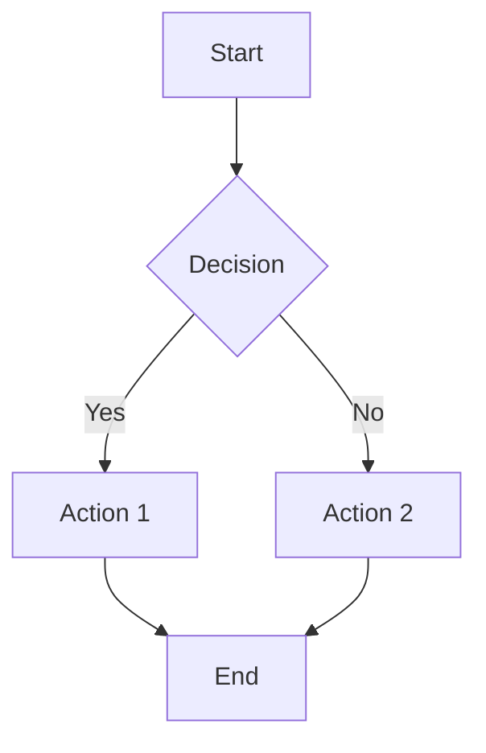

# Dual Documentation System - User Guides

## Table of Contents

1. [Content Author Guide](#content-author-guide)
2. [Documentation Suggestions Review Guide](#documentation-suggestions-review-guide)
3. [Analytics Dashboard Guide](#analytics-dashboard-guide)
4. [Migration Tool Usage Guide](#migration-tool-usage-guide)

---

## Content Author Guide

### Overview

This guide helps content authors create and maintain documentation for the PricePilot Dual Documentation System.

### Getting Started

#### Understanding the Documentation Structure

The system has two separate documentation portals:

**Tenant Documentation** (`/docs`)
- For regular users and tenants
- Public access (no authentication)
- Topics: Product setup, pricing, integrations, troubleshooting

**Admin Documentation** (`/admin-docs`)
- For system administrators
- Requires admin authentication
- Topics: System monitoring, database, security, performance

#### File Organization

Documentation files are stored in:
```
/docs-content/
├── tenant/
│   ├── getting-started/
│   ├── products/
│   ├── competitors/
│   ├── pricing/
│   ├── integrations/
│   └── troubleshooting/
└── admin/
    ├── system-monitoring/
    ├── tenant-management/
    ├── database/
    ├── security/
    ├── performance/
    └── alerting/
```

### Creating New Documentation

#### Step 1: Choose the Right Location

Ask yourself:
- **Who is the audience?** Users → tenant, Admins → admin
- **What's the topic?** Technical/system → admin, User-facing → tenant
- **Is it both?** Create separate versions for each portal

#### Step 2: Create the Markdown File

Create a new `.md` file in the appropriate directory:

```bash
# For tenant documentation
touch docs-content/tenant/getting-started/my-new-guide.md

# For admin documentation
touch docs-content/admin/system-monitoring/my-new-guide.md
```

#### Step 3: Add Frontmatter

Every documentation file must start with frontmatter:

```markdown
---
title: "My New Guide"
description: "A brief description of what this guide covers"
category: "getting-started"
subcategory: null
tags: ["beginner", "setup", "tutorial"]
author: "Your Name"
lastReviewed: "2024-02-05"
relatedDocs: ["quick-start", "product-setup"]
---

# My New Guide

Your content here...
```


#### Frontmatter Fields

| Field | Required | Description | Example |
|-------|----------|-------------|---------|
| `title` | Yes | Document title | "Quick Start Guide" |
| `description` | No | Brief description | "Get started in 5 minutes" |
| `category` | Yes | Main category | "getting-started" |
| `subcategory` | No | Subcategory | "installation" |
| `tags` | No | Search tags | ["beginner", "setup"] |
| `author` | No | Author name | "PricePilot Team" |
| `lastReviewed` | No | Last review date | "2024-02-05" |
| `relatedDocs` | No | Related doc slugs | ["quick-start"] |

#### Step 4: Write Content

Use standard Markdown syntax:

```markdown
# Main Heading

## Section Heading

### Subsection Heading

Regular paragraph text.

**Bold text** and *italic text*.

- Bullet point 1
- Bullet point 2

1. Numbered item 1
2. Numbered item 2

[Link text](https://example.com)


```

#### Step 5: Add Code Blocks

Use fenced code blocks with language specification:

````markdown
```typescript
function example() {
  console.log('Hello, world!');
}
```

```bash
npm install package-name
```

```json
{
  "key": "value"
}
```
````

The system will automatically apply syntax highlighting.

#### Step 6: Add Diagrams (Optional)

Use Mermaid syntax for diagrams:

````markdown

````

Supported diagram types:
- Flowcharts
- Sequence diagrams
- Class diagrams
- State diagrams
- Gantt charts

#### Step 7: Link to Other Documentation

Use relative links to other documentation pages:

```markdown
See the [Quick Start Guide](../getting-started/quick-start) for more information.

For advanced configuration, check the [Admin Guide](/admin-docs/configuration).
```

The system will validate these links automatically.

### Editing Existing Documentation

#### Step 1: Locate the File

Find the documentation file in `/docs-content/`:

```bash
# Search for a file
find docs-content -name "*keyword*"

# Or use your editor's file search
```

#### Step 2: Make Changes

Edit the Markdown file with your changes.

#### Step 3: Update Metadata

Update the `lastReviewed` date in frontmatter:

```yaml
---
lastReviewed: "2024-02-05"
---
```

#### Step 4: Save and Commit

```bash
git add docs-content/
git commit -m "docs: update product setup guide"
git push
```

The system will automatically:
- Update the search index
- Create a version history entry
- Invalidate cached content

### Best Practices

#### Writing Style

1. **Be Clear and Concise**
   - Use simple language
   - Avoid jargon when possible
   - Define technical terms

2. **Use Active Voice**
   - ✅ "Click the button to save"
   - ❌ "The button should be clicked to save"

3. **Be Specific**
   - ✅ "Enter your API token in the field"
   - ❌ "Enter the required information"

4. **Use Examples**
   - Show real-world examples
   - Include screenshots when helpful
   - Provide code samples

#### Structure

1. **Start with Overview**
   - What is this guide about?
   - Who is it for?
   - What will they learn?

2. **Use Headings**
   - Break content into sections
   - Use hierarchical headings (H2, H3, H4)
   - Keep headings descriptive

3. **Add Navigation**
   - Link to related guides
   - Provide "Next Steps" section
   - Include table of contents for long guides

4. **End with Summary**
   - Recap key points
   - Provide next steps
   - Link to related resources

#### Formatting

1. **Use Lists**
   - Break down steps
   - Highlight key points
   - Make content scannable

2. **Use Tables**
   - Compare options
   - List parameters
   - Show configurations

3. **Use Callouts**
   ```markdown
   > **Note:** This is important information.
   
   > **Warning:** Be careful with this action.
   
   > **Tip:** Here's a helpful tip.
   ```

4. **Use Code Blocks**
   - Always specify language
   - Keep examples short
   - Test code before publishing


### Common Tasks

#### Adding Images

1. Place images in `/public/images/docs/`
2. Reference in Markdown:
   ```markdown
   
   ```

#### Creating Tables

```markdown
| Column 1 | Column 2 | Column 3 |
|----------|----------|----------|
| Value 1  | Value 2  | Value 3  |
| Value 4  | Value 5  | Value 6  |
```

#### Adding Alerts/Callouts

```markdown
> **Note:** This is a note.

> **Warning:** This is a warning.

> **Tip:** This is a helpful tip.
```

#### Embedding Videos

```markdown
<video controls width="100%">
  <source src="/videos/tutorial.mp4" type="video/mp4">
  Your browser does not support video.
</video>
```

### Validation and Testing

#### Before Publishing

1. **Check Frontmatter**
   - All required fields present
   - Dates in correct format (YYYY-MM-DD)
   - Tags are relevant

2. **Validate Links**
   ```bash
   npm run validate:links
   ```

3. **Check Markdown Syntax**
   - No unclosed code blocks
   - Proper heading hierarchy
   - Valid Mermaid diagrams

4. **Preview Locally**
   ```bash
   npm run dev
   # Visit http://localhost:3000/docs/your-page
   ```

5. **Test Search**
   - Search for your content
   - Verify it appears in results
   - Check relevance ranking

### Troubleshooting

#### Document Not Appearing

1. Check file location is correct
2. Verify frontmatter is valid
3. Rebuild search index:
   ```bash
   npm run index:docs
   ```

#### Links Not Working

1. Use relative paths
2. Don't include `.md` extension
3. Check file exists at target path

#### Diagrams Not Rendering

1. Verify Mermaid syntax
2. Test at https://mermaid.live
3. Check for syntax errors

#### Code Highlighting Not Working

1. Specify language in code fence
2. Use supported language names
3. Check for unclosed code blocks

---

## Documentation Suggestions Review Guide

### Overview

The Documentation Hook system automatically generates suggestions when tasks are completed. This guide helps admins review and manage these suggestions.

### Accessing Suggestions

1. Log in as admin
2. Navigate to `/admin-docs/suggestions`
3. View pending suggestions

### Understanding Suggestions

Each suggestion includes:

- **Task Information**
  - Task ID and title
  - Task description
  - Completion date

- **Impact Analysis**
  - Impact type (feature, bugfix, api, ui, database)
  - Affected areas
  - Target audience (tenant, admin, both)

- **Suggested Changes**
  - Document to update (or "new document")
  - Suggested title (for new documents)
  - Suggested content
  - Category and tags

### Reviewing a Suggestion

#### Step 1: Read the Suggestion

Click on a suggestion to view details:
- What changed in the code?
- What documentation needs updating?
- Is it tenant-facing or admin-facing?

#### Step 2: Evaluate Quality

Ask yourself:
- Is the suggestion accurate?
- Is it relevant to users?
- Is the content clear and helpful?
- Is it in the right category?

#### Step 3: Make a Decision

You have three options:

**1. Approve**
- Content is good as-is
- Will be published immediately
- Creates version history entry

**2. Edit and Approve**
- Content needs minor changes
- Edit the suggestion
- Then approve

**3. Reject**
- Not relevant or accurate
- Provide rejection reason
- Suggestion is archived

### Approving Suggestions

#### For Existing Documents

1. Click "Approve" button
2. System will:
   - Update the document
   - Create version history entry
   - Update search index
   - Mark suggestion as approved

#### For New Documents

1. Review suggested title and category
2. Edit if needed
3. Click "Approve"
4. System will:
   - Create new document file
   - Add to search index
   - Mark suggestion as approved

### Editing Suggestions

1. Click "Edit" button
2. Modify:
   - Title
   - Content
   - Category
   - Tags
3. Click "Save and Approve"

### Rejecting Suggestions

1. Click "Reject" button
2. Provide reason:
   - Not relevant
   - Inaccurate information
   - Duplicate content
   - Better handled manually
3. Click "Confirm Rejection"

### Best Practices

#### Review Regularly

- Check suggestions daily
- Don't let them pile up
- Quick review is better than perfect

#### Be Thoughtful

- Consider the user perspective
- Ensure accuracy
- Maintain consistency

#### Provide Feedback

- When rejecting, explain why
- Help improve the system
- Report patterns of bad suggestions

#### Maintain Quality

- Don't approve low-quality content
- Edit for clarity and accuracy
- Ensure proper categorization

### Bulk Actions

#### Approve Multiple

1. Select suggestions with checkboxes
2. Click "Bulk Approve"
3. Confirm action

#### Reject Multiple

1. Select suggestions
2. Click "Bulk Reject"
3. Provide reason
4. Confirm action

### Filtering and Sorting

#### Filter by Status

- Pending
- Approved
- Rejected

#### Filter by Type

- Tenant documentation
- Admin documentation
- Both

#### Filter by Category

- Getting Started
- Products
- Pricing
- System Monitoring
- etc.

#### Sort by

- Date created (newest/oldest)
- Task completion date
- Impact type


---

## Analytics Dashboard Guide

### Overview

The Analytics Dashboard provides insights into how users interact with documentation. Available only to admins at `/admin-docs/analytics`.

### Accessing the Dashboard

1. Log in as admin
2. Navigate to `/admin-docs/analytics`
3. View analytics overview

### Dashboard Sections

#### 1. Overview Metrics

**Key Metrics:**
- Total page views (last 30 days)
- Unique visitors
- Total searches
- Average time on page
- Feedback submissions

**Time Range Selector:**
- Last 7 days
- Last 30 days
- Last 90 days
- Custom range

#### 2. Popular Pages

**Displays:**
- Most viewed pages
- View count
- Unique visitors
- Average time on page
- Bounce rate

**Use Cases:**
- Identify important content
- Find pages needing improvement
- Prioritize updates

**Actions:**
- Click page to view details
- Export data to CSV
- Filter by portal (tenant/admin)

#### 3. Search Analytics

**Displays:**
- Top search queries
- Search count
- Average results count
- Click-through rate
- Zero-result searches

**Use Cases:**
- Understand user needs
- Identify content gaps
- Improve search relevance

**Actions:**
- View query details
- See clicked results
- Identify missing content

#### 4. User Feedback

**Displays:**
- Average rating by page
- Rating distribution (1-5 stars)
- Recent comments
- Feedback trends

**Use Cases:**
- Identify problematic content
- Find highly-rated pages
- Read user comments

**Actions:**
- Filter by rating
- View all feedback for a page
- Export feedback data

#### 5. Bounce Rate Analysis

**Displays:**
- Pages with high bounce rates
- Bounce rate percentage
- View count
- Average time on page

**Use Cases:**
- Find confusing content
- Identify navigation issues
- Improve user experience

**Actions:**
- Sort by bounce rate
- View page details
- Compare with related pages

#### 6. Related Pages

**Displays:**
- Pages frequently viewed together
- Co-occurrence count
- Common navigation paths

**Use Cases:**
- Improve internal linking
- Create related content sections
- Understand user journeys

**Actions:**
- View page relationships
- Visualize navigation paths
- Export relationship data

### Using Analytics Data

#### Identify Content Gaps

1. Review zero-result searches
2. Look for common search terms without results
3. Create documentation for missing topics

**Example:**
- Users search "bulk price update"
- No results found
- Create guide for bulk updates

#### Improve Low-Performing Content

1. Find pages with high bounce rates
2. Review content quality
3. Make improvements:
   - Clarify confusing sections
   - Add examples
   - Improve navigation
   - Update outdated information

#### Prioritize Updates

1. Review popular pages
2. Ensure they're up-to-date
3. Expand high-traffic content
4. Keep popular pages fresh

#### Optimize Search

1. Review search queries
2. Identify common terms
3. Ensure content uses those terms
4. Improve search relevance

### Exporting Data

#### Export Options

**CSV Export:**
- Popular pages
- Search queries
- Feedback data
- Bounce rates

**JSON Export:**
- Complete analytics data
- For custom analysis
- API integration

**PDF Report:**
- Executive summary
- Key metrics
- Charts and graphs
- Recommendations

#### How to Export

1. Select data to export
2. Choose format (CSV, JSON, PDF)
3. Select date range
4. Click "Export"
5. Download file

### Privacy and Compliance

#### Data Collected

**Tracked:**
- Page views (with user ID if authenticated)
- Search queries
- Feedback ratings and comments
- Session IDs (anonymous users)

**Not Tracked:**
- Personal information
- IP addresses (hashed only)
- User agents
- Detailed browsing history

#### Data Retention

- Raw data: 90 days
- Aggregated data: Indefinitely
- User can request deletion
- GDPR compliant

### Best Practices

#### Regular Review

- Check dashboard weekly
- Monitor trends
- Act on insights
- Track improvements

#### Set Goals

- Target bounce rate < 40%
- Average rating > 4.0
- Zero-result searches < 10%
- Time on page > 2 minutes

#### Take Action

- Don't just collect data
- Make improvements based on insights
- Test changes
- Measure impact

#### Share Insights

- Report to team
- Discuss findings
- Collaborate on improvements
- Celebrate wins

---

## Migration Tool Usage Guide

### Overview

The Migration Tool helps move existing documentation from `/docs` to the new dual-portal structure in `/docs-content/`.

### When to Use

- Initial setup of dual documentation system
- Reorganizing existing documentation
- Splitting mixed-audience content
- Creating redirects for moved content

### Prerequisites

Before running the migration:

1. **Backup existing documentation**
   ```bash
   tar -czf docs-backup-$(date +%Y%m%d).tar.gz docs/
   ```

2. **Review existing structure**
   ```bash
   ls -R docs/
   ```

3. **Ensure database is ready**
   ```bash
   npx prisma migrate deploy
   ```

### Running the Migration

#### Step 1: Analyze Existing Documentation

```bash
npm run migrate:docs -- --analyze-only
```

This will:
- Scan all files in `/docs`
- Classify each as tenant/admin/both
- Generate classification report
- No files are moved yet

Review the report:
```bash
cat docs-migration-analysis.json
```

#### Step 2: Review Classifications

Check the analysis report for:
- Correct classifications
- Documents needing manual review
- Potential issues

Edit classifications if needed:
```bash
# Edit the classification file
nano docs-migration-classifications.json
```

#### Step 3: Run Full Migration

```bash
npm run migrate:docs
```

This will:
1. Move files to appropriate directories
2. Split mixed-audience documents
3. Add frontmatter metadata
4. Update internal links
5. Create redirects
6. Generate migration report

#### Step 4: Review Migration Report

```bash
cat docs-migration-report.json
```

Check for:
- Total documents processed
- Successful migrations
- Failed migrations
- Warnings
- Created redirects

### Understanding Classifications

#### Tenant Documentation

Classified as tenant if contains:
- User-facing features
- Product guides
- Integration tutorials
- Troubleshooting for users
- Getting started guides

**Examples:**
- `TENANT_GUIDE.md`
- `PRICE_APPROVAL_GUIDE.md`
- `OPENCART_SETUP.md`

#### Admin Documentation

Classified as admin if contains:
- System architecture
- Database operations
- Deployment procedures
- Monitoring setup
- Security configuration

**Examples:**
- `ARCHITECTURE.md`
- `DEPLOYMENT.md`
- `MONITORING_SYSTEM.md`

#### Both (Split Required)

Classified as both if contains:
- API documentation (user + admin endpoints)
- Configuration (user + system settings)
- Mixed audience content

**Examples:**
- `API_DOCUMENTATION_INDEX.md`
- `CONFIGURATION_GUIDE.md`

These will be split into separate tenant and admin versions.


### Migration Options

#### Dry Run Mode

Test migration without making changes:

```bash
npm run migrate:docs -- --dry-run
```

Shows what would happen without actually moving files.

#### Specific Directory

Migrate only specific directory:

```bash
npm run migrate:docs -- --source docs/guides
```

#### Force Overwrite

Overwrite existing files in destination:

```bash
npm run migrate:docs -- --force
```

**Warning:** This will overwrite existing content!

#### Skip Redirects

Don't create redirect records:

```bash
npm run migrate:docs -- --skip-redirects
```

#### Verbose Output

Show detailed progress:

```bash
npm run migrate:docs -- --verbose
```

### Post-Migration Tasks

#### 1. Verify File Locations

```bash
# Check tenant docs
ls -R docs-content/tenant/

# Check admin docs
ls -R docs-content/admin/
```

#### 2. Test Redirects

```bash
# Test old URL redirects to new location
curl -I http://localhost:3000/docs/OLD_PATH
# Should return 301 redirect
```

#### 3. Validate Links

```bash
npm run validate:links
```

Fix any broken links reported.

#### 4. Index Documentation

```bash
npm run index:docs
```

Add all migrated content to search index.

#### 5. Test Search

1. Visit `/docs` and `/admin-docs`
2. Search for content
3. Verify results are correct
4. Check search isolation

#### 6. Review Split Documents

For documents that were split:
1. Review both versions
2. Ensure content is appropriate
3. Remove irrelevant sections
4. Add cross-references if needed

### Troubleshooting Migration

#### Issue: Classification Errors

**Symptom:** Documents classified incorrectly

**Solution:**
1. Edit `docs-migration-classifications.json`
2. Change classification manually
3. Re-run migration

```json
{
  "docs/EXAMPLE.md": {
    "classification": "tenant",
    "confidence": 1.0
  }
}
```

#### Issue: Broken Links After Migration

**Symptom:** Internal links don't work

**Solution:**
1. Run link validator:
   ```bash
   npm run validate:links
   ```
2. Fix broken links manually
3. Update link format to new structure

#### Issue: Missing Frontmatter

**Symptom:** Documents missing metadata

**Solution:**
1. Add frontmatter manually:
   ```markdown
   ---
   title: "Document Title"
   category: "category-name"
   ---
   ```
2. Re-index documentation

#### Issue: Duplicate Content

**Symptom:** Same content in multiple locations

**Solution:**
1. Review duplicates
2. Keep best version
3. Delete others
4. Update redirects

#### Issue: Migration Fails Partway

**Symptom:** Migration stops with error

**Solution:**
1. Check error message
2. Fix the issue
3. Run migration again (it's idempotent)
4. Or use `--resume` flag:
   ```bash
   npm run migrate:docs -- --resume
   ```

### Manual Migration

For complex cases, migrate manually:

#### Step 1: Copy File

```bash
cp docs/EXAMPLE.md docs-content/tenant/category/example.md
```

#### Step 2: Add Frontmatter

Edit file and add frontmatter at the top.

#### Step 3: Update Links

Change internal links to new format.

#### Step 4: Create Redirect

Add to database:
```sql
INSERT INTO documentation_redirects (old_path, new_path)
VALUES ('/docs/EXAMPLE', '/docs/category/example');
```

#### Step 5: Index Document

```bash
npm run index:docs -- --file docs-content/tenant/category/example.md
```

### Best Practices

#### Before Migration

1. **Backup everything**
2. **Test in development first**
3. **Review classifications**
4. **Plan for downtime** (if needed)
5. **Communicate with team**

#### During Migration

1. **Monitor progress**
2. **Check for errors**
3. **Don't interrupt process**
4. **Keep logs**

#### After Migration

1. **Verify all content**
2. **Test thoroughly**
3. **Update bookmarks**
4. **Notify users**
5. **Monitor for issues**

### Rollback Procedure

If migration causes issues:

#### Step 1: Stop Application

```bash
docker-compose down
# or
vercel --prod --stop
```

#### Step 2: Restore Backup

```bash
# Restore files
tar -xzf docs-backup-20240205.tar.gz

# Restore database
psql $DATABASE_URL < backup-20240205.sql
```

#### Step 3: Clear Migrated Content

```bash
rm -rf docs-content/tenant/*
rm -rf docs-content/admin/*
```

#### Step 4: Restart Application

```bash
docker-compose up -d
# or
vercel --prod
```

#### Step 5: Investigate Issue

- Review migration logs
- Identify what went wrong
- Fix the issue
- Test in development
- Try migration again

### Migration Checklist

Use this checklist for migration:

- [ ] Backup existing documentation
- [ ] Backup database
- [ ] Run analysis mode
- [ ] Review classifications
- [ ] Test in development
- [ ] Run full migration
- [ ] Review migration report
- [ ] Verify file locations
- [ ] Test redirects
- [ ] Validate all links
- [ ] Index documentation
- [ ] Test search functionality
- [ ] Review split documents
- [ ] Test both portals
- [ ] Update internal documentation
- [ ] Notify team
- [ ] Monitor for issues

### Getting Help

If you encounter issues:

1. **Check logs**
   ```bash
   tail -f logs/migration.log
   ```

2. **Review documentation**
   - Migration Tool README
   - Troubleshooting guide

3. **Contact support**
   - Email: support@pricepilot.com
   - Include: error messages, logs, migration report

4. **Community**
   - GitHub Issues
   - Discussion forum

---

## Additional Resources

### Documentation

- [API Reference](DUAL_DOCUMENTATION_API_REFERENCE.md)
- [Architecture Guide](DUAL_DOCUMENTATION_ARCHITECTURE.md)
- [Deployment Guide](DUAL_DOCUMENTATION_DEPLOYMENT_GUIDE.md)
- [Configuration Guide](DUAL_DOCUMENTATION_CONFIGURATION_GUIDE.md)

### Tools

- [Markdown Guide](https://www.markdownguide.org/)
- [Mermaid Live Editor](https://mermaid.live/)
- [Markdown Linter](https://github.com/DavidAnson/markdownlint)

### Support

- Email: support@pricepilot.com
- Documentation: https://docs.pricepilot.com
- GitHub: <repository-url>

---

## Appendix

### Markdown Cheat Sheet

```markdown
# H1 Heading
## H2 Heading
### H3 Heading

**Bold text**
*Italic text*
~~Strikethrough~~

- Bullet list
- Item 2

1. Numbered list
2. Item 2

[Link text](url)


`inline code`

> Blockquote

---

Horizontal rule
```

### Frontmatter Template

```yaml
---
title: "Document Title"
description: "Brief description"
category: "category-name"
subcategory: null
tags: ["tag1", "tag2"]
author: "Author Name"
lastReviewed: "2024-02-05"
relatedDocs: ["slug1", "slug2"]
---
```

### Common Categories

**Tenant:**
- getting-started
- products
- competitors
- pricing
- integrations
- troubleshooting

**Admin:**
- system-monitoring
- tenant-management
- database
- security
- performance
- alerting

### Useful Commands

```bash
# Development
npm run dev

# Migration
npm run migrate:docs
npm run migrate:docs -- --analyze-only
npm run migrate:docs -- --dry-run

# Validation
npm run validate:docs
npm run validate:links

# Indexing
npm run index:docs
npm run index:docs -- --type tenant

# Monitoring
npm run logs:errors
npm run monitor:performance
```
